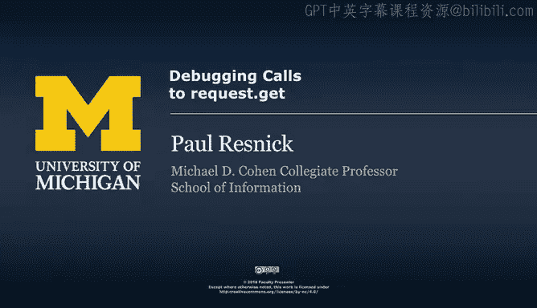
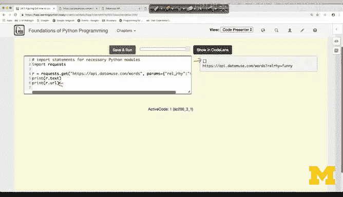

# 课程3：Python 3编程 - P44：调试 `requests.get` 调用 🐛




在本节课中，我们将学习如何调试使用 `requests.get` 函数时遇到的问题。当调用没有返回预期结果时，我们需要系统地找出问题所在。

---

## 概述

`requests.get` 是用于从网络获取数据的常用函数。当它未能返回预期数据时，通常有两种主要错误类型：一是无法生成有效的URL，二是生成的URL有效但返回的数据不对。本节将指导你如何识别和修复这些问题。

---

## 调试无法生成有效URL的情况

上一节我们介绍了 `requests.get` 的基本用法，本节中我们来看看当调用失败时，如何首先检查URL的生成问题。

在Runestone教科书环境中，`requests.get` 调用总会返回一个响应对象。你可以打印这个对象来诊断问题。如果打印出的 `text` 属性包含类似“valid request”的错误信息，并且 `url` 属性显示“couldn't generate a valid URL”，那么问题通常出在传递给 `params` 参数的字典上。

以下是导致此错误的两个主要原因：

1.  **传递的不是字典**：`params` 参数必须是一个字典。如果传递了列表、元组等其他类型，调用就会失败。
    ```python
    # 错误示例：传递了列表
    params = ['rel_rhy', 'funny']
    ```

2.  **字典的键或值不是字符串**：字典中的键和值都必须是字符串类型。如果使用了数字或其他类型，也会导致错误。
    ```python
    # 错误示例：值是一个数字
    params = {'rel_rhy': 123}
    ```

**调试步骤**：
首先，检查你传递给 `params` 参数的值。如果它存储在一个变量中，就打印这个变量。如果是直接写在代码里的字面量，就仔细检查其语法。确保它是一个用花括号 `{}` 定义、键值对用冒号 `:` 分隔的字典，并且所有键和值都是字符串。

**正确示例**：
```python
params = {'rel_rhy': 'funny'}
response = requests.get("https://api.datamuse.com/words", params=params)
```

---

## 调试URL有效但数据错误的情况

解决了URL生成问题后，我们来看看另一种情况：URL成功生成，但返回的数据不是我们想要的。

假设你调用API获取与“funny”押韵的单词，但返回的 `response.text` 是一个空列表 `[]`，而不是预期的单词列表。

以下是处理此问题的步骤：

1.  **检查生成的完整URL**：打印 `response.url` 属性，获取 `requests` 库实际请求的完整URL。
    ```python
    print(response.url)
    ```

2.  **在浏览器中测试该URL**：将打印出的URL复制到浏览器的地址栏中打开。这是最有效的调试方法，因为你可以即时看到API的原始响应。

3.  **对比与文档的差异**：在浏览器中看到结果后，将你的URL与API官方文档中示例的URL进行对比。常见的错误包括：
    *   参数名拼写错误（例如，`rel_rhy` 写成了 `relrhy`）。
    *   参数值格式不正确。
    *   基础URL错误。

4.  **在浏览器中迭代调整**：直接在浏览器的地址栏中修改URL的参数，直到获得正确的响应。例如，添加上缺少的下划线。

5.  **将修正同步回代码**：一旦在浏览器中找到了正确的URL，就将对应的修改（通常是修正 `params` 字典中的键名或值，或者基础URL）更新到你的Python代码中。

---



## 完整Python环境中的额外说明

在Runestone环境之外的标准Python环境中，还存在第三种错误模式：网络请求失败，例如服务器无响应。

在这种情况下，`requests.get` 会抛出一个异常（如 `ConnectionError`），而不会返回响应对象。因此，你无法通过 `response.url` 来查看尝试请求的URL，这使得调试稍显困难。

Runestone教科书提供了一个代码片段，可以帮助你在完整Python环境中捕获异常并打印出尝试请求的URL，以辅助调试。如果你不在浏览器中运行代码，可以查阅相关材料来使用这个工具。

---

## 总结

本节课中我们一起学习了如何调试 `requests.get` 调用。

*   在Runestone环境中，如果无法生成有效URL，请检查 `params` 参数是否是一个**全由字符串构成**的字典。
*   如果URL有效但数据错误，请将 `response.url` 打印出来，并**粘贴到浏览器中进行测试和调整**，然后将修正应用到你的代码中。
*   记住，系统性地检查参数和利用浏览器进行实时测试是解决网络请求问题的关键。

通过掌握这些调试技巧，你将能更高效地处理API调用中的各种问题。我们下次再见。