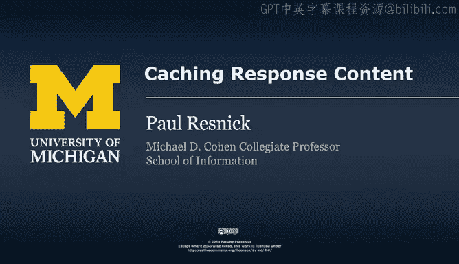
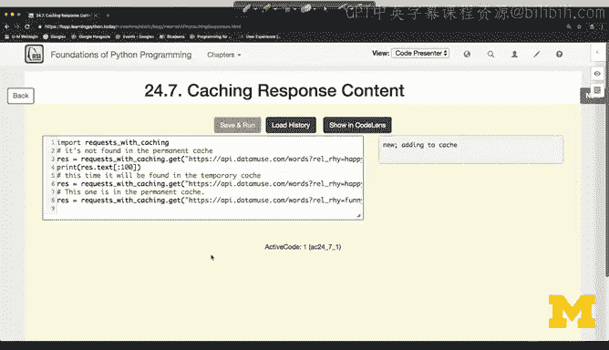

# 课程45：Python 3编程 - 响应内容缓存 🗂️




在本节课中，我们将学习一个名为“缓存”的编程模式。我们将了解为何需要缓存，以及如何在Python中通过一个特定的模块来实现网络请求的缓存，从而提高代码效率并减少对不稳定外部资源的依赖。

## 什么是缓存？💡

上一节我们介绍了缓存的概念，本节中我们来看看它的具体工作原理。

缓存是一种存储机制，用于保存先前计算或获取的结果。当程序需要再次执行一个耗时或不稳定的操作时，它可以首先检查缓存中是否已有该结果。如果有，则直接使用缓存的结果，从而避免重复执行昂贵的操作。

在编程中，这通常通过一个键值对结构来实现：
```python
cache = {
    'input_key_1': 'output_result_1',
    'input_key_2': 'output_result_2'
}
```

## 为何缓存网络请求？🌐

网络请求是一个典型的“昂贵”操作。使用 `requests.get()` 函数时，程序需要时间通过互联网连接到另一台服务器。这个过程不仅耗时，还可能因为网络连接不稳定、服务器限制或跨站脚本限制而失败。

此外，许多API服务设有“速率限制”，例如“每15分钟只能调用15次”。在调试代码时，我们可能会反复运行程序，很容易触发此限制。缓存请求结果可以避免不必要的重复调用。

## 使用 `requests_with_caching` 模块 🛠️

为了解决上述问题，课程提供了一个名为 `requests_with_caching` 的模块。它的使用方式与标准的 `requests` 库非常相似。

以下是使用该模块的基本步骤：

1.  **导入模块**：首先需要导入这个特殊的模块。
2.  **发起请求**：使用 `requests_with_caching.get()` 方法替代 `requests.get()`。
3.  **自动缓存**：该方法会先检查缓存。如果找到匹配结果，则直接返回；如果未找到，则执行真实的网络请求，并将结果存入缓存供下次使用。

该模块实现了两种缓存：
*   **永久缓存**：存储在名为 `datamcache.txt` 的文件中，在多次运行间持久保存。
*   **页面特定缓存**：这是一个临时缓存，仅在当前页面会话期间有效，刷新页面后即消失。

`requests_with_caching.get()` 方法会同时检查这两个缓存。

## 代码示例与运行过程 📝

让我们通过一个具体的例子来观察缓存的行为。

```python
import requests_with_caching

# 第一次请求，查询与“happy”押韵的单词
resp = requests_with_caching.get("https://api.datamuse.com/words?rel_rhy=happy")
print(resp.text[:100])  # 打印前100个字符

# 第二次请求，完全相同的查询
resp = requests_with_caching.get("https://api.datamuse.com/words?rel_rhy=happy")
print(resp.text[:100])

# 第三次请求，查询与“funny”押韵的单词
resp = requests_with_caching.get("https://api.datamuse.com/words?rel_rhy=funny")
print(resp.text[:100])
```

以下是代码运行时可能发生的情况：

*   **第一次调用**：缓存中没有“happy”的结果。模块会执行真实的网络请求，获取数据（例如包含“snappy”、“nappy”等单词），并将结果添加到**页面特定缓存**中。
*   **第二次调用**：查询相同的“happy”。模块在**页面特定缓存**中找到了结果，因此直接返回缓存数据，无需再次访问网络。
*   **第三次调用**：查询“funny”。假设**永久缓存文件**中已存有该结果，模块会从那里找到并返回数据。

如果你重新运行整个代码块，第二次对“happy”的调用依然会从缓存中获取数据。但如果你刷新了浏览器页面，**页面特定缓存**会被清空。此时再次运行代码，第一次对“happy”的调用将不得不重新访问网络并添加结果到缓存。

## 总结 🎯



本节课中我们一起学习了缓存模式及其在Python网络编程中的应用。我们了解到，通过使用 `requests_with_caching` 模块，可以有效地：
*   避免重复执行耗时的网络请求。
*   减少因网络不稳定或API速率限制导致的失败。
*   在开发和调试过程中显著提升效率。

你只需要简单地导入并使用 `requests_with_caching.get()`，即可为你的程序自动获得这些好处。当你需要多次进行相同请求时，缓存将确保后续调用能快速地从本地获取数据。