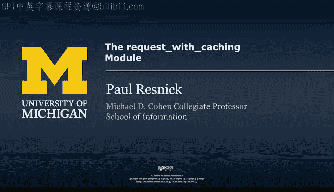
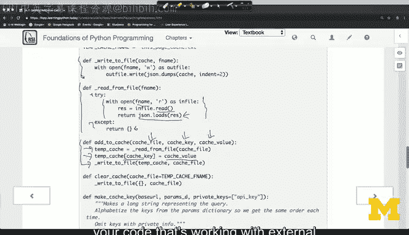

# 课程 46：📦 带缓存的requests模块




在本节课中，我们将学习如何实现一个带缓存的 `requests.get` 函数。这个功能可以避免重复向远程服务器发送相同的请求，从而提高效率，并帮助我们在调试代码时规避API的速率限制。

---

## 概述

上一节我们讨论了缓存的概念。本节中，我们来看看如何用Python代码实现一个简单的缓存机制，并将其包装在 `requests.get` 函数周围。

## 核心函数结构

我们定义了一个名为 `get` 的函数。它接收与 `requests.get` 相同的参数：一个基础URL `R` 和一个可选的参数字典 `params`。此外，它还包含一些额外的可选参数，例如 `private_keys_to_ignore`，我们稍后会讨论这些。

缓存的核心思想是使用一个数据存储来保存之前 `requests.get` 调用的结果。在Python中，我们使用字典来实现这个缓存。字典的每个键代表一次 `requests.get` 的调用，它编码了基础URL和参数信息。对应的值则是从服务器返回的文本结果。

以下是 `get` 函数的基本逻辑结构：

```python
def get(base_url, params=None, **kwargs):
    # 计算缓存键
    cache_key = make_cache_key(base_url, params, kwargs.get('private_keys_to_ignore', []))
    
    # 检查缓存
    if cache_key in temp_cache:
        return temp_cache[cache_key]
    elif cache_key in perm_cache:
        return perm_cache[cache_key]
    else:
        # 未命中缓存，发起真实请求
        response = requests.get(base_url, params=params)
        # 将结果添加到缓存
        add_to_cache(cache_key, response.text, response.url)
        return response
```

## 辅助函数详解

理解了基本结构后，我们来看看实现缓存所需的几个关键辅助函数。

### 1. 生成缓存键 (`make_cache_key`)

这个函数负责将基础URL和参数字典转换成一个唯一的字符串，作为字典的键。

我们需要处理两个问题：
1.  排除某些敏感参数（如用于身份验证的私钥）。
2.  确保参数字典的键总是以相同的顺序出现，因为字典的键序是不固定的。

以下是实现方法：

```python
def make_cache_key(base_url, params, private_keys_to_ignore):
    if params is None:
        params = {}
    
    # 过滤掉需要忽略的私钥
    filtered_params = {k: v for k, v in params.items() if k not in private_keys_to_ignore}
    
    # 对键进行排序，确保顺序一致
    sorted_keys = sorted(filtered_params.keys())
    
    # 构建键字符串：基础URL + 排序后的键值对
    key_parts = [base_url]
    for k in sorted_keys:
        key_parts.append(f"{k}_{filtered_params[k]}")
    
    # 用下划线连接所有部分
    cache_key = "_".join(key_parts)
    return cache_key
```

### 2. 从文件读取缓存 (`read_from_file`)

为了让缓存在程序多次运行之间持久化，我们需要将缓存字典保存到文件中。这个函数负责从指定文件读取JSON格式的数据，并将其加载为Python字典。

我们使用 `try...except` 块来优雅地处理文件不存在或格式错误的情况。

```python
import json

def read_from_file(filename):
    try:
        with open(filename, 'r', encoding='utf-8') as f:
            cache_dict = json.load(f)
        return cache_dict
    except (FileNotFoundError, json.JSONDecodeError):
        # 如果文件不存在或不是有效JSON，返回空字典
        return {}
```

### 3. 写入缓存到文件 (`write_to_file` 与 `add_to_cache`)

与读取对应，我们需要将更新后的缓存字典写回文件。

首先是一个简单的写入函数：

```python
def write_to_file(filename, cache_dict):
    with open(filename, 'w', encoding='utf-8') as f:
        json.dump(cache_dict, f)
```

然后是添加数据到缓存的函数。它先读取现有缓存，添加新的键值对，然后再写回文件。

```python
def add_to_cache(filename, cache_key, result_text, result_url):
    # 读取现有缓存
    cache_dict = read_from_file(filename)
    # 添加新条目。这里我们存储一个包含文本和URL的字典，以模拟requests的Response对象。
    cache_dict[cache_key] = {'text': result_text, 'url': result_url}
    # 写回文件
    write_to_file(filename, cache_dict)
```

## 总结

本节课中我们一起学习了一个简单的缓存模式实现。我们创建了一个 `requests` 模块的包装器，它首先检查请求结果是否已存在于本地缓存（临时缓存或持久化缓存）中。如果存在，则直接返回缓存的结果；如果不存在，才真正调用 `requests.get` 向远程服务器发起请求，并将结果保存到缓存中供后续使用。

这个模式非常实用，它不仅能提升代码运行效率，更重要的是，在调试与外部REST API交互的代码时，它能有效避免因频繁请求而触发的API速率限制问题。



我们下次再见。