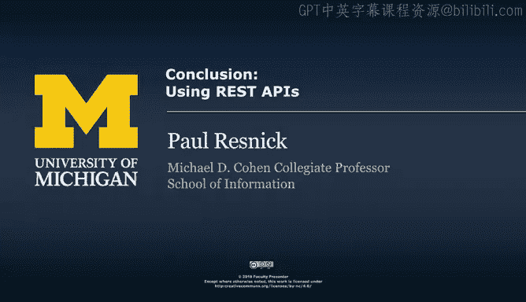

# 课程3、4、5：Python 3编程 - P47：REST API应用总结 🧩

## 概述

在本节课中，我们将学习如何阅读API文档以构建和调试请求，理解并使用缓存模块，并通过一个具体的“笑话”API实例来巩固这些概念。

---

欢迎回来。现在，你应该能够阅读API文档，以便构建和调试 `requests.get` 函数的调用。

同时，你应该能够理解并欣赏 `requests_with_caching` 模块的作用。

你可能会好奇我从哪里收集了所有这些老套的笑话。其中一些是我多年来积累并可能重复讲述过多次的经典笑话。

当然，有一个REST API可以在 `icanhazdadjoke.com` 网站上搜索这些笑话。请注意，这里的“haz”拼写中带有字母“Z”。

该API的基础端点会返回一个随机的“爸爸笑话”。以下是我首次调用此API时得到的结果：

> 你如何称呼一群在国际象棋比赛中获胜并在酒店大堂吹嘘的棋手？
> 答案是：在开放式门厅里吹嘘的“栗子”（谐音“棋手”）。这真是个老掉牙的笑话。

以下是另一个我得到的、更有深度的笑话：

> 什么发明比第一部电话更重要？
> 答案是：第二部电话。

此API还允许进行搜索。当我请求 `/search?term=hipster` 时，我得到了三个笑话：

以下是搜索结果：
1.  一个“潮人”有多重？答案是：一个Instagram（谐音“一克”）。
2.  需要多少个“潮人”来换一个灯泡？答案是：哦，这是一个非常冷门的数字，你可能从未听说过。
3.  那个“潮人”是如何烫伤上颚的？答案是：他在比萨“变凉”之前就吃了它（双关“酷”）。

好了，好了，我能隔着屏幕听到你们的呻吟声。双关语到此为止。我听到了。我会让它“休息”一下（双关“REST”）。下次见。

---

## 总结

本节课我们一起学习了如何根据API文档发起请求，了解了缓存模块的用途，并通过一个实际的“笑话”API示例，实践了搜索和调用不同端点的过程。