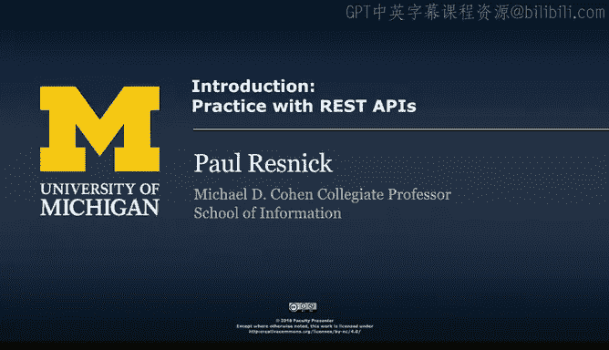

# 课程3、4、5：Python 3编程 🐍
## P48：REST API实践简介 🔑

在本节课中，我们将通过更多练习来熟悉如何阅读API文档，并使用`requests.get()`或带缓存的`requests.get()`方法构建API调用。同时，我们还将学习API密钥，这是当你的程序尝试与REST API交互时，有时需要的最简单的身份验证形式。

本节课没有新的学习目标，主要目的是提升你的熟练度，为最终项目做好准备。在最终项目中，你需要解读两个不同REST API的文档，并创建一个整合两者结果的“混搭”应用。


---

### 阅读API文档与构建调用



上一节我们介绍了REST API的基本概念，本节中我们来看看如何实际操作。首先，你需要学会阅读API提供方的文档。文档通常会详细说明可用的端点（Endpoints）、所需的参数、请求方法（如GET、POST）以及返回数据的格式。

以下是调用一个API的基本步骤：

1.  **确定目标端点**：找到你想获取数据或执行操作的特定URL。
2.  **检查请求参数**：查看是否需要提供查询参数、请求头或请求体数据。
3.  **选择请求方法**：根据操作类型（获取、创建、更新、删除）使用对应的HTTP方法。
4.  **处理身份验证**：如果API需要，准备好你的API密钥或其他凭证。
5.  **发送请求并解析响应**：使用`requests`库发送请求，然后处理返回的JSON或其他格式的数据。

一个简单的`GET`请求代码如下所示：

```python
import requests

response = requests.get('https://api.example.com/data')
data = response.json()
print(data)
```

### 关于API密钥

许多公开的API为了管理使用量和防止滥用，会要求使用者注册并获取一个唯一的API密钥。这个密钥通常需要作为参数附加在请求URL中，或者放在请求头（Headers）里发送。

例如，将API密钥作为查询参数传递：

```python
api_key = "your_api_key_here"
url = f"https://api.example.com/data?api_key={api_key}"
response = requests.get(url)
```

或者，将API密钥放在请求头中：

```python
headers = {
    'Authorization': f'Bearer {api_key}'
}
response = requests.get('https://api.example.com/data', headers=headers)
```

**请注意**：务必妥善保管你的API密钥，不要将其直接硬编码在公开的代码或版本控制系统中，可以考虑使用环境变量来管理。

---

### 为最终项目做准备

本节课的练习旨在增加你的实践流畅度。在最终项目中，你将需要独立完成以下任务：

*   查阅两个不同API的官方文档。
*   理解它们的调用方式、数据格式和限制。
*   设计一个程序，从这两个API获取数据。
*   将获取的数据进行整合、分析或展示，创造出一个新的应用（即“混搭”）。

通过现在的练习，你可以更从容地面对这些挑战。

---

本节课中我们一起学习了如何通过阅读文档来构建REST API调用，并了解了API密钥这一基本的身份验证机制。这些技能是连接网络服务、获取外部数据的基础，请务必通过实践加以巩固。我们下次再见！