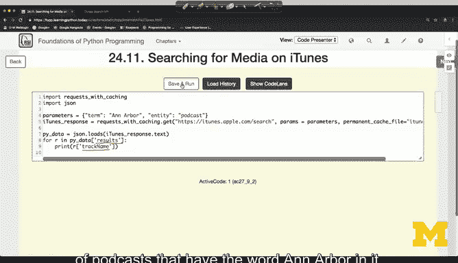

# 课程49：iTunes API应用 🎵


在本节课中，我们将学习如何使用iTunes的REST API进行数据查询。iTunes是苹果公司的媒体商店，其API允许我们查询商店中的内容。我们将通过一个具体的例子，学习如何构建请求、解析响应，并提取所需的信息。

## 理解iTunes API文档

上一节我们介绍了REST API的基本概念，本节中我们来看看iTunes API的具体使用方法。

iTunes API有一个基础URL：`https://itunes.apple.com/search`。与之前见过的API类似，查询参数通过问号`?`和键值对的形式附加在URL之后。

以下是iTunes API文档中部分关键查询参数及其说明：

*   **term**： 这是搜索的关键词，可以填入任何文本字符串。此参数为**必需**。
*   **country**： 指定搜索的国家或地区。此参数为**必需**。
*   **media**： 指定媒体类型，其值必须是限定的选项，如 `movie`、`podcast`、`music`。此参数为**可选**。
*   **entity**： 指定更具体的实体类型，例如在`media=podcast`的前提下，可以进一步指定`entity=podcast`来精确搜索。此参数为**可选**。

## 构建查询请求

理解了参数后，我们来看看如何构建一个查询请求。假设我们想搜索与“Ann Arbor”相关的播客。

在代码中，我们需要向 `requests.get()` 函数传递一个参数字典。对于搜索词“Ann Arbor”，我们需要将其作为字符串赋值给键 `term`。

```python
params = {"term": "Ann Arbor"}
```

接下来，我们需要指定搜索的媒体类型为播客。根据文档，我们可以使用 `media` 或 `entity` 参数。

```python
params = {"term": "Ann Arbor", "entity": "podcast"}
```

## 执行请求并解析响应

现在，我们可以使用这个参数字典来发起请求。在课程环境中，我们使用带缓存的 `requests_with_caching` 模块以确保代码的稳定运行。

```python
import requests_with_caching
params = {"term": "Ann Arbor", "entity": "podcast"}
response = requests_with_caching.get("https://itunes.apple.com/search", params=params)
```

请求完成后，响应内容通常以JSON格式返回。我们需要将其加载为Python对象。

```python
import json
p_data = json.loads(response.text)
```

## 提取所需数据

现在进入“理解、提取、重复”的过程。通过分析 `p_data` 的结构，我们发现顶层是一个字典，其中键 `results` 对应的值是一个列表。

这个列表中的每一个元素都是一个字典，代表一个播客结果。每个播客字典中都有一个键 `trackName`，其值就是播客的名称。

以下是提取所有播客名称的代码：



```python
for podcast in p_data['results']:
    print(podcast['trackName'])
```

运行这段代码，我们将得到一系列包含“Ann Arbor”关键词的播客名称列表。

## 总结

本节课中我们一起学习了如何使用iTunes API。我们首先查阅了官方文档以理解其查询参数，然后构建了搜索“Ann Arbor”相关播客的请求。接着，我们执行请求并将JSON响应解析为Python对象。最后，我们通过分析数据结构，成功地提取并打印出了所有匹配的播客名称。这个过程完整展示了调用一个REST API、处理响应并提取信息的标准工作流。