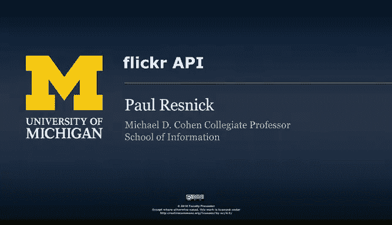
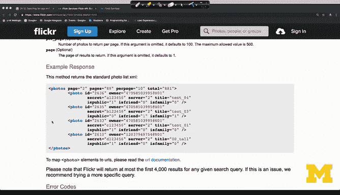
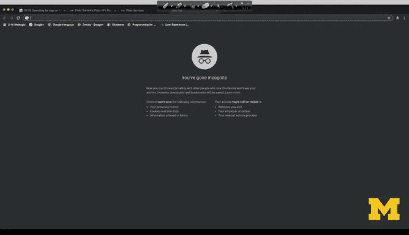
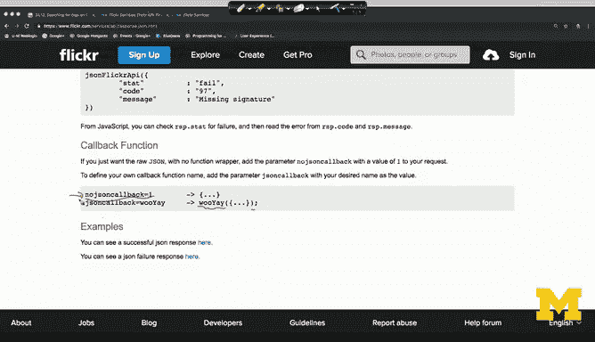
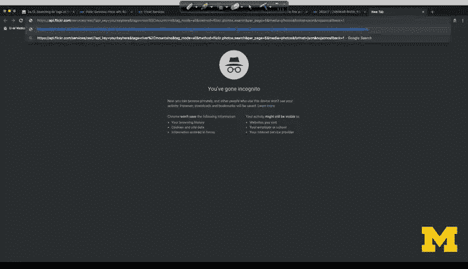
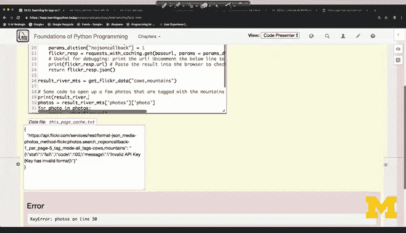

# 课程3：Python 3编程 - P50：Flickr API应用 🖼️




在本节课中，我们将学习如何使用Python查询Flickr的REST API，以搜索和获取照片数据。我们将了解如何构建API请求、处理返回的JSON数据，并理解API密钥等概念。

---

## Flickr API概述

Flickr是一个流行的照片分享网站，由Yahoo运营。它提供了一个REST API，允许开发者通过编程方式访问其功能。本节课我们将专注于其照片搜索功能。

## API基础与文档解读

上一节我们介绍了API的基本概念，本节中我们来看看如何阅读Flickr的API文档以构建正确的请求。

在Flickr API的概述文档页面上，有几个关键信息点：
*   **端点（Endpoint）**：即基础URL，所有请求都以此开始，后接`?`和键值对参数。
*   **必需参数**：`api_key`和`method`是必须提供的查询参数。
*   **API密钥**：你需要向Flickr注册以获得一个开发者专属的API密钥。

## 搜索功能与参数

为了搜索照片，我们需要指定`method`参数为`flickr.photos.search`。此外，我们可以使用许多其他参数（或称“参数”）来细化搜索。

以下是搜索时可以使用的部分参数示例：
*   `tags`：用于搜索具有特定标签的照片。
*   `tag_mode`：当提供多个标签时，决定是搜索包含任一标签（`any`）还是所有标签（`all`）的照片。
*   `lat` 和 `lon`：根据经纬度搜索特定地理位置的照片。
*   `per_page`：控制返回结果的数量。





## 获取JSON格式数据

默认情况下，Flickr API返回XML格式的数据。虽然Python可以解析XML，但本课程中我们更倾向于使用JSON格式。

为了从Flickr获取JSON格式的响应，我们需要在请求中添加两个特定的查询参数：
*   `format=json`
*   `nojsoncallback=1`



参数`nojsoncallback=1`是为了避免返回被包裹在JSONP回调函数中的JSON数据，从而获得纯净的JSON。

## 编写代码进行API请求

了解了必要的参数后，我们现在来看看如何用Python代码来构建并发送API请求。

我们将使用带缓存的`requests`库，这样即使没有有效的Flickr API密钥，也能通过课程提供的缓存数据运行示例。

首先，我们定义一个函数来获取Flickr数据。以下是核心代码结构：

```python
import requests_with_caching

def get_flickr_data(tag_string):
    baseurl = "https://api.flickr.com/services/rest/"
    params_diction = {}
    params_diction['api_key'] = flickr_key # 你的API密钥变量
    params_diction['tags'] = tag_string
    params_diction['tag_mode'] = 'all'
    params_diction['method'] = 'flickr.photos.search'
    params_diction['per_page'] = 5
    params_diction['media'] = 'photos'
    params_diction['format'] = 'json'
    params_diction['nojsoncallback'] = 1
    flickr_resp = requests_with_caching.get(baseurl, params = params_diction, permanent_cache_file="flickr_cache.txt")
    return flickr_resp.json()
```

在这段代码中：
1.  我们设置了基础URL和参数字典。
2.  参数字典包含了所有必需的查询参数。
3.  我们使用`requests_with_caching.get()`发送GET请求，并指定缓存文件。
4.  最后，使用`.json()`方法将响应文本解析为Python字典或列表。

## 解析响应数据与构建照片URL

发送请求后，我们会得到一个JSON响应，需要从中提取所需信息。我们已经通过“理解-提取-重复”的过程分析了数据结构。

从Flickr返回的搜索结果数据结构如下：
*   顶层字典有一个键`'photos'`。
*   `'photos'`对应的值是一个字典，其中包含键`'photo'`。
*   `'photo'`对应的值是一个列表，列表中的每个元素都是一个代表单张照片的字典。
*   每个照片字典包含诸如`'id'`和`'owner'`等键。

利用`'id'`和`'owner'`，我们可以按照Flickr的URL格式规则，构建出指向具体照片页面的链接。格式通常类似于：
`"https://www.flickr.com/photos/{owner}/{photo_id}"`



## 处理错误与API密钥限制

如果尝试使用无效的API密钥或搜索未被缓存的新内容，代码可能会出错。例如，当API返回错误信息（如“无效API密钥”）时，响应字典中可能没有预期的`'photos'`键，导致`KeyError`。

要使代码能进行新的查询，你需要：
1.  前往Flickr注册并获取一个有效的API密钥。
2.  将代码中的`flickr_key`变量替换为你自己的密钥。



对于更高级的操作（如上传照片），还需要用户授权，这通常涉及OAuth协议，已超出本课程范围。

## 核心要点总结

本节课中我们一起学习了如何使用Python调用Flickr API。以下是关键知识点总结：

1.  **复杂参数**：API请求有时需要传递大量查询参数来定制请求。
2.  **格式指定**：并非所有API默认返回JSON，有时需要显式指定（如`format=json`）。
3.  **特殊参数**：某些API有特殊要求（如Flickr的`nojsoncallback=1`）。
4.  **API密钥**：许多服务要求注册并获取API密钥以验证请求者身份。


通过掌握这些步骤，你已能够基础地使用Python与像Flickr这样的外部REST API进行交互，获取并处理网络数据。