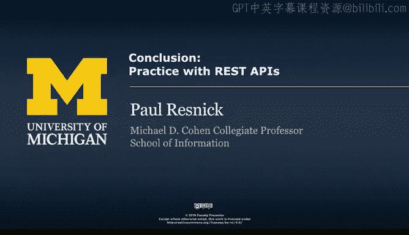

# 课程5：Python 3编程 - P51：REST API实践总结 🎯


在本节课中，我们将对之前学习的REST API调用和文档查阅进行总结，帮助你巩固知识并为独立实践做好准备。



## 概述

上一节我们介绍了如何使用缓存机制优化API请求。本节中，我们将回顾关键概念，并通过一个经典笑话来强调练习的重要性。

希望到目前为止，你已经看过足够多的API文档示例，以及如何使用 `requests.get()` 或带缓存的 `requests_with_caching.get()` 来构建API调用。你现在应该准备好自己尝试了。

要建立熟练度，没有什么比**实践和重复**更有效。

这让我想起一个我最喜欢的经典笑话。一个来自密歇根州小镇的年轻游客在曼哈顿中城闲逛。他看了看手表，意识到半小时后他在卡内基音乐厅有一场交响乐音乐会门票，但他不太确定卡内基音乐厅在哪里。

于是他看到一个拿着小提琴的年长女士，心想她一定知道。他问她：“打扰一下，您能告诉我怎么去卡内基音乐厅吗？”她慢慢地看了看他，说：“年轻人，练习，练习，再练习。”

## 核心要点回顾

以下是本课程关于REST API实践的核心要点总结：

1.  **理解API文档**：成功调用API的第一步是仔细阅读官方文档，找到正确的**端点（Endpoint）**、**请求方法（如GET、POST）** 和所需的**参数**。
2.  **构建API请求**：在Python中，我们主要使用 `requests` 库。一个基本的GET请求代码如下：
    ```python
    import requests
    response = requests.get("https://api.example.com/data", params={"key": "value"})
    ```
3.  **处理响应**：API通常返回JSON格式的数据。我们需要使用 `.json()` 方法将其解析为Python字典或列表。
    ```python
    data = response.json()
    ```
4.  **实现请求缓存**：为了减少对API服务器的重复调用并提高效率，我们使用了自定义的缓存函数。其核心逻辑是：**检查请求是否在缓存中 -> 如果在，则返回缓存数据 -> 如果不在，则发送新请求并保存结果到缓存**。
5.  **错误处理**：始终检查响应状态码（如 `response.status_code == 200` 表示成功），并准备好处理可能出现的异常。

## 总结

本节课中我们一起学习了REST API实践的总结。我们回顾了查阅文档、构建请求、处理响应和实现缓存的关键步骤。记住，掌握这些技能的关键在于持续的“练习，练习，再练习”。我下次课再见。