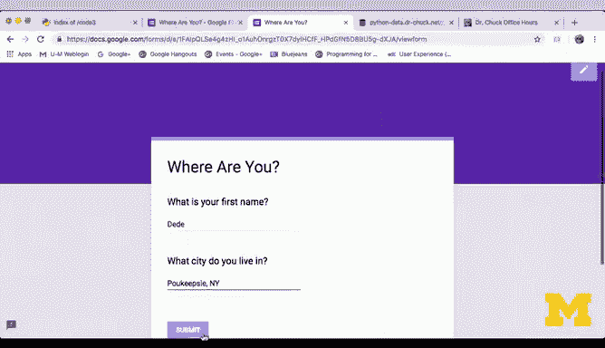
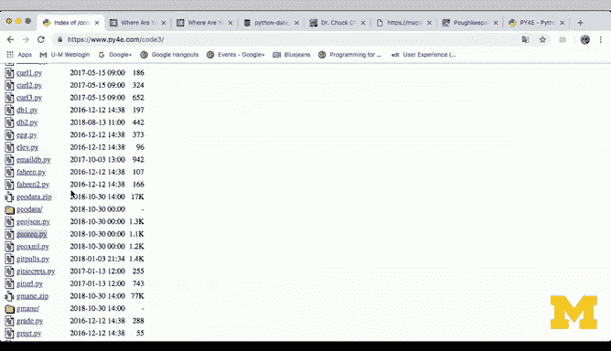

# 课程3：Python 3编程 - P52：使用Google Places API进行地理编码 🗺️


在本节课中，我们将学习如何利用Google Places API（或一个替代服务），通过Python程序将用户输入的地点名称（如城市名）转换为精确的经纬度坐标。这对于创建地图可视化应用至关重要。



## 概述

地图是强大的可视化工具，但要让数据在地图上显示，我们需要将人类可读的地点名称（如“北京”）转换为机器可读的经纬度坐标。手动获取经纬度非常不便，因此我们将编写一个Python程序，自动调用API来完成这项工作。

## API与数据准备

我们首先需要理解API（应用程序编程接口）的概念。简单来说，API就像一个在线服务，我们向它发送一个包含地点名称的请求，它会返回一个包含该地点经纬度等信息的结构化响应。

通常，使用Google Places API需要一个API密钥。为了教学方便，本教程使用一个由Dr. Chuck提供的、无需个人密钥的替代服务端点。其基本请求URL格式如下：
```
http://python-data.dr-chuck.net/geojson?address=地点名称&key=42
```
请注意，参数中的空格需要用加号 `+` 编码。

## 处理用户数据

在实际应用中，用户输入的数据往往不完美。以下是一个简单的调查数据示例，展示了用户可能犯的错误：

*   Deie 居住在 Poughkeepsie, New York （拼写错误）
*   Jane 居住在 Holt, Michigan （正确）
*   John 居住在 South Bend, Indiana （正确）

我们的程序需要能够处理这些不规范的输入，并通过API智能地找到正确的地点。

## 核心代码解析

接下来，我们深入讲解实现地理编码功能的核心Python代码。我们将使用 `requests` 库发送网络请求，并使用 `json` 库解析返回的数据。

以下是代码的主要结构：

```python
import requests
import json

# 服务地址（使用教学用的替代API）
serviceurl = ‘http://python-data.dr-chuck.net/geojson‘
# 如果需要使用真实的Google API，请在此处填入你的API密钥
# api_key = ‘YOUR_GOOGLE_API_KEY_HERE‘

while True:
    address = input(‘请输入地点（直接回车退出）: ‘)
    if len(address) < 1:
        break

    # 准备请求参数
    payload = {‘address‘: address, ‘key‘: 42}  # 使用教学密钥
    # 如果使用Google API，则替换为：payload = {‘address‘: address, ‘key‘: api_key}

    # 发送GET请求
    r = requests.get(serviceurl, params=payload)
    print(‘正在检索‘, r.url)

    # 读取返回的JSON数据
    data = r.text
    print(‘已接收‘, len(data), ‘个字符‘)

    try:
        js = json.loads(data)
    except:
        js = None

    # 检查API返回状态
    if not js or ‘status‘ not in js or js[‘status‘] != ‘OK‘:
        print(‘==== 获取数据失败 ====‘)
        print(data)
        continue

    # 美化打印JSON，用于调试
    print(json.dumps(js, indent=4))

    # 从复杂的JSON结构中提取纬度和经度
    lat = js[‘results‘][0][‘geometry‘][‘location‘][‘lat‘]
    lng = js[‘results‘][0][‘geometry‘][‘location‘][‘lng‘]
    location = js[‘results‘][0][‘formatted_address‘]

    print(‘纬度:‘, lat, ‘经度:‘, lng)
    print(‘规范地址:‘, location)
```

### 代码关键点说明

1.  **发送请求**：我们使用 `requests.get()` 方法，将服务URL和参数字典 `payload` 传递给它，它会自动构建完整的请求URL。
2.  **解析JSON**：API返回的数据是JSON格式。我们使用 `json.loads()` 将其转换为Python的字典和列表嵌套结构。
3.  **提取数据**：从转换后的Python对象 `js` 中提取所需信息需要遵循JSON的结构。表达式 `js[‘results‘][0][‘geometry‘][‘location‘][‘lat‘]` 的含义是：
    *   `js`：最外层的字典。
    *   `[‘results‘]`：获取键为 `‘results‘` 的值，它是一个列表。
    *   `[0]`：获取列表中的第一个元素（字典）。
    *   `[‘geometry‘]`：从该字典中获取键为 `‘geometry‘` 的值（另一个字典）。
    *   `[‘location‘]`：继续获取键为 `‘location‘` 的值（字典）。
    *   `[‘lat‘]`：最终获取键为 `‘lat‘` 的值，即纬度数字。
4.  **错误处理**：代码检查了返回的JSON中是否包含 `‘status‘: ‘OK‘`，这是API调用成功的标志。`try-except` 块用于防止JSON解析失败导致程序崩溃。

## 运行示例

让我们运行程序并输入几个地点进行测试。

*   **输入**：`Ann Arbor, Michigan`
    *   **输出**：程序将打印出请求的URL、接收的数据长度、格式化的JSON，并最终输出类似 `纬度: 42.2808256, 经度: -83.7430378` 的坐标以及规范地址。
*   **输入**：`Pougkepsie, New York` （故意拼错）
    *   **输出**：尽管输入有误，API仍然能够进行模糊匹配，返回正确的Poughkeepsie的坐标和规范地址。这展示了该服务的强大纠错能力。

## 总结

本节课中，我们一起学习了如何利用Python和地理编码API将文本地点转换为经纬度坐标。我们掌握了以下核心技能：

*   理解API的基本调用原理，即通过带有参数的URL获取结构化数据（JSON）。
*   使用 `requests` 库在Python中发送HTTP GET请求。
*   使用 `json` 库解析复杂的嵌套JSON数据，并从中提取所需字段。
*   编写能够处理用户不规范输入、并具备基本错误检查功能的程序。



这项技术是构建基于地图的数据可视化应用的基础。你可以进一步扩展此程序，例如从CSV文件中批量读取地点数据，然后将获取的经纬度写入新的文件或数据库，最终在地图库（如Folium）中生成交互式地图。