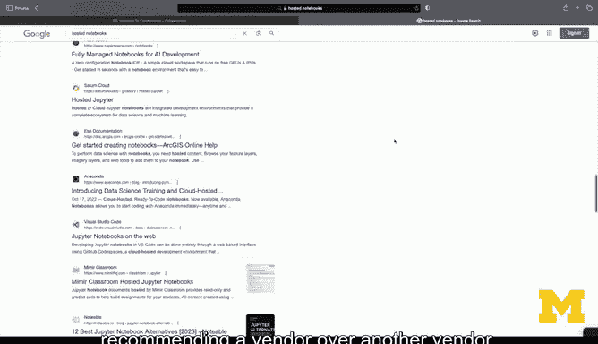
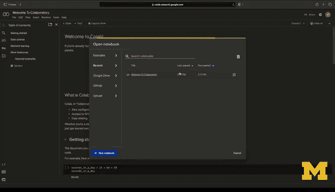
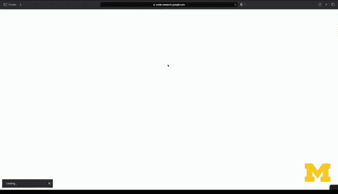
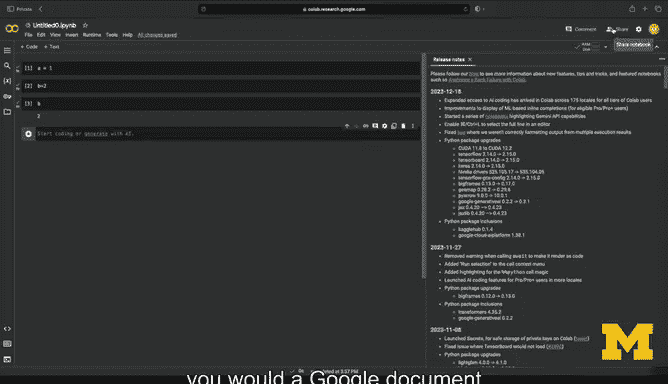

# 课程3：Python 3编程 - P53：在托管系统中运行Python 🚀

在本节课中，我们将学习如何在Coursera平台、本地计算机和云服务之外的环境中运行Python代码，特别是Jupyter Notebook。我们将重点介绍一种流行的托管式笔记本服务，并了解其基本使用方法。

## 概述

你已经使用了Runestone和Jupyter Notebook，我们也讨论过在本地和云端运行代码。现在，我们将探讨如何在Coursera、本地计算机和云服务之外的环境中运行Python，尤其是Notebook。虽然每个云服务商都提供相关功能，但为了运行一个Notebook而创建整个云账户通常比较繁琐。

## 托管式Notebook服务简介

如果你在Google上搜索“hosted notebooks”，会得到大量不同的结果。需要明确的是，我并非推荐某个特定的服务商，以下内容仅基于流行度进行展示。我们将花一些时间讨论Google Colab，它可能是最受欢迎的、在主流云服务之外运行Notebook的平台之一。

## 认识Google Colab

Google Colab并非一个真正的云服务，而是Google提供的一项服务。它有点像Google Docs的扩展，由Google构建和支持。你可以直接访问并创建一个新的Notebook。

**注意**：我们在课程中大量使用了Jupyter Notebook，但Google Colab并非真正的Jupyter。它非常类似于Jupyter，并且基于Jupyter构建，但它是Google独立于Jupyter项目开发的产品。

## Google Colab的基本操作

以下是Google Colab的基本工作方式：

*   你可以创建一个变量，例如 `a = 1`。
*   运行该单元格。
*   创建另一个变量，例如 `b = 2`。
*   运行该单元格。
*   然后打印 `b`，它会显示该单元格的输出值。

除了运行代码，作为Google服务的一部分，你还可以访问许多Google功能。例如，你可以打开一个终端。

## Google Colab的优势

Google Colab的一个优点是，你可以像共享Google文档一样共享Notebook，并让他人协同编辑。如果你有一小部分数据需要快速处理和分析，这是一个极佳的工具，可以让你在Google环境中立即开始工作。

## 总结

本节课我们一起学习了如何在托管系统中运行Python，特别是介绍了Google Colab这一流行的在线Notebook服务。我们了解了它的基本概念、操作方式以及与标准Jupyter Notebook的异同，并认识到了其便于共享和快速上手的优势。