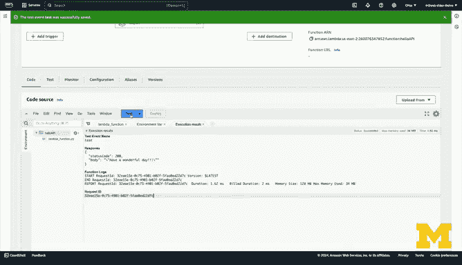
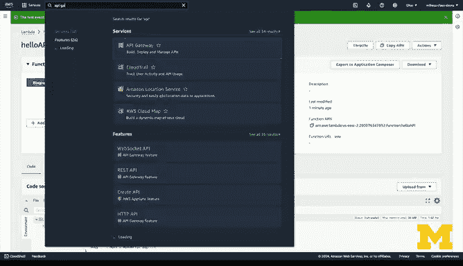
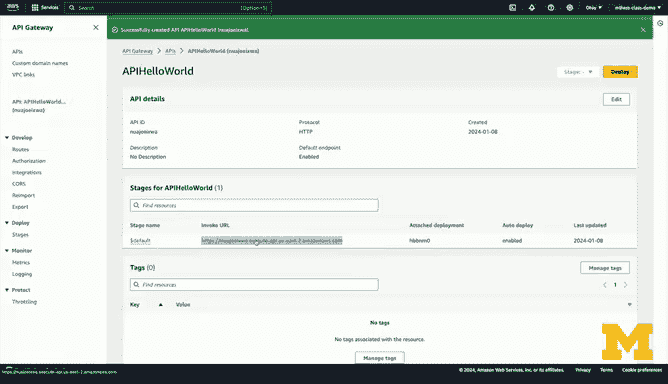
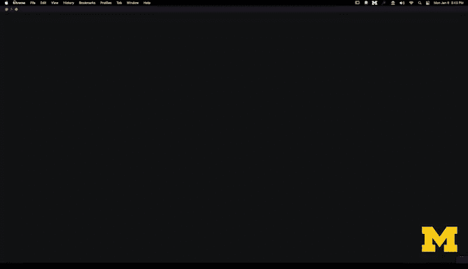
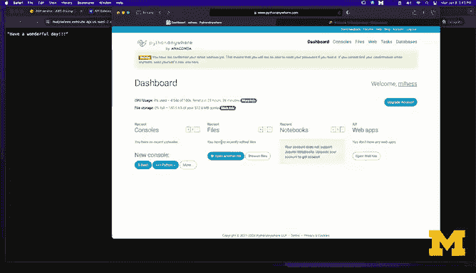
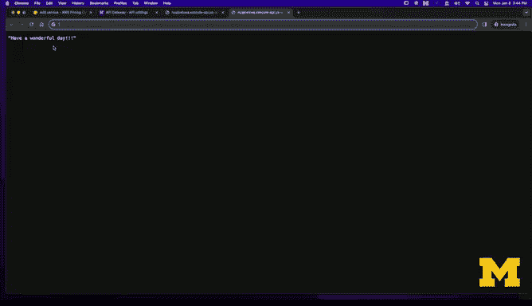
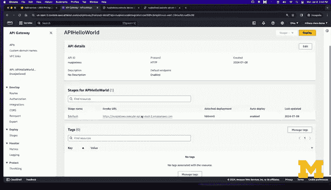
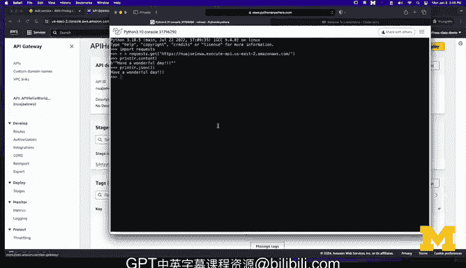

# 课程3：构建API（第二部分）🚀


在本节课中，我们将学习如何利用AWS Lambda和API Gateway服务，将一个简单的Python函数部署为可通过网络访问的API。整个过程无需管理服务器等基础设施。

---

上一节我们介绍了Lambda函数的基本概念。本节中，我们来看看如何将这个函数通过API Gateway暴露给外部世界，使其成为一个可通过HTTP请求调用的Web API。

## 创建Lambda函数 🐍

首先，我们需要在AWS Lambda中创建一个Python函数。

以下是创建函数的核心步骤：
1.  在AWS控制台导航至Lambda服务。
2.  点击“创建函数”。
3.  将函数命名为 `helloAPI`。
4.  选择运行时为 `Python`。
5.  在函数代码部分，输入简单的返回语句。

该函数的核心代码如下：
```python
def lambda_handler(event, context):
    return {
        'message': 'Have a wonderful day'
    }
```
目前，这个函数仅返回一条问候信息。在实际应用中，你可以在此处导入所需的库并编写更复杂的业务逻辑。本教程的重点是展示如何将AWS的不同服务连接起来，而非编写复杂的Python代码。

创建完成后，点击“部署”按钮。此时，我们已经拥有了一个可工作的Lambda函数。我们可以像上一节视频中那样为其创建测试事件，并验证其输出。





然而，这个函数目前无法被终端用户直接调用。用户需要登录我们的AWS账户并点击测试按钮才能执行，这显然不是分发API的可行方式。我们需要通过一个Web端点来公开这个Lambda函数。

## 配置API Gateway 🌉

AWS的API Gateway服务正是为此而设计。它允许我们将Lambda函数映射到一个可通过HTTP访问的URL。

以下是配置API Gateway的流程：
1.  在AWS控制台导航至API Gateway服务。
2.  选择“创建API”。
3.  在API类型中，选择“HTTP API”。这种API可以通过Python的 `requests` 库轻松访问。
4.  将API命名为 `HelloWorld`。
5.  在集成部分，选择“Lambda”作为后端，并关联我们之前创建的 `helloAPI` 函数。

接下来需要配置“路由”。路由是一个将特定URL路径映射到后端函数（即我们的Lambda）的机制。在一个实际的API中，你可能会有多个不同的路径（如 `/users`、 `/items`）。

为了简化，我们将根路径 `/` 映射到我们的函数。完成创建后，API Gateway会为我们生成一个唯一的“调用URL”。这个URL就是外部世界访问我们API的入口。

在API的管理界面，我们可以点击“调用URL”直接在浏览器中测试。浏览器会显示 `Have a wonderful day`，这证明我们的API正在成功执行Lambda函数中的代码。

## 从Python代码调用API 🤖



虽然在浏览器中测试很方便，但我们通常希望用编程语言（如Python）来调用API。现在，让我们看看如何在Python脚本中实现这一点。

我们需要使用 `requests` 库来发起HTTP GET请求。以下是调用API并处理响应的代码示例：





```python
import requests

# 替换为你的API Gateway调用URL
api_url = "https://your-api-id.execute-api.region.amazonaws.com/"

response = requests.get(api_url)
data = response.json()
print(data)
```
运行这段代码，你会看到控制台打印出 `{'message': 'Have a wonderful day'}`。最初使用 `response.content` 可能会看到带 `b` 前缀的字节字符串，这是因为API默认返回JSON格式的数据。使用 `.json()` 方法可以将其正确解析为Python字典。

---



**总结**

本节课中，我们一起学习了构建一个完整API的流程：
1.  我们在AWS Lambda中创建了一个简单的Python函数。
2.  我们使用API Gateway服务，将该函数与一个HTTP API端点绑定。
3.  我们通过生成的URL，成功地从Python代码中调用并获取了API的响应。





整个过程我们只编写了业务逻辑代码，无需关心启动服务器、管理基础设施等运维工作，所有这些都运行在云端。这展示了无服务器架构在快速构建和部署应用接口方面的强大能力。