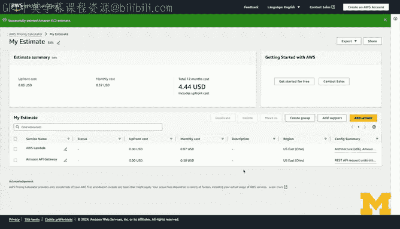

# 课程56：自建API成本估算 💰

在本节课中，我们将学习如何估算运行一个自建API的成本。我们已经构建了API，并用Python进行了调用。接下来，我们需要关注API的运行成本。课程中提到，该API预计每天会有10,000次调用。我们将使用亚马逊AWS提供的成本计算工具，来估算使用Lambda和API Gateway两种服务的费用。

---

## 估算Lambda函数成本

上一节我们介绍了API的基本构建，本节中我们来看看运行它的核心服务之一——AWS Lambda的成本。

我们首先估算Lambda函数的成本。需要输入几个关键参数：

以下是需要填写的估算参数：
*   **请求数量**：每天10,000次。
*   **每次请求运行时间**：虽然一个简单的“Hello World”函数可能只需不到100毫秒，但为计算方便，我们假设每次运行需要1秒。
*   **内存配置**：Lambda的最小内存配置是128MB，我们按此计算。

AWS和其他云服务提供商一样，提供免费额度。为了看清实际成本，我们在计算时暂时关闭免费额度选项。

根据计算，仅Lambda服务一项，每月成本约为 **0.07美元**。

---

## 估算API Gateway成本

接下来，我们估算第二个核心服务——API Gateway的成本。

我们将API Gateway服务添加到成本计算中。我们使用的是HTTP API类型。

以下是API Gateway的成本估算参数：
*   **请求数量**：同样为每天10,000次。
*   **平均请求大小**：每次请求的数据量大约为1KB。

根据计算，API Gateway服务每月的成本约为 **0.30美元**。

---

## 总成本汇总与分析

综合以上两项服务的估算，如果我们以每天10,000次请求的规模运行此API服务，那么：

*   **12个月的总成本**约为 **4.44美元**。
*   **每月成本**约为 **0.37美元**。
*   该平台无需任何前期投入。

由此可见，运行这样的服务成本非常低廉。即使我们调整使用量，例如将请求频率提高到每小时10,000次，每月总成本也仅为167美元，对于API Gateway和Lambda函数来说，这仍然是相当经济的。

对于希望快速、高效启动业务的企业而言，这是一种极佳的入门方式。

---

## 与传统服务器方案对比

之前我们讨论了无服务器架构的成本，现在我们来对比一下传统的服务器方案。

在云计算中，除了无服务器方案，也有传统方式，即启动一个专用服务器来运行Python程序。在AWS中，这项服务称为EC2。

如果我们选择一个小型EC2实例来持续运行服务，其每月费用约为 **3.80美元**。然而，选择EC2意味着我们需要自行负责服务器的搭建、防火墙配置等众多运维工作。

相比之下，使用Lambda和API Gateway，我们只需在管理界面中进行点击配置即可完成部署。因此，如果今天启动一个新项目，我会选择使用AWS Lambda和API Gateway，或其他云服务商的类似功能。

---

本节课中我们一起学习了如何估算自建API的运行成本。我们分别计算了AWS Lambda和API Gateway服务的费用，并对比了无服务器架构与传统EC2服务器方案的成本与运维复杂度。结果表明，对于轻量级、可扩展的API应用，无服务器架构在成本和便捷性上具有显著优势。