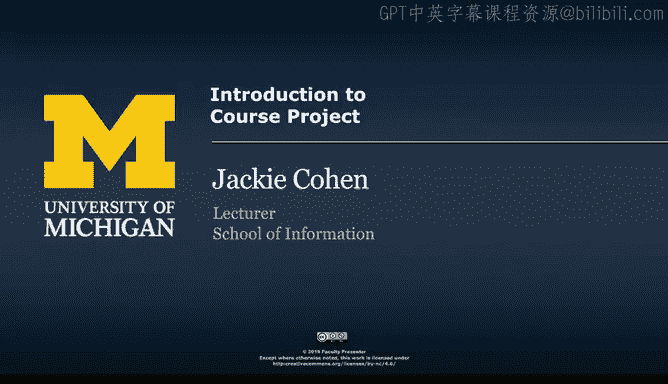

# 课程3：最终项目简介 🎯

在本节课中，我们将介绍课程3的最终项目。你将创建一个名为“API Mashup”的程序，从两个不同的API获取并使用数据。通过这个项目，你将学习如何从互联网上的两个不同来源获取数据，逐步处理这些数据，并生成一个结合了双方信息的新结果。

---

## 理解项目目标

上一节我们介绍了项目的总体目标，本节中我们来看看具体需要做什么。

你将需要查阅并理解每个API的文档。阅读文档的目的是提取必要信息，以便向每个API发出请求。文档中可能包含复杂内容、非必要信息或陌生术语，但你需要从中找出关键信息，例如API请求的基础URL。

---

## 运用已有知识

在构建结果和处理数据的过程中，你将运用已学的函数构建知识。请记住这一点。

此外，你将使用本专项课程中构建的特殊工具来从互联网获取和缓存数据，并从缓存中检索数据。

---

## 分步执行建议

以下是完成项目的步骤建议。

处理每个步骤时，请确保缓慢进行，仔细思考在特定时刻要实现的具体目标。

先用文字制定计划，然后将文字转化为代码。这种方法将使构建基于全新API的结果的过程更加容易，并使其更类似于你之前编写的代码。

---

## 项目的广泛适用性

这种从两个不同地方获取数据并对其进行新处理的程序，在各种情境、工作和不同学科中都非常有用。

祝你顺利，并希望你能享受这个过程。

---

## 总结

本节课中我们一起学习了课程3最终项目的概况。你了解了项目目标是创建一个API Mashup，需要从两个API获取数据并处理以生成新结果。我们强调了阅读API文档、运用函数知识、使用缓存工具以及分步计划的重要性。这种技能在众多领域都具有广泛的应用价值。