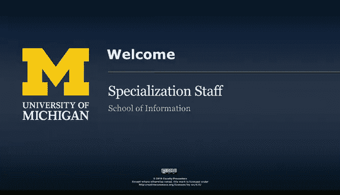
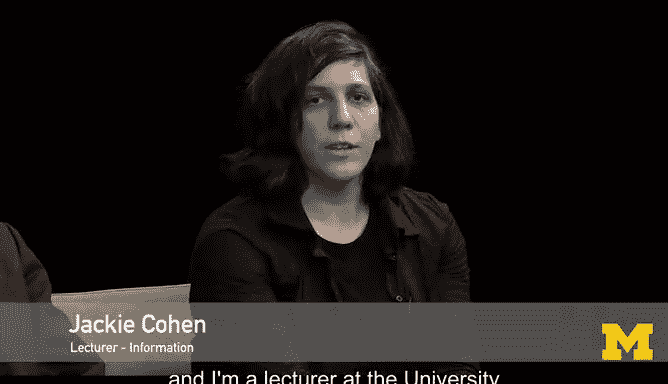
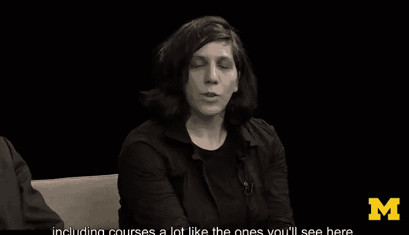
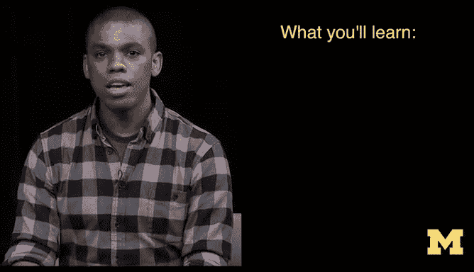
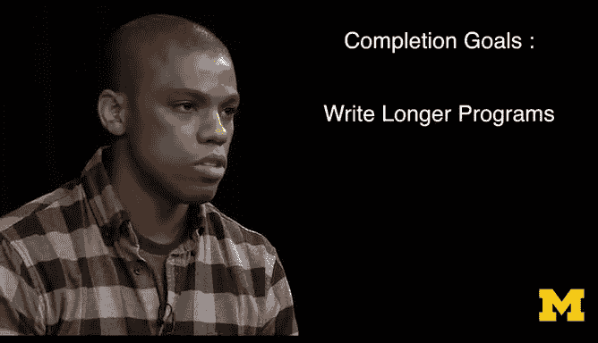
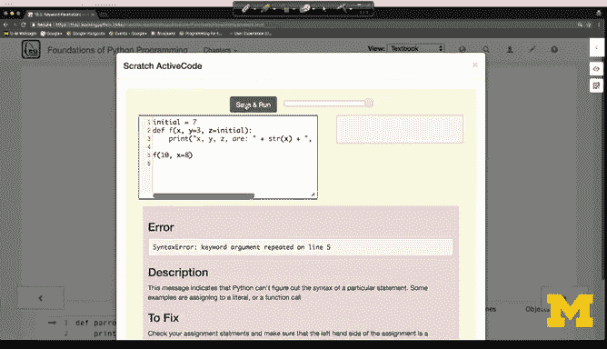
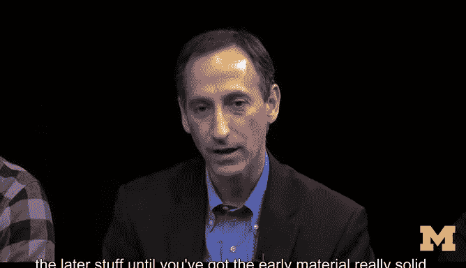
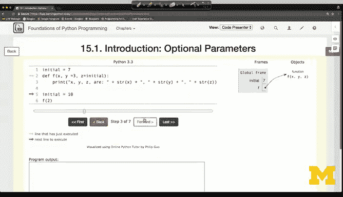

# 课程1：Python 3 编程专业课程介绍 🐍

在本节课中，我们将了解密歇根大学《Python 3 编程》专业课程的整体概览、教学团队以及课程特色。我们将学习课程的目标、使用的工具以及如何帮助你成为一名合格的Python程序员。

---

## 教学团队介绍 👨‍🏫👩‍🏫

以下是本专业课程的核心教学团队成员。

**史蒂夫尼**
我是史蒂夫尼，密歇根大学信息学院的助理教授。我在信息学院教授一些编程入门课程。我认为编程将日益成为一种根本性的重要素养，也是处理我们日常生活中日益增长的数据的一种方式。我的研究主要围绕如何使编程工具更易用，即围绕人们的思维方式和我们实际的编程方式来设计工具。你将在课程一、二和四中看到我。

**保罗·雷斯尼克**
我是保罗·雷斯尼克，密歇根大学信息学院的教授兼研究副院长。我将在此专业课程中教授部分内容，你将在课程一、二、几乎整个课程三以及课程四的部分内容中看到我。我的研究以推荐系统而闻名。在课程中，我还会分享一些“冷笑话”。

**杰基·科恩**
我是杰基·科恩，密歇根大学信息学院的讲师。我教授许多编程课程，并负责设计和支持大量课程资源。在这里，我将引导你完成最终的课程项目，并提供一些有用的提示和技巧。

**克里斯·布鲁克斯**
我是克里斯·布鲁克斯，密歇根大学的教员。在本专业课程中，我将教授最后一门课。在那门课中，你将学习使用图像处理库和大型图像集，并用Python将其转换为有用的信息。我的研究专注于教育技术。

**查尔斯·塞弗伦斯**
我是查尔斯·塞弗伦斯，你可能在《Python for Everybody》课程中见过我。在本课程中，我扮演“程序员之道”的角色，这意味着我可以展示一些我认为有趣的东西，而不是教授核心内容。我的研究领域是教育技术。

**劳伦·墨菲**
我是劳伦·墨菲，几年前我学习了这个课程的校园版本，后来作为教学助理帮助其他学生学习。现在我回来帮助构建本课程的测验、评估和项目。我很高兴你有机会学习相同的材料。

---

## 课程目标与内容 🎯

上一节我们认识了教学团队，本节中我们来看看本专业课程将教你什么。

在本专业课程中，你将学习如何成为一名合格的Python程序员。
*   你将详细学习Python语言的基础知识。
*   你将学习如何导航复杂的数据结构并从中累积结果。
*   你将学习如何将数据转换为可供其他程序使用的格式。

完成专业课程后，你将能够：
*   编写数百行的Python程序。
*   在你的代码中使用和集成Python模块。
*   通过阅读文档来使用外部工具，如API。

课程从零开始，不要求任何先验知识，但会深入Python基础，确保你理解代码的每个方面。

---

## 互动学习环境与工具 🛠️

了解了课程目标后，我们来看看你将使用哪些独特的学习工具和环境。

**Runestone互动教科书**
Runestone互动教科书允许你将学习材料与主动代码评估交织在一起。这使你可以实际编写代码。我们发现编写代码非常重要，因为即使你从理论上了解某个Python特性如何工作，实际编写代码对于获得更多实践理解和知道如何在实践中应用这些概念也至关重要。

**代码透镜工具**
我们有一个很棒的代码透镜工具，它可以让你可视化程序执行时发生的情况，一次一行。你可以前进和后退，查看变量的值、列表内容何时更改等。这为你提供了一种思考方式，对调试非常有帮助。

**“程序员之道”环节**
课程的大部分内容是关于如何使用Python和学习Python特性。“程序员之道”环节则更多是关于程序员可以且应该如何工作。编程更像是一门艺术而非纯科学，做事情有很多正确的方法，但存在最佳实践。例如，如何逐步编写程序。在这些环节中，你还将学习如何编写良好的自动化测试用例。

---

## 评估、练习与项目 📝

掌握了学习工具后，我们来看看课程如何通过评估和项目来确保你的学习效果。

**严格的评估**
劳伦创建了大量的评估。你不仅可以在浏览器中运行代码，它还会告诉你是否正确，并提供即时反馈，你可以多次尝试。我们设置的评估要求你必须全部答对（100%）才能通过。这样做的原因是我们真的希望你建立精通度，确保你在掌握早期材料之前不会进入后面的内容。

**实践工具**
我们有一个很棒的练习工具，它会根据你的掌握情况，向你重复展示过去遇到过的问题。如果你遇到困难，它会更频繁地出现；如果你已掌握，则出现频率降低。这是巩固所学知识的一种方式。当你完成当天的所有练习问题时，它还会显示有趣的烟花效果。

**结合实际的项目**
在你完成的所有项目中，你会发现将课程和专业课程中学到的概念转化为现实生活的方法。例如，构建可能对你的工作、学习或其他活动有用的程序。

**最终项目课程**
在课程的最后，我们增加了一个项目课程，重点在于教你如何获取外部的API或软件包，并用它们做一些新颖的事情，而不仅仅是学习。为此，我们将在Jupyter环境中进行。就像你需要反复练习API和Python基础一样，你可以在许多不同的地方编写和运行Python代码，Runestone是其中之一，Jupyter也是一个非常常见的环境。我们试图展示Python编程在学习和生产环境中的多样性。

---

## 总结 📚

本节课中，我们一起学习了密歇根大学《Python 3 编程》专业课程的概览。
*   我们认识了来自信息学院的教学团队。
*   明确了课程目标是帮助你成为能编写数百行代码、使用模块和API的合格Python程序员。
*   了解了课程将使用Runestone互动教科书、代码透镜等工具进行深入、实践性的学习。
*   知道了课程通过严格的评估、定制的练习工具以及结合现实的项目来确保学习效果和技能迁移。

我们非常高兴能与您分享这些材料，祝您学习愉快，好运！正如密歇根大学的传统口号：“加油，蓝色！”（Go Blue!）