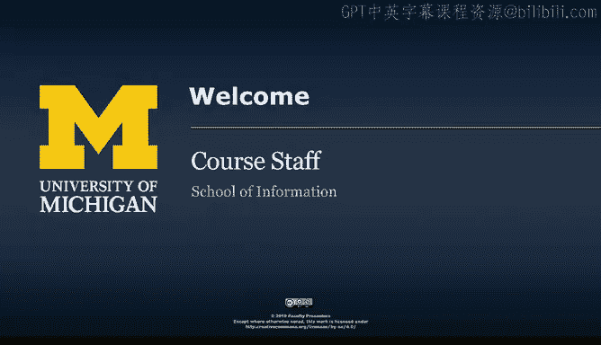
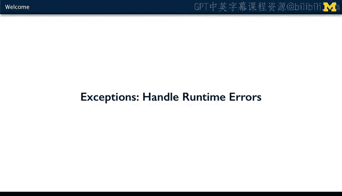
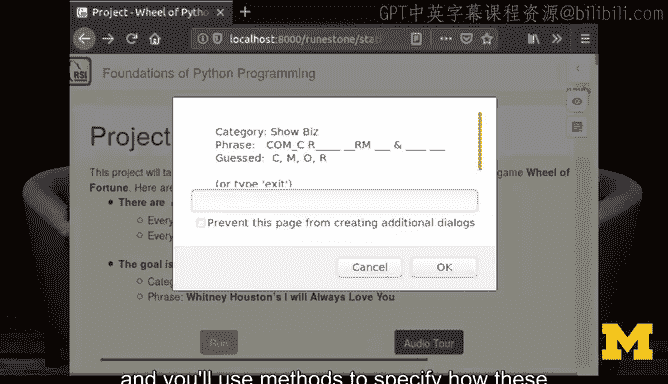

# 课程3：Python类与继承 🐍

在本节课中，我们将要学习Python中两个核心概念：**类**与**继承**。我们将了解如何通过类将数据和方法封装在一起，以及如何通过继承复用代码，使程序结构更清晰、更易维护。

---

欢迎回来，我们很高兴你能继续学习。如果你是第一次加入我们，我们也非常欢迎你来到这里。我们假设你已经熟悉函数、字典，能够从嵌套数据结构中提取数据，并且对Python的列表推导式感到自如。

如果你是第一次加入，请务必观看关于Runestone环境的介绍视频，因为在接下来的学习中，我们仍将大量使用该环境。

我是Steve Oney，我是Paul Resnick。我们都是密歇根大学信息学院的教员。在本课程中，你将学习关于类的知识。类非常有用，因为它们允许你将与某个问题相关的方法和数据组合成一个易于使用的包。

事实上，类如此好用，以至于像Java这样的编程语言要求你必须使用类才能进行编程。Python让类的使用成为可选项，但你会发现，在本课程中，它们能让你的代码更易读、更易写。

你还将学习**类继承**。类继承允许你复用代码，这能让你的代码更加简洁、更易阅读。

在本课程中，你还会学习测试用例。对于入门编程系列来说，这是一个有点高级的话题，但我们认为，从编程生涯的一开始就养成编写测试用例的习惯非常有价值。

**测试用例**是一种规定函数或类应如何工作的方式。如果你编写了一些测试用例，然后实现你的函数，如果它通过了测试，你就知道函数实现正确；如果没有通过，你就知道函数实现有误。

你还将学习如何处理**异常**。你可能之前遇到过运行时异常。例如，当你尝试引用一个不存在的变量，或者尝试除以零时，Python会停止运行你的程序并给出错误信息。我们将学习如何实际处理这类运行时异常，从而让你对Python如何评估你的代码有更多的控制权。

---

在上一节我们介绍了本课程的整体学习目标，本节中我们来看看本课程的项目实践。

在本课程的项目中，你将运用所学知识编写一个“幸运之轮”游戏。你将使用类来表示人类玩家和电脑玩家，并使用方法来规定这些玩家如何相互竞争。

---

Dr. Chuck Severance将客串出场，向你展示类和继承如何使使用Django框架实现网络编程变得容易。

与之前的课程一样，我们将主要以带有代码示例的录屏形式进行教学，但偶尔也会出镜，以介绍一些智慧之言或引入新主题。

我还会讲几个冷笑话，但这次不会太多，因为本课程主要由Steve主讲。

那么，让我们开始吧。再见。