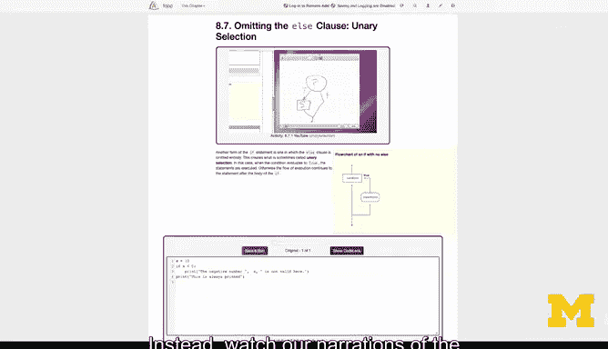

# 课程3：Python交互式教材使用指南 📚


在本节课中，我们将学习如何使用本专项课程附带的免费交互式教材。该教材包含多种互动功能，能帮助你更有效地学习Python编程。

---

## 概述

本课程的前四门课内容与教材内容紧密对应。无论你从哪门课开始，本视频都将介绍教材中的重要互动功能。如果你在之前的课程中已经看过，可以跳过。

Runestone交互式教材环境由Brad Miller创建。过去四年中，我对软件环境和教材内容做出了一些贡献，但主要功劳归于Brad。让我们开始探索。

---

## 访问教材

每次访问Runestone教材，你都需要通过Coursera页面上的链接进入。该链接会指向教材中的特定页面。

点击复选框，然后启动应用。系统将跳转至教材页面，并自动完成登录。这是因为系统通过Coursera识别了你的身份。

---

## 教材内容与互动元素

教材中包含文本、图片和图表。此外，还有一些互动元素。

以下是教材中的一些核心互动功能。

### 活动代码窗口

活动代码窗口是教材中的代码编辑区域。你可以在其中编写、修改并运行代码。

例如：
```python
print("Hello, World!")
```
点击“保存并运行”后，代码将在输出窗口中显示结果。你可以修改代码并重新运行。所有代码版本都会被保存。

窗口下方有一个历史记录滑块。移动滑块可以查看所有旧版本。这些记录不仅在当前页面有效，还会被永久保存。

重新加载页面后，窗口内容会恢复为初始状态。但你可以点击“加载历史”来查看并运行之前的代码版本。

### Code Lens（代码透镜）

Code Lens是活动代码窗口的一个非常实用的功能。这个由加州大学圣地亚哥分校的Philip教授开发的工具，允许你逐行执行程序，观察每一步的变化。

点击“前进”按钮，程序将逐行执行。这对于理解条件执行、循环和自定义函数等复杂程序非常有帮助。

我们的教育理念是揭示所有“魔法”，让你能够理解程序的执行过程。这是通过理解而非试错来调试代码的基础。Code Lens在此方面提供了巨大帮助。

教材中的一些页面已内置了Code Lens示例。但你也可以通过点击“显示/隐藏Code Lens”按钮，为任何活动代码窗口启用此功能。

### 多项选择题

教材中包含多项选择题。你可以回答问题并点击“检查我”按钮获取即时反馈。

例如，一个问题可能询问变量`day`被设置为`"Thursday"`后会打印什么。如果你回答`"Thursday"`，系统会给出反馈，指出该值后续会被覆盖，因此正确答案可能是其他内容。

### 页面完成标记

页面底部有一个“标记页面完成”按钮。点击后，该页面在教材目录中会以特殊颜色标记，用于跟踪你的学习进度。此功能完全可选，你可以根据需要使用或忽略。

---

## 导航与搜索

在Coursera中，我们通常会提供指向特定教材页面的链接。但进入Runestone网站后，你也可以自行导航。

教材页面顶部有“前进”和“后退”按钮，用于跳转到相邻页面。点击教材标题，可以进入详细的目录页面，其中列出了每个页面及其子章节。

此外，还有搜索功能。你可以搜索关键词（如“变量”），系统会显示教材中包含该词的所有页面。

教材还提供了索引功能，你可以查找特定条目并直接跳转到相关位置。

---

## 练习工具

Runestone教材包含一个练习功能。有两种方式可以从Coursera访问它：一是通过课程中多处重复的“练习活动”链接；二是在任何教材页面点击“练习”按钮进入。

练习工具会从你已打开的教材页面中抽取问题。在此工具中，你可以重新回答问题。

如果你答对了，系统会记录，并在一段时间内不再询问同一主题的问题。如果答错了，系统可能会在第二天再次询问。工具界面会显示不同主题再次被询问的时间。

例如，如果你尚未学习太多Python知识，系统可能准备在一天后询问关于“序列长度”的问题，五天后询问关于“更新变量”的问题。

当你多次正确回答某个主题的问题后，再次被询问的间隔会越来越长。这种间隔重复的学习方法基于记忆科学，能有效促进长期记忆。

这个练习工具是我的博士生Iman Yazdanmehr的心血结晶。我们在校内课程中使用了它，结果显示，经常使用该工具的学生在考试中表现明显更好。因此，现在校内课程要求使用此工具，并将其作为最终成绩的一部分。

对于Coursera课程，使用练习工具不是强制要求，但我强烈建议你每天使用一点。我们的校内学生非常喜欢答对问题后出现的烟花庆祝效果。

每天正确回答五个问题后，你会获得庆祝烟花。但你也可以继续回答当天计划内的更多问题。

---

## 评分作业

对于为获取证书而学习本课程的同学，你会在每节课或每组课程结束时看到评分作业的链接。

在前四门课程中，评估和项目都位于Runestone教材中，并全部采用自动评分。只有付费获取证书的同学才能在Coursera中看到这些内容。未付费的同学可以在Runestone教材的章节评估页面找到类似问题。

点击评估链接后，你会进入包含若干问题的页面。通常包括选择题和需要编写代码的题目。

例如，一个代码题可能要求输出`"Hello, World!"`。你可以在代码窗口中编写代码，点击“保存并运行”后，系统会提供即时反馈。如果输出正确，你会通过测试；如果错误，系统会指出问题。

评估通常要求获得100%的分数才能通过。但你可以多次尝试，直到获得满分。我们这样设置是因为掌握早期基础知识非常重要，后续内容会在此基础上不断构建。

提交答案后，系统会更新你的分数。返回Coursera页面并刷新，你会看到自己已通过评估。

---

## 教材中的视频

许多教材页面顶部包含视频。其中一些是Steve制作的精美动画，另一些是由Google教育团队在Brad Miller指导下制作的带旁白的动画。这两类视频都非常出色，推荐观看。

然而，也有一些视频只是对教材内容的讲解，且部分视频分辨率较低。我建议你跳过这些，改为观看我们在Coursera上提供的教材内容讲解。

---



## 总结

本节课我们一起探索了Runestone交互式教材环境。这是一个由多人倾注心血的开源项目，特别是项目发起人Brad Miller。希望它能帮助你扎实掌握Python基础知识。

我通常会在课程结束时讲个小笑话，这里有一条幽默的建议：**“今天就要拖延，总是今天，不要拖到明天。”**

好吧，那么请不要听从这个建议。**不要拖延，今天就行动起来，开始学习本课程的第一课吧！** 我们下次再见。