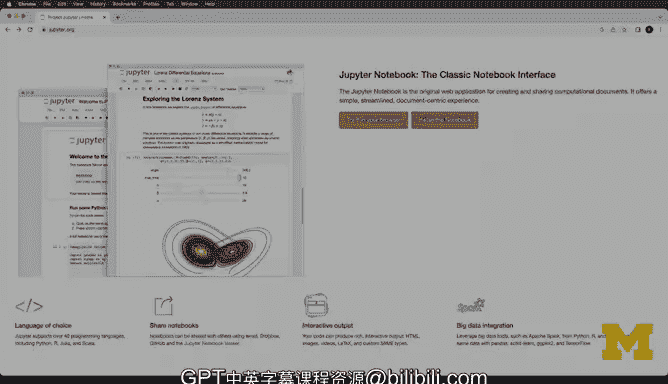
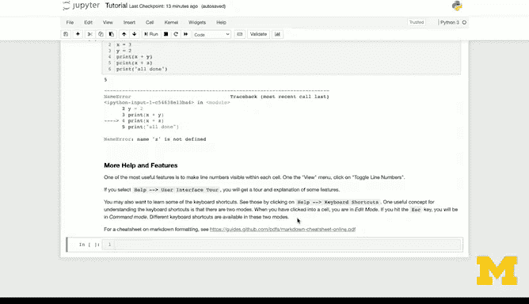

# 课程3、4、5：Jupyter环境中执行Python代码（可选） 🧪




在本节课中，我们将学习如何使用Jupyter Notebook这一新的Python代码执行环境。Jupyter Notebook是一种交互式编程工具，它允许我们将代码、文本和可视化内容整合在一个文档中。课程中的可选实验和最终评估都将使用Jupyter Notebook，因此熟悉它非常重要。

---

## 认识Jupyter Notebook

上一节我们介绍了Jupyter Notebook的基本概念，本节中我们来看看它的具体构成。

Jupyter Notebook由一个个“单元格”组成。单元格有两种主要类型：Markdown单元格和代码单元格。

### Markdown单元格

Markdown单元格用于编写格式化的文本。例如，本段文字就位于一个Markdown单元格中。它支持标题、列表、加粗、链接等丰富的文本格式。

### 代码单元格

代码单元格用于编写和执行Python代码。点击单元格，然后点击“运行”按钮，即可执行其中的代码。

Jupyter的代码单元格与Runestone的“活动代码窗口”有两点主要区别：

1.  **自动输出表达式结果**：在Jupyter中，如果单元格的最后一行是一个表达式（例如 `x + 1`），执行该单元格时会自动输出该表达式的结果。而在Runestone中，必须使用 `print()` 语句才能看到输出。
2.  **变量绑定在单元格间持久化**：在Jupyter中，一个单元格中定义的变量（如 `x = 9`）在其后执行的单元格中仍然有效。Runestone的每个活动代码窗口则是完全独立的。

以下是代码单元格的示例：
```python
x = 9
print(x)
print(x + 1)
x + 2  # 这一行虽然没有print，但执行后会自动输出结果 11
```

---

## 执行顺序与变量管理

由于变量在单元格间共享，代码的执行顺序就变得非常重要。

Jupyter会为每个单元格的输出编号，编号顺序即单元格的执行顺序。例如，输出标记为 `[1]` 的单元格先于标记为 `[2]` 的单元格执行。这有助于你理解代码的执行流程。

如果你因执行顺序错乱而感到困惑，可以随时重启内核来清除所有输出和变量绑定，然后从头按顺序执行。

以下是操作步骤：
1.  点击菜单栏的 **Kernel**。
2.  选择 **Restart & Clear Output**。
3.  这将清除所有输出，让你可以从头开始。

---

## 保存与错误处理

Jupyter Notebook会自动保存你的工作。但你也可以手动保存或创建检查点。

在Coursera环境中，检查点功能可能有限。更可靠的做法是使用 **File -> Save as...** 为笔记本指定一个明确的名称进行保存。

Jupyter使用的是官方的Python解释器，因此其错误信息会比Runestone中的更直接。例如，当引用未定义的变量时，你会看到类似下面的错误：
```python
print(z)  # 假设z未定义
```
```
NameError: name 'z' is not defined
```
为了更清晰地定位错误，建议开启行号显示：点击 **View -> Toggle Line Numbers**。

---

## Markdown格式简介

Markdown是一种轻量级标记语言，可以让你轻松地格式化文本。

以下是常用的Markdown语法示例：
*   **标题**：使用 `#` 符号。`# 一级标题`， `## 二级标题`。
*   **代码高亮**：使用反引号 `` `代码` ``。
*   **斜体**：使用星号 `*斜体文本*`。
*   **链接**：直接写入URL会自动转换为链接，或使用 `[链接文字](网址)` 的格式。

你可以通过双击Markdown单元格查看其背后的原始标记，编辑后运行单元格即可看到渲染后的效果。

---

## 使用建议与后续发展

为了提升效率，建议学习并使用Jupyter的键盘快捷键。虽然本视频中通过点击菜单进行操作是为了演示更清晰，但熟练使用快捷键能极大提高工作效率。

Jupyter Notebook非常适合本课程及专项课程中程序规模的练习。对于更大型的项目，你可能会需要使用集成开发环境（IDE），例如 PyCharm 或 VS Code。你将在本专项课程的后续内容中简要了解这些IDE。

---



本节课中我们一起学习了Jupyter Notebook的基本操作，包括单元格类型、代码执行、变量管理、Markdown格式以及一些实用技巧。掌握这个工具将为后续的学习和项目完成打下坚实基础。