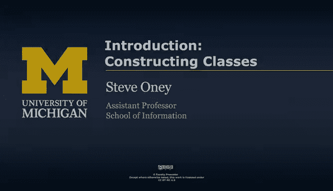

# 课程3：Python 3编程 - P63 🧱 06_02_01 类的构建：引言

在本节课中，我们将开始学习Python中的类。我们将了解类如何帮助我们更好地组织和结构化复杂的代码，并初步接触面向对象编程的核心思想。




---

## 概述

类（Class）是Python中实现面向对象编程（Object-Oriented Programming）的基石。面向对象编程的核心思想是围绕“对象”来组织代码。通过创建类，我们可以定义一种新的数据类型，它既能封装数据（属性），又能包含操作这些数据的函数（方法）。这能让我们的代码更清晰、更简洁、更有条理。

## 为什么需要类？

在之前的课程中，我们学习了如何使用列表和字典等数据结构来管理信息。例如，假设你正在为一家租车公司编写代码来追踪汽车库存。

你可以使用字典来记录每辆车的详细信息，例如颜色、型号、是否被租出等。你也可以使用列表来管理所有这些车辆的集合。

然而，随着程序逻辑变得复杂，单纯使用字典和列表可能会让代码变得难以管理和维护。这时，类就提供了一个更优的解决方案。

## 类的优势：以租车系统为例

设想我们创建一个 `Car`（汽车）类。这个类可以作为一个“蓝图”，用来创建代表每一辆具体汽车的“对象”。

*   **属性（Properties）**：每个`Car`对象都可以拥有自己的属性，如 `color`（颜色）、`size`（尺寸）、`top_speed`（最高速度）和 `is_checked_out`（是否已租出）。
*   **方法（Methods）**：每个`Car`对象还可以拥有属于自己的函数，我们称之为“方法”。例如，我们可以定义一个 `check_out()` 方法。当调用 `car1.check_out()` 时，就表示租出这辆特定的车。

同样，我们还可以创建 `Customer`（客户）类、`Employee`（员工）类等，来构建整个租车系统的业务模型。

**代码示例对比：**

使用字典：
```python
car1 = {'color': 'red', 'size': 'SUV', 'is_checked_out': False}
# 要租出这辆车，需要手动修改字典
car1['is_checked_out'] = True
```

使用类：
```python
# 假设我们已经定义了一个Car类
car1 = Car(color='red', size='SUV')
# 通过调用方法来租出车辆，逻辑被封装在类内部
car1.check_out()
```

虽然不使用类也能实现所有功能，但使用类能让代码结构更清晰、表达更简洁、组织更有序。

## 本节学习目标

完成本课程后，你将能更好地理解如何：
1.  创建类（Class）。
2.  定义类的方法（Method）。
3.  创建类的实例（Instance），也就是具体的对象。

---

上一节我们介绍了类的概念和优势，接下来，让我们正式进入类的构建世界，看看如何亲手创建一个类。

## 总结

本节课我们一起学习了Python中类的基本概念。我们了解到，类是面向对象编程的核心，它通过将数据（属性）和操作数据的函数（方法）捆绑在一起，为我们提供了一种强大的代码组织方式。使用类能够使程序，尤其是复杂的程序，变得更加模块化、易于理解和维护。在接下来的课程中，我们将动手实践，学习如何定义和使用类。