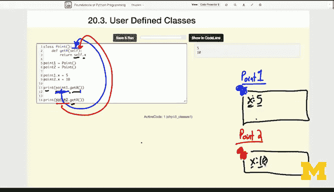

# 课程07：用户自定义类 🧱


在本节课中，我们将要学习Python中类的基础知识。类是一种将数据及其相关操作（方法）捆绑在一起的便捷方式，它允许我们创建自定义的数据类型，以更直观地表示和操作现实世界中的概念。


上一节我们介绍了类的基本概念，本节中我们来看看如何定义和使用一个简单的类。

## 定义类

我们使用 `class` 关键字来定义一个类。按照惯例，类名应以大写字母开头。

```python
class Point:
    pass
```

以上代码定义了一个名为 `Point` 的类。目前它的内部是空的（使用 `pass` 占位），我们将在后续填充它。

## 创建实例

类就像一个工厂，而实例则是这个工厂生产出的具体产品。我们通过类名加括号的方式来创建实例。

```python
point1 = Point()
point2 = Point()
```

这里，`point1` 和 `point2` 是 `Point` 类的两个独立实例。它们是不同的对象。

## 实例变量

实例变量是属于特定实例的变量，用于存储该实例的数据。我们可以直接为实例创建和赋值变量。

```python
point1.x = 5
point2.x = 10
```

现在，`point1` 拥有一个值为 `5` 的实例变量 `x`，而 `point2` 的实例变量 `x` 值为 `10`。

## 定义方法

方法是属于类的函数，用于定义对象的行为。与普通函数不同，方法的第一个参数必须是 `self`，它代表调用该方法的实例本身。

以下是定义方法 `get_x` 的步骤：

```python
class Point:
    def get_x(self):
        return self.x
```

在方法内部，我们通过 `self.x` 来访问当前实例的变量 `x`。

## 调用方法

调用方法时，我们使用 `实例.方法名()` 的语法。Python会自动将调用该方法的实例作为 `self` 参数传入。

```python
print(point1.get_x())  # 输出：5
print(point2.get_x())  # 输出：10
```

当调用 `point1.get_x()` 时，`point1` 被自动传入作为 `self`，因此方法返回 `point1.x` 的值 `5`。同理，`point2.get_x()` 返回 `10`。

## 核心概念总结

*   **类 (Class)**：创建对象的蓝图或模板。定义使用 `class` 关键字。
*   **实例 (Instance)**：根据类创建的具体对象。
*   **实例变量 (Instance Variable)**：存储在每个实例中的独特数据。
*   **方法 (Method)**：定义在类中的函数，第一个参数为 `self`，用于操作实例的数据。

---



本节课中我们一起学习了Python中用户自定义类的基础知识。我们了解了如何定义类、创建实例、设置实例变量以及定义和调用方法。理解 `self` 参数是掌握类方法如何工作的关键。在接下来的课程中，我们将探索更强大的类特性，如初始化方法。