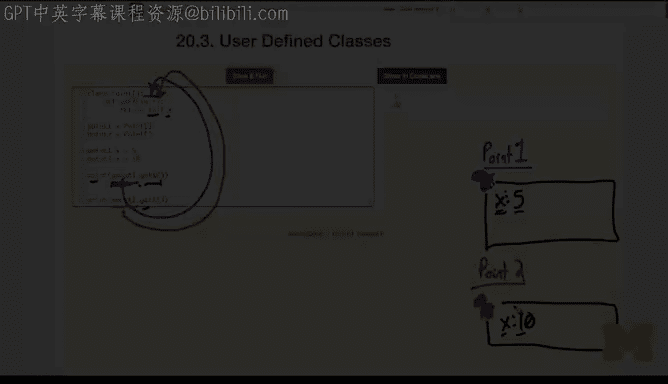
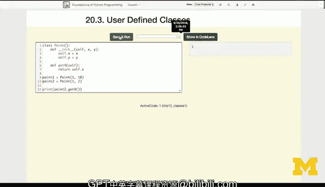

# 密歇根大学《Python3编程》课程3、4、5｜P65：08_02_03_为构造函数添加参数 🧱




在本节课中，我们将要学习如何为Python类的构造函数添加参数。我们将了解为什么使用构造函数来初始化实例变量是比在创建对象后手动设置更规范、更推荐的做法。

## 构造函数简介

上一节我们介绍了实例变量的概念，本节中我们来看看如何更规范地初始化它们。在之前的代码中，我们通常在创建对象后，再单独为其实例变量赋值。虽然这在语法上是可行的，但这并非最佳实践。

更好的做法是使用一个名为**构造函数**的特殊方法来初始化对象。构造函数会在创建对象实例时自动调用，用于设置对象的初始状态。

## 定义构造函数

构造函数在Python中有一个固定的名称：`__init__`。它是一个特殊的方法，专门用于初始化新创建的对象实例。

定义构造函数时，其第一个参数必须是`self`，它代表即将创建的实例本身。之后，我们可以添加任意数量的其他参数，用于接收初始化所需的数据。

以下是定义构造函数的基本语法：
```python
def __init__(self, 参数1, 参数2, ...):
    # 初始化代码
```

## 为构造函数添加参数

现在，让我们通过一个具体的例子，学习如何为构造函数添加参数。我们将创建一个`Point`类，并在其构造函数中接收`x`和`y`坐标值。

以下是实现步骤：
1.  在类中定义`__init__`方法。
2.  除了`self`参数，额外添加`x`和`y`参数。
3.  在构造函数内部，使用`self.x = x`和`self.y = y`将传入的参数值赋给实例变量。

具体代码如下：
```python
class Point:
    def __init__(self, x, y):
        self.x = x
        self.y = y

    def get_x(self):
        return self.x
```

## 创建对象并传递参数

一旦我们为构造函数定义了参数，在创建类的实例时，就必须提供相应的参数值。Python会自动将我们提供的参数传递给`__init__`方法（`self`参数由解释器自动处理）。

例如，要创建两个`Point`对象：
```python
p1 = Point(5, 10)  # x=5, y=10
p2 = Point(1, 2)   # x=1, y=2
```
在这个例子中：
*   创建`p1`时，`5`和`10`分别传递给构造函数的`x`和`y`参数，然后被赋给`p1.x`和`p1.y`。
*   创建`p2`时，`1`和`2`分别传递给构造函数的`x`和`y`参数，然后被赋给`p2.x`和`p2.y`。

因此，调用`p1.get_x()`会返回`5`，调用`p2.get_x()`会返回`1`。

## 总结



本节课中我们一起学习了Python构造函数的核心知识。我们了解到`__init__`方法是用于初始化对象的构造函数，通过为其添加参数，我们可以在创建对象时就完成实例变量的设置，这使得代码更加简洁、清晰和规范。记住，使用构造函数初始化对象是面向对象编程中的标准做法。