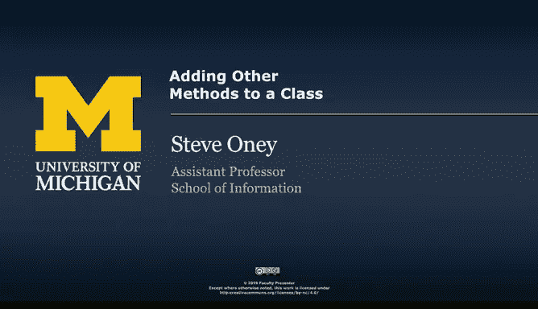
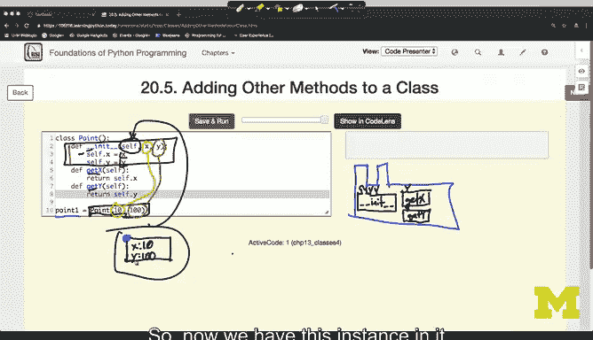

# 密歇根大学《Python3编程》课程3-5｜P66：09_02_04_为类添加其他方法 🧱




在本节课中，我们将要学习Python中类的构造过程，特别是当创建类的实例时，Python内部是如何工作的。我们将通过一个`Point`类的例子，详细解释实例变量和方法是如何被设置和调用的。

上一节我们介绍了如何创建一个简单的类。本节中我们来看看，当我们实例化一个类并调用其方法时，Python在幕后具体执行了哪些步骤。

## 类的定义与构造方法

创建一个类的方法是使用`class`关键字，类名通常以大写字母开头。构造方法是一个名为`__init__`的特殊方法。

```python
class Point:
    def __init__(self, x, y):
        self.x = x
        self.y = y
```

在上述代码中，我们定义了一个`Point`类。`__init__`方法接受三个参数：`self`、`x`和`y`。`self`代表即将创建的实例本身，`x`和`y`是用于初始化实例变量的值。

## 实例化过程详解

当我们执行`point1 = Point(10, 100)`来创建一个`Point`实例时，Python内部发生了一系列操作。

首先，Python会创建一个新的、空白的`Point`实例。此时，这个实例还没有任何实例变量。

接着，Python会检查`Point`类是否定义了`__init__`方法。如果定义了，Python就会调用这个构造方法，并将新创建的空实例作为`self`参数传入，同时传入我们提供的`10`和`100`作为`x`和`y`的参数值。

在`__init__`方法内部，语句`self.x = x`的作用是：为`self`所代表的这个实例，设置一个名为`x`的实例变量，并将其值赋为传入的`x`参数的值（即`10`）。同理，`self.y = y`将实例变量`y`设置为`100`。

至此，这个实例就拥有了两个实例变量：`x`和`y`，其值分别为`10`和`100`。

## 类中的其他方法

除了构造方法，类还可以包含其他用于定义对象行为的方法。以下是向`Point`类添加两个获取坐标值的方法。

```python
class Point:
    def __init__(self, x, y):
        self.x = x
        self.y = y

    def get_x(self):
        return self.x

    def get_y(self):
        return self.y
```

当我们声明`get_x`和`get_y`这些方法时，它们作为函数对象存在于`Point`类这个“工厂”内部。`get_x`方法接受一个参数`self`，并返回`self.x`的值。

## 方法与实例的关联

当我们在一个实例上调用方法时，例如`point1.get_x()`，Python会自动将该实例（`point1`）作为`self`参数传递给`get_x`方法。因此，在方法内部，`self.x`就能正确地访问到该实例的`x`变量。

可以将类想象成一个工厂，其中存放着各种方法（如`__init__`、`get_x`）。当我们创建实例（产品）时，工厂使用`__init__`蓝图来初始化这个产品。之后，产品就可以使用工厂里定义好的其他工具（方法）了。



本节课中我们一起学习了Python类实例化的详细过程。我们了解到，创建实例时，Python会先创建一个空对象，然后调用类的`__init__`方法来初始化实例变量。类中定义的其他方法则作为对象的行为，在调用时会自动接收实例本身作为`self`参数。理解这个过程有助于我们更清晰地掌握面向对象编程在Python中的运作方式。