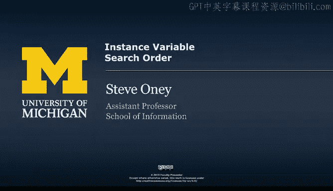
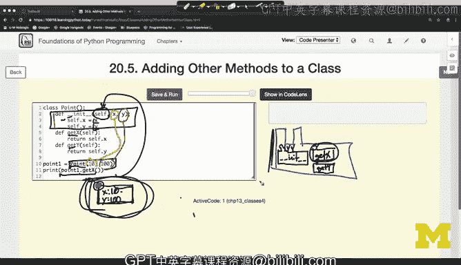

# 密歇根大学《Python3编程》课程3、4、5｜第67课：实例变量搜索顺序 🔍

在本节课中，我们将要学习Python中实例变量和类方法的搜索顺序。理解这个机制对于掌握面向对象编程至关重要，它能帮助我们明白当访问一个对象的属性时，Python解释器是如何在背后工作的。

---

上一节我们介绍了构造函数的执行过程。本节中我们来看看Python是如何查找实例变量和类方法的。

当Python创建一个`Point`类的新实例时，它会先创建一个空实例，然后将这个实例传递给构造函数。构造函数通常会设置实例变量。

接下来需要理解的是Python在搜索实例变量和类方法时所遵循的顺序。

当我们执行类似 `print(point1.x)` 的语句时，Python首先会判断`x`是否是一个实例变量。它会查看`point1`这个实例对象，并询问该实例是否拥有一个名为`x`的实例变量。在这个例子中，实例确实拥有`x`变量。一旦在实例中找到该变量，Python就会返回该实例变量的值。因此，这里我们会得到 `10`。

现在，如果我们搜索一个不存在于实例中的属性，例如执行 `print(point1.get_x)`。

Python首先需要评估`point1.get_x`这个方法的位置。它首先在`point1`实例中搜索，询问`point1`是否有一个名为`get_x`的实例变量。但`point1`并没有。

于是，Python接下来会搜索的地方是类本身。Python识别出`point1`是`Point`类的一个实例。因此，它会在`Point`类内部进行查找。正是在这里，Python找到了`get_x`这个方法。

以下是Python搜索属性的完整顺序：

1.  **首先在实例内部查找**：Python会检查对象实例本身是否拥有该名称的属性。
2.  **然后在类内部查找**：如果在实例中未找到，Python会转向该实例所属的类，在类定义中查找类属性或方法。

如果Python在实例和类中都没有找到该属性，那么它将抛出一个运行时错误（`AttributeError`）。

---

本节课中我们一起学习了Python的属性解析顺序。核心要点是：当访问一个对象的属性时，Python会**先在实例自身中查找**，如果找不到，**再转向其所属的类中查找**。这个简单的两步搜索规则是理解Python对象模型的基础。