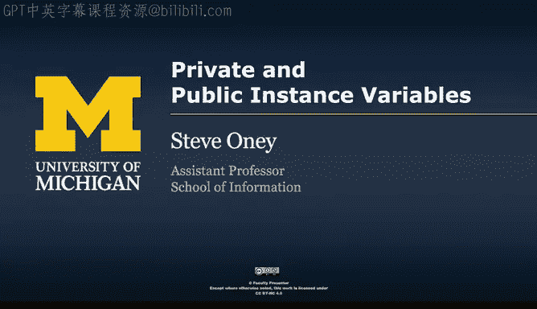
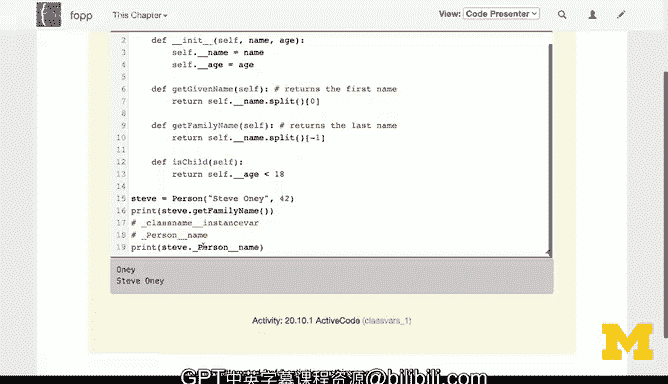

# 课程3.4.5：Python 3 编程 - P68：私有与公有实例变量 🔒




在本节课中，我们将学习Python中**私有**与**公有**实例变量的概念，理解它们的作用以及如何通过命名约定来区分它们。

---

## 概述

在面向对象编程中，类的设计者通常希望隐藏其内部实现细节，只对外提供一组明确的接口（方法）。这有助于保护数据的完整性，并使代码更易于维护和协作。本节课将探讨如何通过特定的命名约定来指示一个实例变量是“私有”的，即不建议在类的外部直接访问或修改。

---

## 公有实例变量

首先，我们来看一个定义`Person`类的代码示例。这个类有一个构造函数，它接受`name`和`age`两个参数，并设置同名的实例变量。类中还定义了三个方法：获取名、获取姓以及判断是否为儿童。

```python
class Person:
    def __init__(self, name, age):
        self.name = name
        self.age = age

    def get_given_name(self):
        return self.name.split()[0]

    def get_family_name(self):
        return self.name.split()[1]

    def is_child(self):
        return self.age < 18
```

我们可以创建一个`Person`类的实例并调用其方法。例如，`steve.get_family_name()`会返回姓氏。

这里需要注意，实例变量`name`和`age`不仅可以在类定义内部访问，也可以在类定义外部直接访问。例如，`print(steve.name)`可以获取到`steve`实例的姓名。

这看起来可能不是问题，但在实际编程中，我们经常需要与其他程序员协作。使用我们代码的人不应该关心我们代码的实现细节，比如我们具体给实例变量起了什么名字，或者我们如何存储姓名。他们应该只需要调用我们定义好的公开方法（如`get_given_name`, `get_family_name`, `is_child`）就能获得正确的结果。理想情况下，我们应该能够在不破坏使用该类的任何代码的前提下，自由地修改`Person`类的内部实现。

---

## 私有实例变量的需求

上一节我们介绍了公有实例变量可以被外部直接访问的特性，这可能导致实现细节的暴露。本节中我们来看看如何通过命名约定来创建“私有”实例变量，以保护类的内部状态。

问题在于，如果其他人使用这个`Person`类，他们可以访问或修改所有实例变量，如`name`、`age`等。这可能会带来风险，例如，如果我们决定改变内部存储姓名的方式（比如拆分为`first_name`和`last_name`两个变量），那么外部直接依赖`name`变量的代码就会失效。

为了解决这个问题，Python提供了两种命名约定来指示一个实例变量应被视为“私有”的，即不建议在类外部直接引用。

---

## 使用单下划线约定

第一种方法是在实例变量名前添加一个下划线（`_`）。例如，将`self.name`改为`self._name`。

```python
class Person:
    def __init__(self, name, age):
        self._name = name
        self._age = age

    def get_given_name(self):
        return self._name.split()[0]

    def get_family_name(self):
        return self._name.split()[1]

    def is_child(self):
        return self._age < 18
```

这样做之后，代码功能不变。单下划线主要起到一种**社会性信号**的作用，它告诉其他程序员：“你不应该依赖这个变量”。Python本身无法完全阻止外部访问，例如`steve._name`仍然可以获取到全名，但这个约定强烈建议你不要去引用或赋值它。

---

## 使用双下划线约定

第二种方法是在实例变量名前添加两个下划线（`__`），这被称为“名称修饰”。

```python
class Person:
    def __init__(self, name, age):
        self.__name = name
        self.__age = age

    def get_given_name(self):
        return self.__name.split()[0]

    def get_family_name(self):
        return self.__name.split()[1]

    def is_child(self):
        return self.__age < 18
```

双下划线同样向其他程序员发送了“绝对不应在类外引用或修改此变量”的强烈信号。此外，Python还会对以双下划线开头的实例变量名进行**名称修饰**。

在类外部，如果你尝试直接访问`steve.__name`，Python会报错，提示`Person`对象没有`__name`属性。这是因为Python在类外部将这个变量名“改写”了。改写规则大致是：`_类名__变量名`。对于`Person`类中的`__name`变量，它在外部被改写为`_Person__name`。

因此，技术上你仍然可以通过`steve._Person__name`来访问它，但这违背了设计初衷。使用双下划线有两个好处：
1.  通过名称修饰，有助于防止对实例变量的意外覆盖和引用。
2.  向其他程序员发出了更强烈的“禁止访问”信号。

---

## 总结

本节课中我们一起学习了Python中私有与公有实例变量的概念。我们了解到：

*   **公有变量**可以直接在类内外访问，但会暴露实现细节。
*   **私有变量**通过命名约定来标识：
    *   使用**单下划线**（如`_variable`）是一种社会约定，表示“请勿直接使用此变量”。
    *   使用**双下划线**（如`__variable`）会触发Python的名称修饰机制，提供了更强的访问限制信号，并能防止一些意外的命名冲突。



记住，这些约定都是为了促进良好的编程实践和团队协作，使代码更健壮、更易于维护。在设计类时，请仔细考虑哪些属性应该公开，哪些应该保持私有。