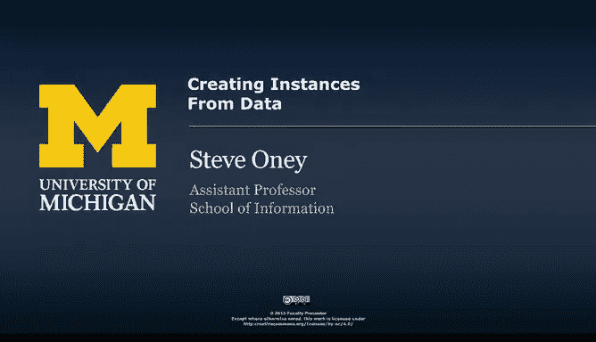
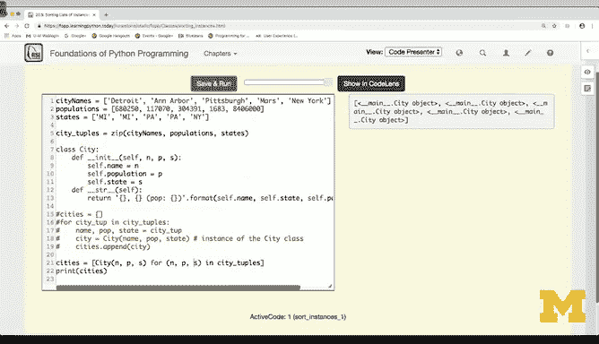

# 课程12：从数据创建实例 🏙️




在本节课中，我们将学习如何利用已有的数据来创建类的实例。我们将通过一个具体的例子，展示如何将存储在列表或元组中的数据，转换为一系列具有特定属性和方法的对象。

---

## 概述

假设我们有一些数据，我们希望使用类来表示这些数据。这些数据可能来自文件、网络，或者像本例中一样，是我们直接硬编码的。我们将从一个包含城市名称、人口和州信息的列表开始，学习如何定义一个`City`类，并最终将原始数据列表转换成一个`City`对象的列表。

## 定义数据与类

首先，我们拥有以下数据：

```python
city_names = ['Detroit', 'Ann Arbor', 'Pittsburgh', 'Mars', 'New York']
populations = [680250, 117070, 304391, 1683, 8406000]
states = ['Michigan', 'Michigan', 'PA', 'PA', 'New York']
```

我们使用`zip`函数将这些独立的列表组合成一个元组列表：

```python
city_tuples = list(zip(city_names, populations, states))
```

打印`city_tuples`，我们会得到一个列表，其中每个元素都是一个包含城市名、人口和州的元组。

现在，我们希望用类来表示这些数据。首先需要思考：每个实例应该存储什么数据？在这个案例中，我们关心城市名、人口和州。因此，每个实例都应该存储这三个属性。

接下来，我们需要定义这个类。每个实例将代表一个具体的城市。我们将其命名为`City`类。

## 创建City类

以下是`City`类的定义：

```python
class City:
    def __init__(self, n, p, s):
        self.name = n
        self.population = p
        self.state = s

    def __str__(self):
        return '{}, {} (pop: {})'.format(self.name, self.state, self.population)
```

*   **`__init__`方法**是构造函数，用于在创建新实例时初始化属性。它接收三个参数（`n`, `p`, `s`），并将它们分别赋值给实例变量`self.name`、`self.population`和`self.state`。
*   **`__str__`方法**定义了当我们将对象转换为字符串（例如使用`print`函数）时的输出格式。这里我们返回一个格式化的字符串，包含城市名、州和人口信息。

## 从数据创建实例列表

现在我们有了数据元组列表（`city_tuples`）和`City`类，目标是创建一个`City`实例的列表。

一种直观的方法是使用循环：

```python
cities = []
for city_tuple in city_tuples:
    name, population, state = city_tuple
    city = City(name, population, state)
    cities.append(city)
print(cities)
```

1.  我们创建一个空列表`cities`。
2.  遍历`city_tuples`中的每个元组。
3.  将每个元组解包为`name`、`population`和`state`三个变量。
4.  使用这些变量作为参数，创建一个新的`City`实例`city`。
5.  将新创建的`city`实例添加到`cities`列表中。
6.  循环结束后，`cities`列表就包含了所有的`City`对象。

## 更简洁的方法：列表推导式

上面的过程可以使用**列表推导式**更简洁地完成：

```python
cities = [City(n, p, s) for n, p, s in city_tuples]
print(cities)
```

这行代码实现了完全相同的功能：它遍历`city_tuples`，将每个元组解包为`n`、`p`、`s`，然后用它们创建`City`实例，并最终生成一个包含所有这些实例的列表。

还有一种更简短的写法是使用**元组解包操作符（`*`）**：

```python
cities = [City(*t) for t in city_tuples]
```

这里的`*t`会将元组`t`展开成独立的参数，相当于`City(t[0], t[1], t[2])`。虽然更简短，但为了代码的清晰性和可读性，通常更推荐在列表推导式中显式地解包元组（即`City(n, p, s)`的方式）。

---

## 总结



本节课我们一起学习了如何从现有数据创建类的实例。我们首先定义了要表示的数据结构，然后创建了对应的`City`类。接着，我们通过循环和更高效的列表推导式，将原始的元组数据列表转换成了一个由`City`对象组成的列表。这个过程是面向对象编程中非常常见的模式，即将结构化的数据封装成具有行为和属性的对象。