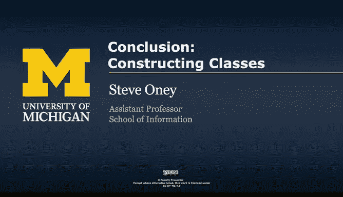

# 课程13：类的构建小结 🧩

在本节课中，我们将回顾关于Python类的基本概念，理解类如何将数据与功能封装到对象中，并探讨函数与方法之间的核心区别。


---



## 概述

本节课程是对“类的构建”主题的总结。我们将梳理类的核心思想，并明确函数与方法在定义和用途上的不同之处。

---

## 类的核心概念

上一节我们介绍了类的定义，本节中我们来看看类的核心思想。

类的根本目的是**封装**。我们可以编写代码，将相关的数据（属性）和功能（方法）捆绑到独立的**对象**中。这种技术通常被称为**面向对象编程**。

通过这种方式，我们可以为许多应用编写出结构更清晰、更易维护的代码。在后续课程中，我们将看到更多这方面的示例。

---

## 函数与方法的区别

理解了类的基本概念后，现在我们来探讨一个常见的疑问：函数和方法有何不同？

Python中的函数和方法非常相似。它们都是**可调用对象**，都可以接收参数并返回值，并且都使用 `def` 关键字进行定义。

然而，它们之间存在一个根本区别：
*   **方法** 定义在**类**的内部，并且与**该类的实例**相关联。
*   **函数** 则独立存在，不依赖于任何特定的实例或对象。

为了更直观地理解，我们可以做一个比喻：想象一个名叫**Frank的函数**和一个名叫**Mary的方法**。

尽管它们非常相似，但Frank和Mary相处得并不好。如果你问Frank原因，他会说：“方法太自私了，它们总是把 `self` 放在第一位。”

这个比喻巧妙地指出了方法定义中的一个关键语法：方法的第一个参数通常是 `self`，它代表调用该方法的对象实例本身。而函数则没有这个限制。

以下是说明这一区别的代码示例：

```python
# 这是一个独立的函数
def greet(name):
    return f"Hello, {name}!"

# 这是一个类中的方法
class Person:
    def __init__(self, name):
        self.name = name

    # 注意：方法的第一个参数是 self
    def greet(self):
        return f"Hello, I'm {self.name}!"

# 使用函数
print(greet("Alice"))  # 输出: Hello, Alice!

# 使用方法
person1 = Person("Bob")
print(person1.greet()) # 输出: Hello, I'm Bob!
```

---

## 总结

本节课中我们一起学习了：
1.  **类的目的**：通过封装数据和功能来创建对象，这是面向对象编程的基础。
2.  **函数与方法的区别**：方法是定义在类中并与实例绑定的函数，其第一个参数通常是 `self`，用于访问实例自身的属性和其他方法。


理解这些概念是有效使用Python类进行编程的关键第一步。