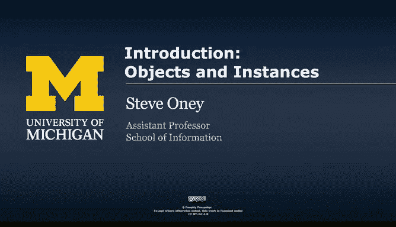

# 课程3：Python面向对象编程入门 🐍

在本节课中，我们将深入学习如何在Python程序中使用类和实例。我们将探讨如何声明实用的类，以及如何更好地设计代码以充分利用类和实例的特性。课程将介绍一些特殊方法，例如 `__str__`，它定义了当我们对实例调用 `print` 函数时应该如何显示。通过本课的学习，你将巩固对类和实例的理解，并能够运用面向对象的设计思想来解决问题。




## 回顾与引言 🔄

上一节我们学习了如何创建类和实例。本节中，我们将更深入地探讨如何将类和实例作为大型Python程序的一部分来使用。

面向对象编程起初可能难以理解，并且通常需要大量的课内外练习才能掌握。但希望在本课结束时，你能打下坚实的基础。

## 特殊方法：`__str__` 📝

我们将介绍额外的特殊方法，例如 `__str__`。这个方法指定了当我们对实例调用 `print` 函数时，应该如何打印它。

以下是 `__str__` 方法的基本用法：

```python
class MyClass:
    def __init__(self, value):
        self.value = value

    def __str__(self):
        return f"MyClass with value: {self.value}"

obj = MyClass(10)
print(obj)  # 输出: MyClass with value: 10
```

## 设计实用的类 🛠️

为了设计出实用的类，我们需要考虑类的职责和它应该提供的方法。一个好的类设计应该遵循单一职责原则，即一个类只负责一项功能。

以下是设计类时需要考虑的几个要点：

*   **明确类的目的**：确定这个类要解决什么问题。
*   **定义清晰的属性**：属性应该直接支持类的目的。
*   **设计有用的方法**：方法应该提供操作属性的逻辑。

## 面向对象设计思维 🧠

运用面向对象设计来解决问题，意味着要将问题域中的概念映射为程序中的类和对象。这有助于创建更模块化、更易维护的代码。

在思考如何设计时，可以问自己以下几个问题：

*   程序中有哪些主要的“事物”或概念？
*   这些“事物”有哪些属性（数据）？
*   这些“事物”能执行哪些操作（方法）？
*   它们之间如何交互？

## 总结 🎯


本节课中我们一起学习了如何更深入地使用类和实例。我们介绍了 `__str__` 特殊方法，探讨了如何设计实用的类，并初步了解了运用面向对象思维来解决问题的方法。虽然掌握面向对象编程需要练习，但你现在已经拥有了一个可以继续构建的坚实基础。