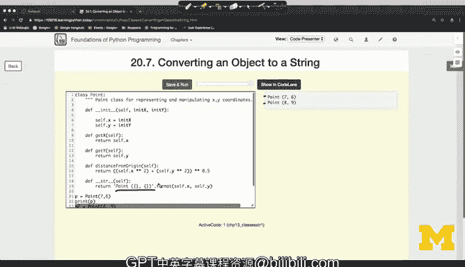

# Python 3 编程课程 72：`__str__` 方法详解 🧑‍🏫


在本节课中，我们将学习如何通过定义 `__str__` 方法，让自定义类的对象在打印时显示更有用的信息，而不是默认的 `<__main__.ClassName object at 0x...>`。


---

## 概述

当我们创建一个自定义类并打印其实例时，Python 默认只会告诉我们它是一个对象及其内存地址。这对于调试和理解对象状态帮助不大。本节课将介绍如何使用 `__str__` 方法来定制对象的字符串表示形式，使其在打印时显示我们关心的信息。

---

## 问题引入：默认打印行为的局限性

假设我们声明一个类来表示 XY 平面上的一个点。

```python
class Point:
    def __init__(self, x, y):
        self.x = x
        self.y = y

    def get_x(self):
        return self.x

    def get_y(self):
        return self.y

    def distance_from_origin(self):
        return (self.x**2 + self.y**2) ** 0.5
```

我们创建一个位于 (7, 6) 的点并打印它。

```python
p = Point(7, 6)
print(p)
```

Python 会返回类似 `<__main__.Point object at 0x...>` 的信息。它没有告诉我们这个点的实际坐标。

如果我们创建第二个点 (8, 9) 并打印 `p2`，我们也无法从打印结果中区分 `p` 和 `p2` 是两个不同的点。

---

## 解决方案：`__str__` 方法

类可以有一个可选的方法，名为 `__str__`（读作“dunder str”）。

和所有其他方法一样，它接受 `self` 作为第一个参数。

`__str__` 方法的作用是告诉 Python，当你打印该对象时，应如何表示它。

---

### 基本用法示例

如果我们在 `Point` 类中指定 `__str__` 方法返回字符串 `"Point"`。

```python
class Point:
    # ... 其他方法同上 ...
    def __str__(self):
        return "Point"
```

现在，当我们打印点实例时，会得到 `Point`。这比内存地址稍好，但仍然没有提供具体信息。

---

### 定制有用的字符串表示

对于 `Point` 类，我们可能希望显示类似 `"Point at (x, y)"` 的信息。

以下是实现方法：

```python
class Point:
    # ... 其他方法同上 ...
    def __str__(self):
        return "Point at ({}, {})".format(self.x, self.y)
```

现在，当我们打印点 `p` 时，会得到 `Point at (7, 6)`。字符串中的 `{}` 是占位符，`self.x` 和 `self.y` 的值会按顺序填入。

这样，我们就可以区分不同的点，并且在打印实例时获得对点对象有用的信息。

---

## 核心要点总结

以下是关于 `__str__` 方法的关键点：

*   `__str__` 是一个特殊方法，用于定义对象的“非正式”或可读的字符串表示。
*   当你对对象调用 `print()` 或 `str()` 时，Python 会自动调用此方法。
*   它必须返回一个字符串。
*   通过定制此方法，可以使调试和日志输出更加清晰易懂。

---

## 总结



本节课我们一起学习了如何通过实现 `__str__` 方法来改善自定义类对象的打印输出。我们从默认打印输出的局限性开始，然后介绍了 `__str__` 方法的基本语法和作用，最后通过一个 `Point` 类的例子，展示了如何返回包含对象核心状态（如坐标）的、对人类友好的字符串。为你的类定义 `__str__` 方法是一个良好的编程实践，它能显著提升代码的可读性和可维护性。