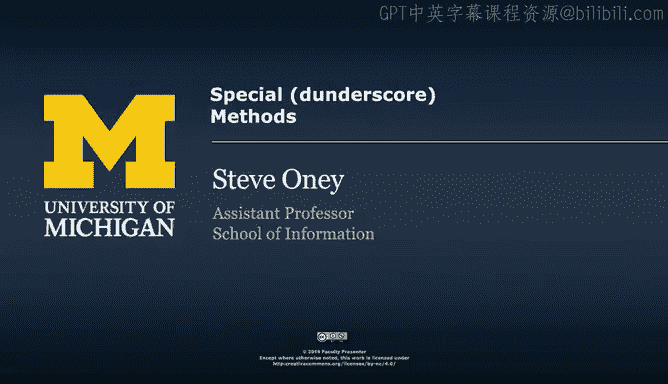
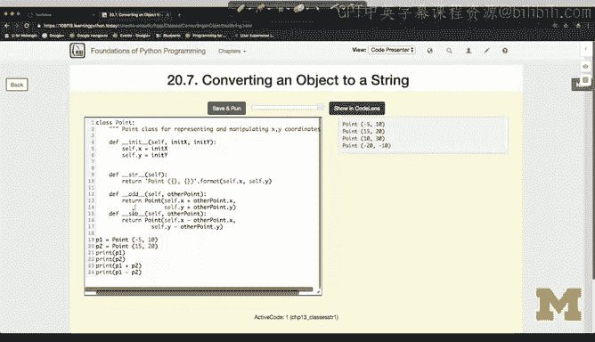

# 课程3：Python 3编程 - P73：16_02_03 特殊双下划线方法 🧮




在本节课中，我们将要学习Python中的特殊方法，也称为“双下划线方法”或“魔术方法”。这些方法允许我们自定义类的行为，例如定义两个对象如何相加或相减。

## 概述

假设我们有一个之前定义好的 `Point` 类，它包含一个构造函数 `__init__` 和一个 `__str__` 方法，用于将实例表示为字符串。

现在，假设我们有两个点：`p1` 在坐标 (-5, 10)，`p2` 在坐标 (15, 20)。

## 实现点的加法

我们希望获得将两个点相加的能力。例如，如果我们执行 `p1 + p2`，我们可能希望得到一个新的点 `p12`。

我们希望通过将它们的x坐标相加（-5 + 15 = 10）和y坐标相加（10 + 20 = 30）来实现点的加法。因此，我们的新点 `p12` 将在坐标 (10, 30)。

如果我们在代码中写下 `print(p1 + p2)`，我们会得到一个错误，提示无法对点进行加法运算。换句话说，当我们告诉Python要相加这两个点实例时，Python不知道如何实际处理这些实例并生成一个代表它们值相加的结果。

但是，我们可以重写一个名为 `__add__` 的方法，来告诉Python如何实际将两个点相加。

## 定义 `__add__` 方法

我们定义 `__add__` 方法。这个方法接收 `self` 参数，同时也接收我们期望与 `self` 相加的另一个对象，我们称之为 `other_point`。

例如，当我们执行 `print(p1 + p2)` 时，`p1` 被传入作为 `self`，`p2` 被传入作为 `other_point`。

如果我们希望将x坐标相加，然后将y坐标相加，并返回一个新的点，我们可以这样做：返回一个新的点，其x坐标等于 `self.x + other_point.x`，y坐标等于 `self.y + other_point.y`。

一旦我们定义了这个 `__add__` 方法，当我们执行 `print(p1 + p2)` 时，我们将看到得到一个新点 (10, 30)。这正好是15加-5等于10，10加20等于30的结果。

**代码示例：**
```python
class Point:
    def __init__(self, x, y):
        self.x = x
        self.y = y

    def __add__(self, other_point):
        new_x = self.x + other_point.x
        new_y = self.y + other_point.y
        return Point(new_x, new_y)
```

## 实现点的减法

除了加法，我们还可以重写其他方法。例如，减法。

如果我们希望能够执行 `print(p1 - p2)`，那么我们可以定义 `__sub__` 方法。假设我们希望将其定义为 `self.x - other_point.x` 和 `self.y - other_point.y`。

现在，我们就具备了“减去”两个点的能力。

**代码示例：**
```python
    def __sub__(self, other_point):
        new_x = self.x - other_point.x
        new_y = self.y - other_point.y
        return Point(new_x, new_y)
```

## 其他可重写的方法

还有许多其他可以重写的方法，它们都遵循与 `__add__` 和 `__sub__` 相同的模式，并且都以双下划线开头和结尾。

以下是部分常见的双下划线方法列表：
*   `__mul__`: 定义乘法行为 (`*`)。
*   `__truediv__`: 定义真除法行为 (`/`)。
*   `__eq__`: 定义相等比较行为 (`==`)。
*   `__lt__`: 定义小于比较行为 (`<`)。

## 总结



本节课中，我们一起学习了Python中的特殊双下划线方法。我们重点了解了如何通过重写 `__add__` 和 `__sub__` 方法来定义自定义类对象的加法和减法行为。掌握这些方法可以让你更灵活地控制类实例的运算逻辑，是面向对象编程中非常强大的工具。