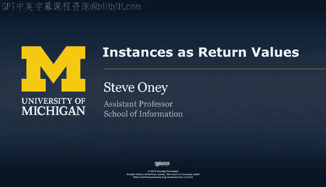
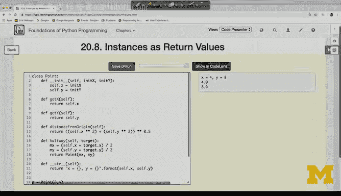

# 课程3：Python 3编程 - P74：17_02_04_实例作为返回值 📝


在本节课中，我们将要学习一个重要的概念：函数和方法不仅可以返回数字、字符串等基本数据类型，还可以返回类的实例对象。我们将通过一个具体的例子，演示如何定义一个方法，使其计算并返回一个全新的对象实例。



---

## 概述

上一节我们介绍了类的方法可以操作实例数据。本节中我们来看看，方法如何能够创建并返回一个全新的实例对象。这是一种强大的模式，允许我们基于现有对象生成新的、相关的对象。

## 定义Point类

首先，我们定义一个简单的 `Point` 类，它代表二维空间中的一个点。

```python
class Point:
    def __init__(self, x, y):
        self.x = x
        self.y = y

    def get_x(self):
        return self.x

    def get_y(self):
        return self.y

    def distance_from_origin(self):
        return (self.x**2 + self.y**2) ** 0.5
```

这个类有一个构造函数 `__init__`，用于初始化点的x和y坐标。它还包含几个方法：`get_x` 和 `get_y` 用于获取坐标值，`distance_from_origin` 用于计算该点到原点的距离。

## 新增方法：返回新实例

现在，假设我们想为 `Point` 类增加一个新功能：给定两个点，计算并返回它们之间的中点。

例如，我们有两个点：`P(3, 4)` 和 `Q(5, 12)`。我们希望有一个方法，调用 `P.halfway(Q)` 后，能返回一个新的 `Point` 实例，其坐标为 `(4, 8)`，即P和Q的中点。

以下是实现这个 `halfway` 方法的步骤：

1.  **方法定义**：它接受 `self`（调用该方法的点实例）和另一个点 `target` 作为参数。
2.  **计算中点坐标**：中点的x坐标是两个点x坐标的平均值，y坐标同理。
3.  **创建并返回新实例**：使用计算出的坐标，创建一个新的 `Point` 对象并返回。

让我们将此方法添加到 `Point` 类中：

```python
def halfway(self, target):
    # 计算中点的x和y坐标
    mid_x = (self.x + target.x) / 2
    mid_y = (self.y + target.y) / 2
    # 创建并返回一个新的Point实例
    return Point(mid_x, mid_y)
```

## 使用示例

现在，我们可以创建点并使用新的 `halfway` 方法。

```python
# 创建两个点
p = Point(3, 4)
q = Point(5, 12)

# 调用halfway方法，返回一个新的Point实例（中点）
mid = p.halfway(q)

# 打印这个新实例
print(mid)          # 通常会输出类似 <__main__.Point object at 0x...>，具体取决于__repr__定义
print(mid.get_x())  # 输出: 4.0
print(mid.get_y())  # 输出: 8.0
```

运行这段代码，`mid` 变量将持有一个全新的 `Point` 对象，其坐标为 `(4.0, 8.0)`。请注意，`mid` 是一个独立的对象，我们可以像操作 `p` 或 `q` 一样调用它的任何方法。

## 核心要点总结

本节课中我们一起学习了如何让类的方法返回新的实例对象。

*   **核心概念**：方法可以通过 `return ClassName(...)` 来构造并返回一个全新的类实例。
*   **应用场景**：这在需要基于现有对象生成衍生对象时非常有用，例如计算中点、向量相加返回新向量等。
*   **优势**：它保持了代码的面向对象特性，操作和结果都封装在对象中，使逻辑更清晰。

通过掌握“实例作为返回值”这一技巧，你可以编写出更灵活、更强大的类，让对象之间能够协作并产生新的数据实体。

---



**总结**：函数和方法可以返回任何类型的值，包括其他类的实例。我们通过在 `Point` 类中定义 `halfway` 方法，演示了如何计算两个点的中点，并**返回一个全新的 `Point` 实例**。这扩展了类方法的能力，使其不仅能修改自身状态，还能充当“工厂”生成新的相关对象。