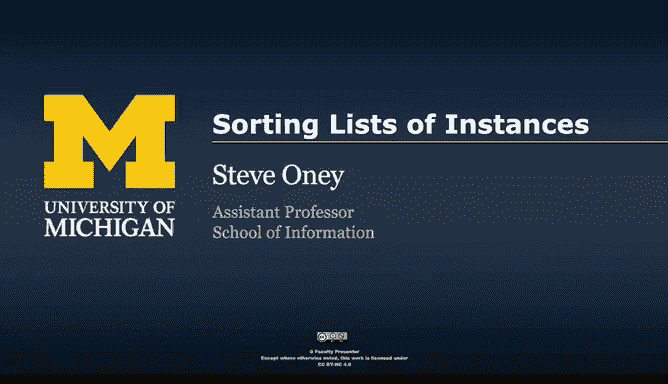
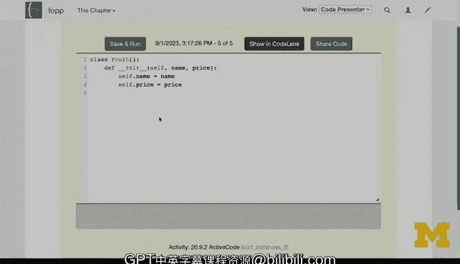
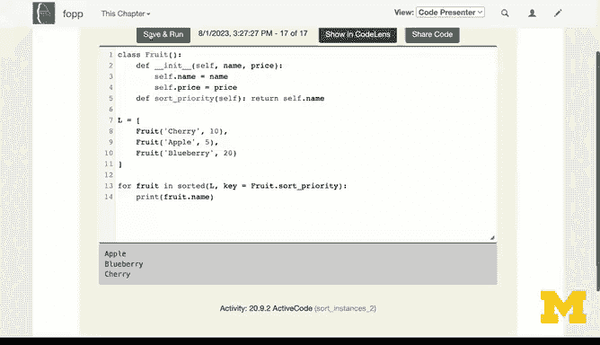

# 课程3：Python 3编程 - P75：实例列表排序 📊






在本节课中，我们将要学习如何对自定义类的实例对象列表进行排序。排序是编程中的常见需求，但Python默认不知道如何比较我们自定义的类对象。我们将探讨两种解决此问题的方法。

## 概述

当我们尝试使用`sorted()`函数对一个包含自定义类实例的列表进行排序时，Python会报错，因为它不知道如何比较这些实例的“大小”。本节课将介绍两种方法来解决这个问题：使用`key`参数指定排序依据，或者通过定义特殊的`__lt__`方法来定义实例间的比较规则。

## 问题引入：为何无法直接排序？

假设我们有一个表示水果的`Fruit`类，每个水果实例都有名称（`name`）和价格（`price`）属性。

```python
class Fruit:
    def __init__(self, name, price):
        self.name = name
        self.price = price
```

如果我们创建几个实例并放入一个列表中：

```python
L = [Fruit('Cherry', 10), Fruit('Apple', 5), Fruit('Blueberry', 15)]
```

直接调用`sorted(L)`会导致错误：
`TypeError: ‘<’ not supported between instances of ‘Fruit’ and ‘Fruit’`

这个错误信息表明，Python不知道如何判断一个`Fruit`实例应该排在另一个`Fruit`实例之前还是之后。它缺少比较的准则。

## 方法一：使用 `key` 参数排序

第一种方法是使用`sorted()`函数的`key`参数。这个参数允许我们指定一个函数，该函数为列表中的每个元素返回一个用于比较的值。

以下是实现此方法的几种方式。

### 方式A：在类中定义排序优先级方法

我们可以在`Fruit`类中定义一个方法（例如`sort_priority`），该方法返回我们想要排序的属性值。

```python
class Fruit:
    def __init__(self, name, price):
        self.name = name
        self.price = price

    def sort_priority(self):
        return self.price  # 按价格排序
```

然后，在排序时将这个方法作为`key`参数传入。注意，我们需要传递方法本身，而不是调用它，因此使用`Fruit.sort_priority`。

```python
sorted_fruits = sorted(L, key=Fruit.sort_priority)
for fruit in sorted_fruits:
    print(fruit.name)
# 输出：Apple, Cherry, Blueberry
```

### 方式B：使用Lambda函数调用类方法

我们也可以使用Lambda函数来达到同样的目的。Lambda函数接收一个实例`f`，然后调用它的`sort_priority`方法。

```python
sorted_fruits = sorted(L, key=lambda f: f.sort_priority())
```

### 方式C：使用Lambda函数直接访问属性

如果我们不想在类中定义额外的方法，可以直接在Lambda函数中指定要排序的属性。

```python
# 按价格排序
sorted_by_price = sorted(L, key=lambda f: f.price)
# 按名称排序
sorted_by_name = sorted(L, key=lambda f: f.name)
```

以上所有技术都是通过向`sorted()`函数传递`key`参数来指定排序依据。这与我们之前对字典、列表或其他对象进行排序时使用的原理相同。

## 方法二：重写 `__lt__` 方法

上一节我们介绍了使用`key`参数的灵活方法。本节中我们来看看另一种更根本的解决方案：通过定义特殊的`__lt__`方法来告诉Python如何比较两个实例。

`__lt__`是“less than”（小于）的缩写。当我们定义这个方法时，就是在告诉Python：当需要比较两个实例谁“更小”时，请调用这个函数。

```python
class Fruit:
    def __init__(self, name, price):
        self.name = name
        self.price = price

    def __lt__(self, other):
        # 定义“小于”的比较规则：按价格比较
        return self.price < other.price
```

现在，当我们再次调用`sorted(L)`时，Python会使用我们定义的`__lt__`方法来比较实例，排序将正常工作。

```python
sorted_fruits = sorted(L)  # 现在可以成功排序
for fruit in sorted_fruits:
    print(fruit.name)
# 输出：Apple, Cherry, Blueberry
```

我们可以轻松地修改`__lt__`方法中的比较逻辑。例如，改为按名称的字母顺序排序：

```python
    def __lt__(self, other):
        # 按名称的字母顺序比较
        return self.name < other.name
```

字符串在Python中可以直接用`<`比较，其规则是字母顺序（即字典序）。因此，修改后排序结果将是：Apple, Blueberry, Cherry。

### `__lt__`方法的额外好处

重写`__lt__`方法的另一个好处是，它允许我们直接使用`<`运算符来比较两个实例。

```python
apple = Fruit('Apple', 5)
cherry = Fruit('Cherry', 10)

print(apple < cherry)  # 输出：True
# Python会自动将其转换为：apple.__lt__(cherry)
```

## 总结

本节课中我们一起学习了如何对自定义类的实例列表进行排序。我们探讨了两种核心方法：

1.  **使用 `key` 参数**：通过向`sorted()`函数传递一个`key`函数，指定用于比较每个实例的**值**。这可以通过类方法、Lambda函数等方式实现，非常灵活。
2.  **重写 `__lt__` 方法**：在类中定义特殊的`__lt__(self, other)`方法，明确告诉Python如何判断一个实例是否“小于”另一个实例。这种方法定义了类的**固有比较行为**，不仅使`sorted()`可用，还支持直接的`<`比较运算符。



选择哪种方法取决于你的需求。如果排序标准可能变化，使用`key`参数更灵活。如果你希望为类定义一种默认的、固定的排序逻辑，那么重写`__lt__`方法是更合适的选择。