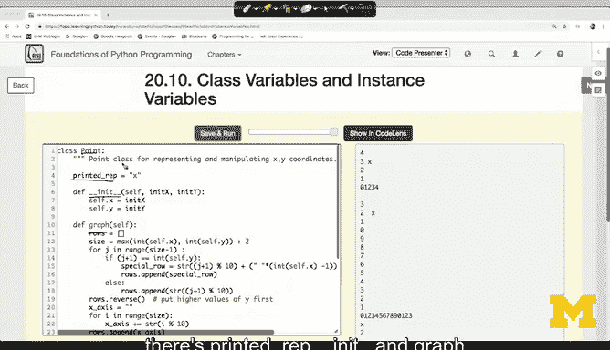

# 课程19：Python 3编程 - 类变量与实例变量 🧩


在本节课中，我们将要学习Python中类变量与实例变量的核心概念。我们将了解它们是什么、它们之间有何区别，以及Python解释器如何查找这些变量。

---

## 概述

在面向对象编程中，类是创建对象的蓝图。每个由类创建的对象（称为实例）都可以拥有自己独特的属性，这些属性被称为**实例变量**。同时，类本身也可以拥有属于自己的属性，这些属性被称为**类变量**。理解这两者的区别对于编写清晰、高效的代码至关重要。

上一节我们介绍了类和对象的基本概念，本节中我们来看看类变量和实例变量的具体工作机制。

## 实例变量

实例变量是属于每个特定对象实例的变量。每个实例的变量值可以互不相同。

例如，我们有一个 `Point` 类，用于表示二维空间中的一个点。在构造函数 `__init__` 中，我们为每个点实例定义了 `x` 和 `y` 坐标。

```python
class Point:
    def __init__(self, x, y):
        self.x = x  # 实例变量
        self.y = y  # 实例变量
```

当我们创建实例时：

```python
p1 = Point(2, 3)   # p1.x = 2, p1.y = 3
p2 = Point(3, 12)  # p2.x = 3, p2.y = 12
```

`p1` 和 `p2` 是两个独立的实例，它们各自拥有自己的 `x` 和 `y` 变量。`p1.x` 的值是 2，而 `p2.x` 的值是 3。

## 类变量

与实例变量不同，类变量是属于类本身的变量。所有该类的实例共享同一个类变量。

我们可以在类定义内部直接声明类变量。

```python
class Point:
    printed_rep = '*'  # 这是一个类变量

    def __init__(self, x, y):
        self.x = x
        self.y = y
```

在这个例子中，`printed_rep` 是一个类变量，它的初始值是字符串 `'*'`。类的方法（如 `__init__` 和 `graph`）在某种意义上也是类变量，因为它们属于类。

## Python的变量查找顺序

当使用 `instance_name.attribute_name` 的语法访问一个属性时（例如 `p1.x` 或 `p1.graph`），Python解释器会遵循一个特定的搜索顺序来查找这个属性。

以下是查找顺序的规则：

1.  **首先在实例中查找**：Python首先检查该实例是否拥有一个同名的实例变量。
2.  **然后在类中查找**：如果在实例中找不到，Python会转而到创建该实例的类中去查找同名的类变量或方法。

让我们通过几个例子来理解这个过程：

*   **`print(p1.x)`**：Python首先在实例 `p1` 中查找 `x`，找到了实例变量 `x=2`，于是返回 2。
*   **`print(p1.printed_rep)`**：Python首先在实例 `p1` 中查找 `printed_rep`，没有找到。然后它去 `Point` 类中查找，找到了类变量 `printed_rep = '*'`，于是返回 `'*'`。
*   **`p2.graph()`**：Python首先在实例 `p2` 中查找 `graph`，没有找到。然后它去 `Point` 类中查找，找到了 `graph` 方法，于是调用它。
*   **`print(p1.z)`**：Python首先在实例 `p1` 中查找 `z`，没有找到。然后它去 `Point` 类中查找，也没有找到。最终，Python会抛出一个 `AttributeError` 运行时错误。

## 实践示例：图形化表示点

我们的 `Point` 类有一个 `graph` 方法，它能生成一个简单的文本图形，在坐标系中显示点的位置。

```python
class Point:
    printed_rep = "*"

    def __init__(self, x, y):
        self.x = x
        self.y = y

    def graph(self):
        rows = []
        # 这里假设生成一个文本网格，'*'代表点的位置
        # 为简化说明，省略具体网格生成代码
        # 关键是在方法内部，我们通过 self.printed_rep 访问类变量
        mark = self.printed_rep
        # ... 使用 mark 在网格中标记位置 ...
        return "\n".join(rows)
```

当我们调用 `p1.graph()` 和 `p2.graph()` 时，它们都会使用类变量 `printed_rep` 的值（初始为 `'*'`）来绘制点。

**类变量的共享特性**：如果我们改变类变量 `printed_rep` 的值，所有实例在调用方法时都会使用这个新值。

```python
Point.printed_rep = "X"  # 将类变量改为 ‘X‘

p1.graph()  # 现在点会用 ‘X‘ 表示
p2.graph()  # 这个点也会用 ‘X‘ 表示
```

这是因为 `self.printed_rep` 的查找路径最终都指向了 `Point` 类中的那个 `printed_rep` 变量。

---

## 总结

本节课中我们一起学习了Python中类变量与实例变量的核心区别。

*   **实例变量** 属于每个对象实例，通过 `self.variable_name` 在方法内定义，每个实例拥有独立的值。
*   **类变量** 属于类本身，在类内部直接定义，所有实例共享同一个值。
*   **查找顺序** 是理解其工作的关键：Python先查找实例属性，未找到时再查找类属性。



掌握这些概念能帮助你更好地设计类结构，并理解对象间如何共享或隔离数据。下一节课我们将探讨更多关于类方法和继承的内容。