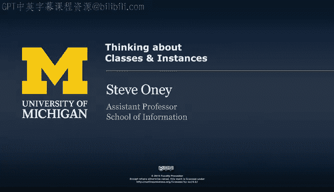

# 课程3、4、5｜P77：类与实例的设计思考 🧠

在本节课中，我们将学习如何设计Python中的类。在开始编写任何类代码之前，我们需要思考一系列关键问题，以确保我们的设计清晰、合理。

---

上一节我们介绍了类的基本概念，本节中我们来看看设计一个类之前需要思考的具体步骤。

在开始为类编写任何代码之前，你应该问自己几个问题。

首先，你实际上想用你的类表示什么类型的数据？它可能是一个歌曲列表、一个学生列表、一个汽车列表等等。

一旦明确了这一点，接下来你应该问自己：这个类的一个特定实例代表什么？

例如，如果它是一个歌曲列表，一个特定实例可能代表一首歌。一个学生列表的特定实例可能代表一个特定的学生。

---

从这一点出发，你应该思考什么是实例变量。

以下是需要考虑的方面：
*   **独特性**：每个实例可能有什么独特之处？例如，对于一个学生，可能是姓名、学号。
*   **数据属性**：对于一首歌，可能是艺术家、曲目名称、长度等。

---

在明确了实例变量之后，你还应该思考可能需要哪些方法。

以下是方法设计的考虑方向：
*   **功能关联**：如果每个实例是一首特定的歌，你可能需要一个方法来调用外部API获取该歌曲的歌词。
*   **行为定义**：如果是一个学生，你可能需要一个方法来向该学生发送消息。
*   **依赖关系**：这再次取决于你的实例代表什么。

---

最后，你应该问自己：一个实例的打印表示形式看起来应该是什么样？

例如，如果我打印出一首特定的歌，我可能希望打印出曲目名称、专辑名称，也许还有长度。

在开始为类编写代码之前，你应该对所有这些问题的答案做到心中有数。

---

现在，需要指出的是，设计类更像是一门艺术，而非一门精确的科学。

即使是专家，也经常需要重构或重写类中的实例变量和方法。所有这些技能都更多地来自于实践。

---

本节课中我们一起学习了设计Python类之前需要思考的关键问题，包括确定数据表示、实例含义、实例变量、方法以及打印格式。记住，类的设计是一个迭代的过程，需要通过实践来不断完善。

直到下次课程。