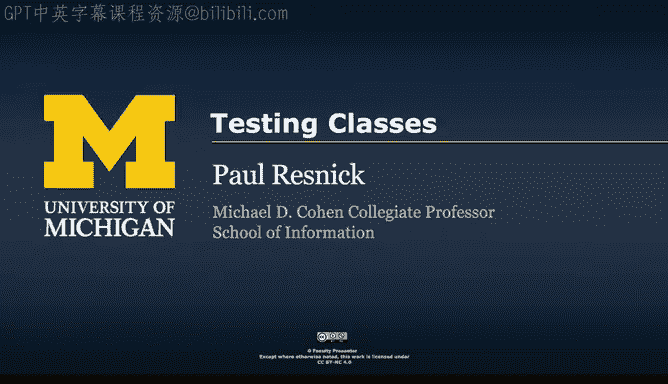
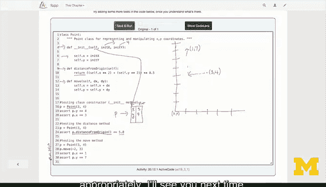

# 课程3：Python类测试教程 🧪




在本节课中，我们将学习如何测试一个Python类定义。我们将通过创建一个表示二维平面上点的类，并逐一测试其构造函数和各个方法，来掌握测试类的基本流程和技巧。

---

## 测试类的基本思路

测试一个类定义通常涉及三个步骤：创建类的实例、调用实例上的方法，然后检查结果是否符合预期。

我们将使用一个简单的`Point`类作为示例。这个类用于表示XY平面上的点，每个点实例都有`x`和`y`两个属性，分别代表其横纵坐标。

为了直观理解，我们可以想象一个坐标网格。例如，点(3,4)表示横坐标为3，纵坐标为4的位置。

---

## 测试构造函数（__init__）

构造函数是任何类的核心。测试构造函数的目的，是验证在创建类的实例时，其属性是否被正确初始化。

以下是测试构造函数的具体步骤：

1.  首先，我们通过调用类（如 `Point(3, 4)`）来创建一个新的点实例。这个过程会：
    *   创建一个空白的`Point`实例。
    *   将这个实例（即`self`）以及传入的参数（3和4）传递给`__init__`方法。
    *   在`__init__`方法内部，将`self.x`设置为3，`self.y`设置为4。
2.  创建实例后，我们需要检查其属性值是否正确。

**代码示例：**
```python
# 创建点实例
p = Point(3, 4)

# 测试属性是否设置正确
assert p.x == 3
assert p.y == 4
```
在这个测试中，第18行代码创建了点实例，第19和20行则检查其属性值。这与测试有副作用的函数类似，但创建实例和调用初始化方法是合并在一步完成的。

如果你对类的机制还不太熟悉，建议使用代码可视化工具（如Python Tutor）逐步运行上述代码，这有助于加深理解。

---

## 测试返回值方法（distance_from_origin）

接下来，我们测试`distance_from_origin`方法。这个方法计算点到原点(0,0)的距离，并返回一个数值。对于返回值的测试，我们采用返回值测试策略。

测试步骤如下：

1.  首先创建一个点实例（尽管可以复用之前创建的`p`，但为了测试的独立性，最好新建一个）。
2.  调用`distance_from_origin`方法。
3.  断言其返回值是否符合预期（例如，点(3,4)到原点的距离应为5）。

**代码示例：**
```python
# 创建点实例
p = Point(3, 4)

# 测试到原点的距离
assert p.distance_from_origin() == 5
```
一个完整的测试套件应该包含多个测试用例，例如测试点(2,0)到原点的距离是否为2。但以上代码展示了测试返回值方法的核心思想。

---

## 测试有副作用的方法（move）

最后，我们测试`move`方法。这个方法的作用是移动点的位置，它会修改实例自身的`x`和`y`属性，属于有副作用的方法。因此，我们需要进行副作用测试。

副作用测试通常包含三个步骤：

1.  **准备**：创建一个初始状态的点实例。
2.  **执行**：调用`move`方法。
3.  **验证**：检查执行后点的属性是否被正确修改。

**代码示例：**
```python
# 1. 准备：创建初始点
p = Point(3, 4)

# 2. 执行：移动点（向左2个单位，向上3个单位）
p.move(-2, 3)

# 3. 验证：检查点的新位置
assert p.x == 1
assert p.y == 7
```
在这个例子中，点从(3,4)移动到(1,7)。第27行创建初始点，第28行执行移动操作，第29和30行验证结果。

---

## 总结

本节课我们一起学习了如何测试一个Python类。核心要点如下：

*   **测试构造函数**：通过创建实例并检查其属性是否正确初始化来进行测试。
*   **测试类方法**：需要根据方法的目的选择测试策略。
    *   对于**返回值方法**，创建实例后调用方法，并断言其返回值。
    *   对于**有副作用的方法**，遵循“准备-执行-验证”三步法，检查实例状态的变化。
*   **通用流程**：无论是哪种方法，测试通常都始于创建一个类的实例。



掌握这些测试模式，能帮助你确保自定义的类在各种情况下都能按预期工作。