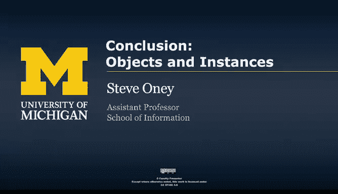

# 课程22：对象与实例小结 🧩


在本节课中，我们将总结关于类实例的核心概念，并理解Python中“万物皆对象”的思想。



---

## 概述

本节课我们深入学习了如何操作类实例。一个关键的认识是：Python中几乎所有事物都是具有属性和方法的对象。因此，在整个专项课程中，我们其实一直在与各种实例打交道。

无论是海龟实例、字符串还是列表，本质上都是对象。唯一的变化是，现在我们开始操作自己定义的类的实例，而非内置类的实例。但我们对它们可以执行相同的操作，例如排序、相加等。

---

## 面向对象编程的优势

上一节我们介绍了实例的普遍性，本节中我们来看看面向对象编程语言（如Python）的一个巨大优势。

这种优势在于，我们可以通过定义类，以符合直觉的方式来操作实例。例如，定义一个`Point`类，并定义`__add__`方法，这样我们就可以直接用加号`+`来将两个点相加。

```python
class Point:
    def __init__(self, x, y):
        self.x = x
        self.y = y
    def __add__(self, other):
        return Point(self.x + other.x, self.y + other.y)
```

---

## 一个关于“类”的玩笑

以下是课程中提到的一个轻松的小插曲，它巧妙地关联了编程概念与社会用语。

我的一个Python程序员朋友开玩笑说，他甚至拒绝与使用非面向对象语言（如C语言）的人交往。我个人觉得这有点苛刻。当我问他为什么不愿与C程序员交往时，他开玩笑说：“因为他们没有‘类’（class）。” 这个笑话利用了“class”在编程中指“类”，在日常用语中指“品位/风度”的双关含义。

---

## 总结


本节课中我们一起学习了：
1.  Python中“万物皆对象”的核心思想。
2.  操作自定义类实例与操作内置类型实例的本质相同。
3.  面向对象编程允许我们通过定义特殊方法（如`__add__`）来使操作更直观。
4.  通过一个幽默的双关语回顾了“类”这个概念。


我们下次再见。