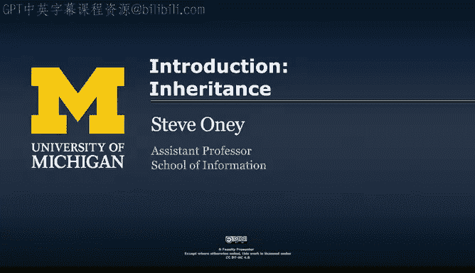

# 课程3：Python面向对象编程 - P80：23_03_01_引言：继承 🧬




在本节课中，我们将要学习一个名为“继承”的核心概念。继承能够通过使代码更具可重用性、可读性和简洁性，来帮助我们更好地构建类。

## 概述

上一节我们介绍了类的基本概念，本节中我们来看看如何通过继承来优化类的设计。继承的基本思想是，当我们有多个相似的类时，可以定义一个称为“父类”或“超类”的类。然后，我们可以让其他类从这个父类继承。这意味着，我们类的每个实例都将拥有父类所拥有的一切，并且还可以拥有更多。

## 继承的基本概念

为了更好地理解继承，让我们来看一个例子。假设我们正在编写一个代表游戏中动物的代码。我们有一个类代表游戏中的狗，另一个类代表猫。

显然，狗和猫是不同的，它们会做不同的事情。例如，你的`Dog`类可能包含吠叫和取物的方法，而`Cat`类可能包含发出呼噜声和追逐激光笔的方法。

尽管存在差异，但这两个类及其功能之间有很多相似和重叠之处。例如，狗和猫都可能具有存储其姓名和年龄的属性，并且它们可能拥有共同的进食和睡觉方法。

通常，我们必须分别为狗和猫定义这些方法，因此我们可能会在两个类的定义中复制声明年龄和姓名实例变量的代码。但继承允许我们创建一个超类，让狗和猫都可以从中继承。

## 如何应用继承

我们可以声明一个父类来代表动物，并规定每个动物都具有年龄、姓名等属性，以及进食、睡觉等方法。然后在Python中，我们可以声明狗和猫都是动物。

这告诉Python，狗和猫应该拥有动物所具有的每一个属性和方法，例如`age`、`name`以及`eat`和`sleep`等方法。这样，我们就不必在狗和猫的类中复制这些通用功能的代码，而可以专注于在`Dog`和`Cat`类中定义使它们真正独特的方面。

以下是使用继承的代码结构示例：

```python
# 定义父类 Animal
class Animal:
    def __init__(self, name, age):
        self.name = name
        self.age = age

    def eat(self):
        print(f"{self.name} is eating.")

    def sleep(self):
        print(f"{self.name} is sleeping.")

# 定义子类 Dog，继承自 Animal
class Dog(Animal):
    def bark(self):
        print(f"{self.name} says: Woof!")

# 定义子类 Cat，继承自 Animal
class Cat(Animal):
    def purr(self):
        print(f"{self.name} says: Purr...")
```

## 继承的优势与考量

有时，如何最有效地使用继承更像一门艺术而非严格的科学。但无论如何，它是一个强大的工具，有助于使我们的代码更易读、更简洁。

以下是使用继承的主要优势列表：
*   **代码复用**：避免在多个类中重复相同的代码。
*   **可维护性**：通用逻辑只需在父类中修改一次。
*   **结构清晰**：通过层次关系清晰地表达类之间的“是一个”关系（例如，狗是一种动物）。

## 总结

本节课中我们一起学习了面向对象编程中的“继承”概念。我们了解到，继承允许我们创建具有层次结构的类，其中子类可以自动获得父类的属性和方法。这极大地提高了代码的复用性和组织性。在接下来的课程中，我们将深入探讨如何具体实现和使用继承。