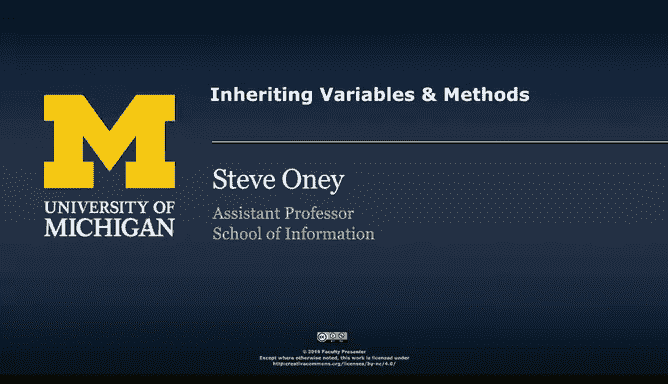
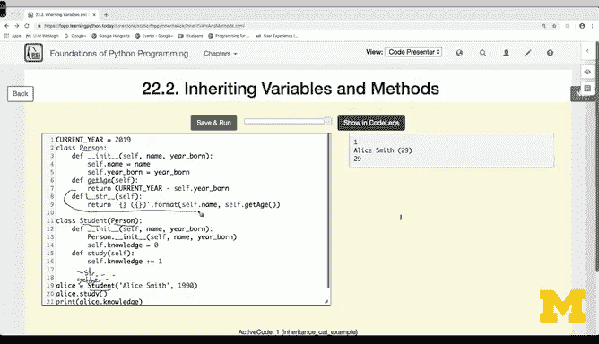

# 课程3：Python面向对象编程 - 第24讲：继承变量与方法 🧬




在本节课中，我们将要学习面向对象编程中的一个核心概念——**继承**。我们将通过创建一个`Person`（人）类和一个`Student`（学生）类来演示如何让一个类继承另一个类的属性和方法，从而避免代码重复，并建立类之间的层次关系。

---

## 概述：什么是继承？

上一节我们介绍了类和对象的基本概念。本节中我们来看看**继承**。继承允许我们创建一个新类（子类），它自动获得另一个现有类（父类）的所有变量和方法，然后可以添加或修改其特有的功能。这体现了“是一个（is-a）”的关系，例如，学生是一个人。

---

## 第一步：创建父类 `Person`

首先，我们定义一个`Person`类，用来表示一个具有姓名和出生年份的人。

```python
class Person:
    def __init__(self, name, year_born):
        self.name = name
        self.year_born = year_born

    def get_age(self, current_year=2019):
        return current_year - self.year_born

    def __str__(self):
        return f"{self.name} ({self.get_age()})"
```

以下是代码的详细解释：
*   `__init__` 是构造函数，用于初始化每个`Person`对象的`name`和`year_born`属性。
*   `get_age` 方法根据出生年份计算年龄。我们暂时将当前年份固定为2019。
*   `__str__` 方法定义了当打印对象时显示的字符串格式。

现在，我们可以创建一个`Person`对象并测试它：

```python
alice = Person("Alice Smith", 1990)
print(alice)  # 输出：Alice Smith (29)
```

---

## 第二步：不使用继承创建 `Student` 类

假设我们现在需要一个`Student`类。学生除了拥有人的所有属性（姓名、年龄）外，还应该有一个`knowledge`（知识）属性，并且能够`study`（学习）。

一种直接的方法是复制`Person`类的代码并添加新功能：

```python
class Student:
    def __init__(self, name, year_born):
        self.name = name
        self.year_born = year_born
        self.knowledge = 0  # 新增的属性

    def get_age(self, current_year=2019):
        return current_year - self.year_born

    def __str__(self):
        return f"{self.name} ({self.get_age()})"

    def study(self):  # 新增的方法
        self.knowledge += 1
```

这种方法虽然可行，但存在大量重复代码（如`__init__`、`get_age`、`__str__`）。如果未来需要修改`Person`的逻辑，我们必须在`Student`类中做同样的修改，这很容易出错且效率低下。

---

## 第三步：使用继承重构 `Student` 类

现在，我们使用继承来更优雅地创建`Student`类。继承的语法是在定义类时，在类名后的括号中指定父类。

```python
class Student(Person):  # Student 继承自 Person
    def __init__(self, name, year_born):
        Person.__init__(self, name, year_born)  # 调用父类的构造函数
        self.knowledge = 0

    def study(self):
        self.knowledge += 1
```

以下是关键改进点：
1.  **声明继承**：`class Student(Person)` 表示`Student`类继承自`Person`类。这意味着`Student`自动拥有了`Person`的所有方法（`get_age`和`__str__`）。
2.  **调用父类构造函数**：在子类的`__init__`方法中，我们使用`Person.__init__(self, name, year_born)`来调用父类的构造函数。这确保了`name`和`year_born`属性被正确初始化，避免了代码重复。
3.  **添加特有功能**：我们只需在子类中定义新增的属性（`knowledge`）和方法（`study`）。

让我们测试新的`Student`类：

```python
alice = Student("Alice Smith", 1990)
print(alice)           # 输出：Alice Smith (29) -> 使用了继承的 __str__ 方法
print(alice.get_age()) # 输出：29 -> 使用了继承的 get_age 方法
print(alice.knowledge) # 输出：0 -> 子类特有的属性
alice.study()          # 调用子类特有的方法
print(alice.knowledge) # 输出：1
```

可以看到，`Student`对象`alice`既能使用从`Person`继承来的方法，也能使用自己特有的属性和方法。

---

## 总结

本节课中我们一起学习了面向对象编程的核心概念——**继承**。

我们首先创建了一个`Person`类作为父类。然后，我们演示了如果不使用继承，创建`Student`类会导致代码重复。最后，我们使用继承语法`class Student(Person)`重构了`Student`类，使其自动获得了`Person`的所有功能，同时只需专注于添加自己特有的`knowledge`属性和`study`方法。

继承的主要优点是：
*   **代码复用**：避免重复编写相同的代码。
*   **逻辑清晰**：建立了类之间的层次关系（学生是人）。
*   **易于维护**：修改父类的逻辑会自动应用于所有子类。



通过掌握继承，你可以构建出更加结构化、可扩展和易于维护的Python程序。