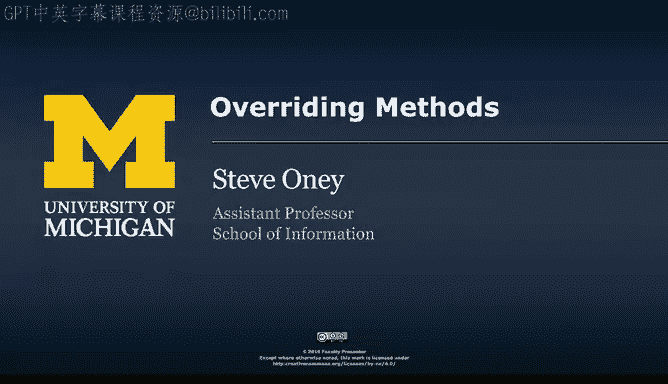
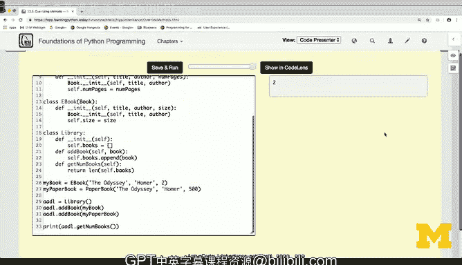

# 课程25：方法重写与继承设计原则 📚




在本节课中，我们将要学习Python中继承的核心概念，并探讨何时应该使用继承，何时应该使用组合。我们将通过图书馆管理系统的例子，清晰地展示如何设计类之间的关系。

---

## 概述：继承与组合

上一节我们介绍了继承的基本概念。本节中我们来看看如何在实际编程中应用继承，以及何时选择继承，何时选择另一种称为“组合”的关系。

在Python中，继承的查找机制遵循一个清晰的链条。当一个实例需要调用一个方法或访问一个属性时，Python会按以下顺序查找：
1.  首先在**实例自身**中查找。
2.  如果未找到，则在**实例所属的类**中查找。
3.  如果仍未找到，则在**该类的父类（超类）**中查找。

这种机制意味着子类“拥有”父类的一切，并可以添加或修改自己的内容。

---

## 何时使用继承？📖

只有当子类**应该拥有父类的所有属性与方法，并且需要添加更多功能或进行少量修改**时，才应该使用继承。

让我们通过一个例子来理解。假设我们要为图书馆的书籍建模，有两种书：纸质书和电子书。

首先，我们创建一个所有书籍的通用超类 `Book`：

```python
class Book:
    def __init__(self, title, author):
        self.title = title
        self.author = author

    def __str__(self):
        return f'"{self.title}" by {self.author}'
```

现在，我们可以创建 `Book` 的实例：

```python
my_book = Book("The Odyssey", "Homer")
print(my_book)  # 输出: "The Odyssey" by Homer
```

接下来，我们创建两种具体的书籍类型。纸质书拥有书籍的一切（书名、作者），并额外拥有页数。

```python
class PaperBook(Book):
    def __init__(self, title, author, num_pages):
        Book.__init__(self, title, author)
        self.num_pages = num_pages
```

电子书也拥有书籍的一切，但额外拥有文件大小。

```python
class Ebook(Book):
    def __init__(self, title, author, size):
        Book.__init__(self, title, author)
        self.size = size  # 文件大小，单位MB
```

现在我们可以创建子类的实例并使用它们：

```python
my_ebook = Ebook("The Odyssey", "Homer", 2)
print(my_ebook)       # 输出: "The Odyssey" by Homer
print(my_ebook.size)  # 输出: 2

my_paperbook = PaperBook("The Odyssey", "Homer", 500)
print(my_paperbook.num_pages)  # 输出: 500
```

在这个例子中，`PaperBook` 和 `Ebook` 是 `Book` 的合格子类，因为它们拥有父类的全部属性（`title`, `author`），并各自添加了新的属性（`num_pages`, `size`）。

---

## 何时不使用继承？使用组合！🏛️

上一节我们看到了继承的适用场景。本节中我们来看看另一种关系：组合。当两个类之间的关系是“包含”而非“是一种”时，应该使用组合。

假设我们不想让书籍孤立存在，而是想创建一个`Library`类来管理书籍集合。一个图书馆包含书籍，但它本身并不是一种书，书也不是一种图书馆。

因此，我们不使用继承，而是在`Library`类内部使用一个列表来“包含”`Book`对象。这种“有一个”的关系就是组合。

以下是`Library`类的实现：

```python
class Library:
    def __init__(self):
        self.books = []  # 使用列表来组合（包含）Book对象

    def add_book(self, book):
        self.books.append(book)

    def get_num_books(self):
        return len(self.books)
```

现在，让我们看看组合如何工作：

```python
# 创建图书馆
aal = Library()
# 添加书籍（可以是Book、PaperBook或Ebook的实例）
aal.add_book(my_ebook)
aal.add_book(my_paperbook)

print(aal.get_num_books())  # 输出: 2
```

`Library`类通过其`books`实例变量“拥有”一个书籍列表。它没有从`Book`继承任何东西，因为图书馆不是书。它只是包含书。这种设计更加清晰和符合逻辑。

---

## 总结

本节课中我们一起学习了面向对象编程中两个关键的设计概念：
1.  **继承**：当子类与父类是“是一种”的关系，并且需要**完全拥有父类的所有功能并加以扩展**时使用。公式可以表示为：`子类 is a 父类`。
2.  **组合**：当一个类与另一个类是“有一个”或“包含”的关系时使用。在这种关系中，一个类将另一个类的实例作为自己的属性。公式可以表示为：`类A has a 类B`。



记住，选择继承还是组合，取决于类之间的实际关系，正确选择能使代码更健壮、更易于理解和维护。