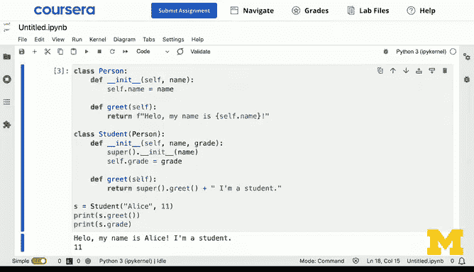

# 课程26：Python 3编程 - 第03章 第04节：调用父类方法 🧬


在本节课中，我们将学习如何在Python的子类中调用父类（超类）的方法。这是面向对象编程中实现代码复用和扩展功能的重要技巧。


---

## 概述

在Python中，当我们创建一个子类时，它通常会继承父类的属性和方法。有时，我们希望在子类的方法中，先执行父类方法中的逻辑，然后再添加子类特有的行为。本节课将介绍如何实现这一目标。

上一节我们介绍了类的继承，本节中我们来看看如何具体地在子类中调用父类的方法。

---

## 使用父类名直接调用

一种直接的方法是使用父类的类名来调用其方法。

请看以下代码示例。我们有一个名为 `Person` 的父类，它代表一个人。每个人都有一个名字，并且 `Person` 类中定义了一个 `greet` 方法。

```python
class Person:
    def __init__(self, name):
        self.name = name

    def greet(self):
        print(f"Hello, my name is {self.name}")
```

然后，我们有一个 `Person` 的子类，名为 `Student`。每个学生都是一个人，因此 `Student` 类会继承 `Person` 类的 `name` 属性。

假设 `Student` 类也有自己的 `greet` 方法，并且我们希望在这个方法中引用 `Person` 类的 `greet` 方法。

```python
class Student(Person):
    def greet(self):
        Person.greet(self)  # 调用父类的greet方法
        print("I'm a student.")
```

如果我们运行这段代码，在 `Student` 的 `greet` 方法中，会首先调用 `Person` 的 `greet` 方法，打印出“Hello, my name is Alice”，然后添加额外的“I‘m a student.”。

---

## 使用 `super()` 函数

然而，实际上有一种更好的方法来完成这个任务。Python 内置了一个名为 `super` 的函数。

`super()` 函数返回一个代理对象，它会将方法调用委托给当前类的父类。我们可以使用这个代理对象来调用父类的方法。

以下是使用 `super()` 改进后的代码：

```python
class Student(Person):
    def greet(self):
        super().greet()  # 使用super()调用父类的greet方法
        print("I'm a student.")
```

现在，我们不再需要显式地传递 `self` 参数。`super()` 会自动为我们处理。

使用 `super()` 的一个主要优势是提高了代码的灵活性。例如，如果我们决定重命名 `Person` 类，或者改变 `Student` 类所继承的父类，我们不需要修改子类中调用父类方法的代码。Python 会自动处理这些变化。

---

## 在 `__init__` 方法中使用 `super()`

我们也可以在 `__init__` 这样的特殊方法中使用 `super()`。

假设每个学生除了有名字，还有一个年级。我们希望在 `Student` 的初始化方法中使用 `Person` 的初始化逻辑。

同样，我们可以直接使用父类名：

```python
class Student(Person):
    def __init__(self, name, grade):
        Person.__init__(self, name)  # 调用父类的__init__
        self.grade = grade
```

但更好的方式是使用 `super()`：

```python
class Student(Person):
    def __init__(self, name, grade):
        super().__init__(name)  # 使用super()调用父类的__init__
        self.grade = grade
```

这样，如果 Alice 是11年级，我们创建 `Student('Alice', 11)` 并打印 `s.grade`，就能看到它正常工作。

---

## 总结

本节课中我们一起学习了在Python子类中调用父类方法的两种方式：

1.  **直接使用父类名**：例如 `ParentClass.method(self)`。这种方式简单直接，但将父类名硬编码在子类中，降低了代码的灵活性。
2.  **使用 `super()` 函数**：例如 `super().method()`。这是更推荐的方式，它通过代理对象自动找到父类，使代码更易于维护和扩展，特别是在继承链发生变化时。

`super()` 是访问超类方法和属性的一种更优方式，它避免了硬编码超类名称，从而使我们的代码更加灵活和易于维护。

---



