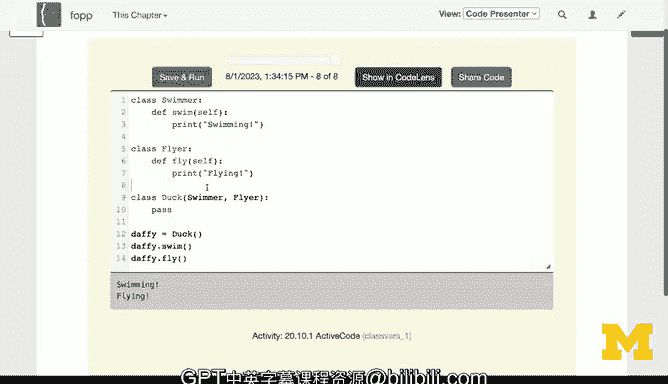

# 课程3：Python面向对象编程 - P84：多重继承 🦆✈️


在本节课中，我们将要学习Python面向对象编程中的一个高级概念——多重继承。我们将了解它的基本语法、用途以及需要注意的复杂性。


## 概述

多重继承允许一个子类同时从多个父类继承属性和方法。这可以增强代码的复用性，但也可能引入额外的复杂性。本节将通过具体的代码示例来演示其工作原理。

## 从单继承到多重继承

上一节我们介绍了单继承，即一个子类只从一个父类继承。本节中我们来看看如何让一个子类从多个父类继承。

首先，我们定义一个具有游泳方法的 `Swimmer` 类：

```python
class Swimmer:
    def swim(self):
        print("swimming")
```

接着，我们定义一个 `Duck` 类，它最初只继承自 `Swimmer` 类：

```python
class Duck(Swimmer):
    pass
```

我们可以创建 `Duck` 类的实例并调用继承来的方法：

```python
daffy = Duck()
daffy.swim()  # 输出: swimming
```

## 引入多重继承

现在，假设我们还有另一个父类 `Flyer`，它拥有飞行方法：

```python
class Flyer:
    def fly(self):
        print("flying")
```

如果我们希望 `Duck` 类既能游泳又能飞行，就可以使用多重继承。在类定义的括号内，用逗号分隔多个父类：

```python
class Duck(Swimmer, Flyer):
    pass
```

这样，`Duck` 类就同时继承了 `Swimmer` 和 `Flyer` 两个父类。我们可以调用从两个父类继承来的方法：

```python
daffy = Duck()
daffy.swim()  # 输出: swimming
daffy.fly()   # 输出: flying
```

与单继承一样，多重继承提高了我们在类中复用代码的能力。当这些父类代表一些可以被子类选择性应用或移除的特性时，它会特别有用。

## 多重继承的注意事项与替代方案

然而，只要有可能，我们应尽量避免使用多重继承，因为它会给代码增加额外的复杂性。当父类本身很复杂，或者它们也继承自其他类时，预测子类的行为会变得更加困难。

因此，在转向多重继承之前，我们通常先考虑更简单的替代方案。以下是几种常见的替代方案：

*   **组合**：将一个类的实例作为另一个类的实例变量使用。
*   **单继承**：重新设计类层次结构，看是否能用单继承实现。
*   **类装饰器**：我们将在未来的课程中学习这个概念。

## 总结



本节课中我们一起学习了Python的多重继承。我们了解了其语法，看到了它如何让一个子类从多个父类获取功能。同时，我们也认识到多重继承可能带来的复杂性，并了解了一些可供考虑的替代方案，如组合和单继承。在设计中，应根据具体情况谨慎选择是否使用多重继承。