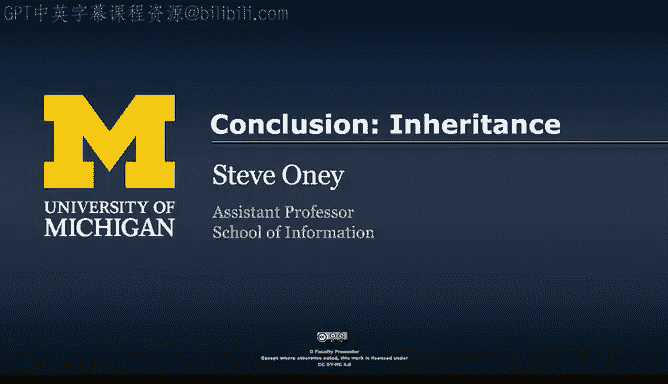

# 课程3、4、5：P85 - 28_03_06_小结：继承 🧬

在本节课中，我们将要学习面向对象编程中的一个核心概念——继承。继承是一种强大的代码复用机制，它允许我们创建新的类（子类）来继承现有类（父类）的属性和方法，从而避免重复编写代码。

## 什么是继承？

上一节我们介绍了类和对象的基本概念，本节中我们来看看继承。继承允许一个类（子类）获取另一个类（父类）的属性和方法。这意味着子类可以复用父类中已经定义好的功能，并在此基础上进行扩展或修改。

**核心公式**可以表示为：
`class 子类(父类):`

## 如何决定使用继承？

决定何时使用继承有时会有些棘手。一个重要的判断方法是，思考潜在的子类与父类之间是“是一个”（is-a）关系，还是“有一个”（has-a）关系。

例如，假设你正在定义一个表示不同类型车辆的类，并且你已经定义了一个 `Vehicle`（车辆）类。

以下是判断是否使用继承的示例：

*   `Car`（汽车）类继承自 `Vehicle` 类是合理的，因为汽车是一种车辆。
*   `Truck`（卡车）类继承自 `Vehicle` 类也是合理的，因为卡车也是一种车辆。
*   但是，让 `Vehicle` 类继承自 `Wheel`（车轮）类，或者让 `Wheel` 类继承自 `Vehicle` 类就不合理。因为车辆不是一个车轮，车轮也不是一辆车。

在大多数情况下，一辆车拥有车轮。因此，`Wheel` 的实例更适合作为 `Vehicle` 类中的一个实例变量（即“有一个”的关系），而不是通过继承来建立关系。

## 一个关于继承的有趣故事

本节课没有准备笑话，但我想分享一个在社交媒体上看到的、我认为很有趣的帖子。

这个故事是关于一位使用名为 **COBOL** 的编程语言的程序员。COBOL 是一门相当古老的语言，诞生于1959年。这位程序员正在维护一个几十年前编写的代码库。

有趣的是，这位程序员后来发现，最初编写这个代码库的人正是他自己的母亲。

所以，虽然 COBOL 可能不是一门面向对象的语言，但如果这都不算“继承”的一个例子，那我就不知道什么才算了。

## 总结

本节课中我们一起学习了继承的概念。继承通过允许子类继承父类的属性和方法，帮助我们更好地复用代码，避免重复劳动。关键在于判断类之间的关系是“是一个”还是“有一个”，这能指导我们正确地应用继承。我们下次再见。