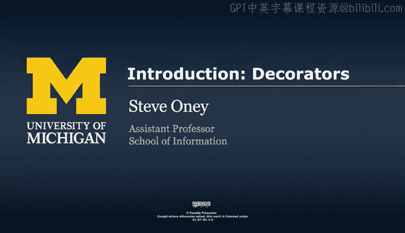

# 课程3：Python装饰器入门 🎭

在本节课中，我们将要学习Python中一个强大且优雅的工具——装饰器。装饰器允许你修改函数或类的行为，通常用于以简洁而强大的方式为代码添加新功能。

## 什么是装饰器？ 🤔

上一节我们介绍了本课程的主题，本节中我们来看看装饰器的基本概念。

装饰器本质上是一个函数，它接受另一个函数作为参数，并返回一个新的函数。这个新函数通常会“包装”或“装饰”原始函数，从而在不修改原始函数代码的情况下，为其增加额外的功能。

其核心思想可以用以下**公式**描述：
`decorated_function = decorator(original_function)`

## 装饰器的基本语法 ✨


理解了装饰器的概念后，我们来看看如何在代码中使用它。

Python为装饰器提供了特殊的语法糖，使用`@`符号。这使得装饰器的应用变得非常简洁。

以下是装饰器语法的基本结构：



```python
@my_decorator
def my_function():
    # 函数体
    pass
```

上面的代码等同于：
```python
def my_function():
    # 函数体
    pass

my_function = my_decorator(my_function)
```

## 如何编写一个简单的装饰器 🛠️

现在我们已经知道了装饰器的语法，接下来让我们动手编写一个自己的装饰器。

一个最简单的装饰器示例是记录函数执行时间的装饰器。

以下是创建一个计时装饰器的步骤：

1.  定义一个装饰器函数（例如 `timer_decorator`），它接受一个函数作为参数。
2.  在装饰器内部，定义一个包装函数（例如 `wrapper`），它将在调用原始函数前后执行额外操作。
3.  在包装函数中，调用原始函数，并返回其结果。
4.  最后，装饰器函数返回这个包装函数。

```python
import time

def timer_decorator(func):
    def wrapper(*args, **kwargs):
        start_time = time.time()
        result = func(*args, **kwargs)  # 执行原始函数
        end_time = time.time()
        print(f"{func.__name__} 执行耗时：{end_time - start_time:.4f}秒")
        return result
    return wrapper

# 使用装饰器
@timer_decorator
def example_function(n):
    time.sleep(n)
    print("函数执行完毕")

example_function(2)
```

## 装饰器的常见用途 📝

我们已经学会了如何创建装饰器，本节中我们来看看装饰器在实际开发中的一些常见应用场景。

装饰器非常灵活，可以用于多种目的。

以下是几个典型的装饰器使用案例：

*   **日志记录**：自动记录函数的调用信息、参数和返回值。
*   **权限检查**：在Web开发中，验证用户是否有权限执行某个操作。
*   **性能测试**：如我们上面编写的计时器，用于监控函数性能。
*   **输入验证**：检查函数输入参数的有效性。
*   **结果缓存（记忆化）**：存储函数计算结果，避免对相同输入进行重复计算。

## 总结 🎯

本节课中我们一起学习了Python装饰器的核心知识。我们了解了装饰器是一个用于修改函数或类行为的强大工具，掌握了其基本语法`@decorator`，并动手编写了一个简单的计时装饰器。最后，我们还探讨了装饰器在日志、权限检查、性能测试等场景下的实际应用。掌握装饰器将帮助你写出更干净、更模块化和更强大的Python代码。