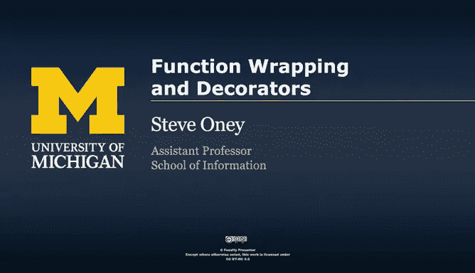
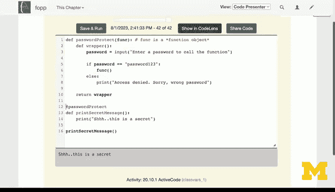

# 课程3：函数包装与装饰器 🎁





在本节课中，我们将学习Python中一个强大的概念：函数包装与装饰器。我们将了解如何通过包装一个函数来修改或增强其行为，以及如何使用Python的装饰器语法来更简洁地实现这一目标。

---

## 函数是对象

在深入探讨包装之前，我们需要理解一个核心概念：在Python中，函数是**对象**。

这意味着，除了调用函数，我们还可以引用它们、将它们作为参数传递给其他函数，或者从其他函数中返回它们。

虽然我们不能直接修改一个函数的行为，但我们可以将其**包装**在另一个函数中。这个包装函数可以在原始函数被调用之前或之后执行一些操作，也可以修改传递给原始函数的参数。这个概念就叫做**函数包装**。

---

## 通过组合实现包装

让我们通过一个具体的例子来理解包装。假设我们有两个简单的函数：

```python
def subtract_32(x):
    return x - 32

def multiply_by_five_ninths(x):
    return x * (5/9)
```

你可能知道，将华氏温度转换为摄氏温度的公式是：`摄氏度 = (5/9) * (华氏度 - 32)`。

我们可以通过组合上述两个函数来创建一个新的转换函数。为此，我们先定义一个`compose`函数：

```python
def compose(func1, func2):
    return lambda x: func1(func2(x))
```

`compose`函数接受两个函数作为参数，并返回一个新的函数（一个lambda函数）。这个新函数会先对输入`x`应用`func2`，然后将结果传递给`func1`。

现在，我们可以创建华氏转摄氏的函数：

```python
f_to_c = compose(multiply_by_five_ninths, subtract_32)
result = f_to_c(75)  # 计算75华氏度对应的摄氏度
print(result)
```

让我们分解一下`f_to_c(75)`的执行过程：
1.  `x`的值为75。
2.  首先调用`func2`，即`subtract_32(75)`，得到43。
3.  然后调用`func1`，即`multiply_by_five_ninths(43)`，得到最终结果。

本质上，我们通过`compose`函数，将`subtract_32`和`multiply_by_five_ninths`这两个函数**包装**在了返回的lambda函数内部。

---

## 为函数添加日志功能

函数包装的一个常见用途是为函数添加日志记录功能，以便调试。假设我们想在函数调用前后打印一些信息。

我们可以定义一个`add_logging`函数来实现包装：

```python
def add_logging(func):
    def wrapper(x):
        print(f"About to call {func.__name__} with argument {x}")
        result = func(x)  # 调用原始函数
        print(f"Done calling {func.__name__} with argument {x}")
        return result
    return wrapper
```

`add_logging`函数接受一个函数`func`作为参数，并定义了一个内部函数`wrapper`。`wrapper`函数包含了打印日志的代码，并调用了原始的`func`。最后，`add_logging`返回这个`wrapper`函数。

现在，我们可以用它来包装`subtract_32`函数：

```python
subtract_32_with_logging = add_logging(subtract_32)
result = subtract_32_with_logging(75)
print(result)
```

执行上述代码，你会看到类似以下的输出：
```
About to call subtract_32 with argument 75
Done calling subtract_32 with argument 75
43
```

`subtract_32_with_logging`就是我们的新函数，它“包装”了原始的`subtract_32`，并在其前后添加了日志功能。

---

## Python装饰器语法

这种包装模式非常常见，因此Python提供了一种特殊的语法糖，让代码更简洁、更清晰，这就是**装饰器**。

我们可以直接在函数定义的上方使用`@`符号加上包装函数的名字：

```python
@add_logging
def subtract_32(x):
    return x - 32

# 现在直接调用subtract_32，就会自动带有日志功能
result = subtract_32(100)
```

使用`@add_logging`装饰器，完全等同于我们之前写的：
```python
def subtract_32(x):
    return x - 32
subtract_32 = add_logging(subtract_32)
```

装饰器语法的优势在于：
1.  **代码更清晰**：包装逻辑与函数定义分离，一目了然。
2.  **易于管理**：如果想移除日志功能，只需注释掉`@add_logging`这一行即可。

---

## 另一个例子：密码保护装饰器

让我们看一个更实际的例子：使用装饰器为函数添加密码保护。

```python
def password_protect(func):
    def wrapper():
        pwd = input("Enter password to call the function: ")
        if pwd == "123":  # 假设密码是"123"
            return func()  # 密码正确，执行函数
        else:
            print("Access denied. Wrong password.")
    return wrapper

@password_protect
def print_secret_message():
    print("This is a secret message!")

# 调用函数时会要求输入密码
print_secret_message()
```

在这个例子中，`password_protect`装饰器会拦截对`print_secret_message`的调用，先要求用户输入密码。只有密码正确时，才会执行真正的函数。

这种模式在Web开发中非常有用，例如，可以用装饰器来检查用户是否登录，从而保护那些需要权限才能访问的页面或数据。

---

## 总结

本节课我们一起学习了Python中的函数包装与装饰器。

我们首先了解到函数在Python中是对象，可以作为参数传递和返回。基于此，我们探索了**函数包装**的概念，即通过一个外部函数来修改或增强另一个函数的行为。

我们通过`compose`函数和`add_logging`函数的例子，具体演示了如何实现包装。最后，我们介绍了Python提供的**装饰器**语法（`@decorator_name`），这是一种更简洁、更优雅的实现函数包装的方式。



装饰器是一个强大的工具，它允许我们以非侵入式的方式为函数添加通用功能（如日志、验证、计时等），使代码更加模块化和可维护。