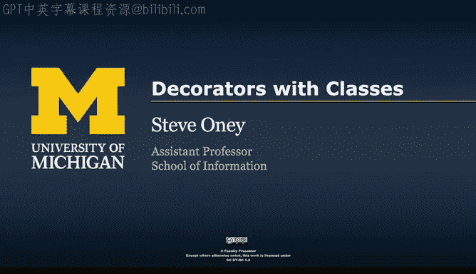
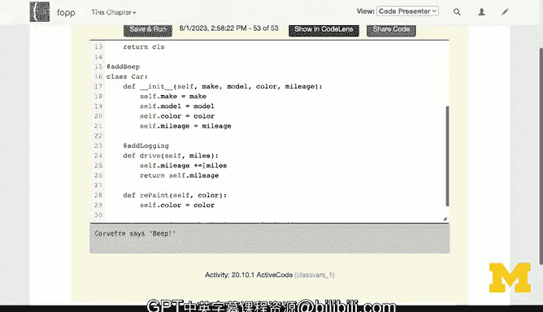

# 课程 31.3.3：类的装饰器 🎭




在本节课中，我们将要学习如何将装饰器应用于类。装饰器不仅可用于函数，也能用于类和实例。我们将探讨两种主要的使用方式：装饰类的方法以及装饰类本身。

---

## 概述

上一节我们介绍了函数装饰器，本节中我们来看看如何将装饰器应用于类。装饰器可以增强类的方法功能，甚至动态地修改类本身的结构。

---

## 装饰类的方法

首先，我们回顾一个之前用过的日志装饰器。这个装饰器接受一个函数，并返回一个新的包装函数，用于记录函数调用信息。

以下是日志装饰器的代码：

```python
def add_logging(func):
    def wrapper(*args, **kwargs):
        print(f"About to call {func.__name__} with arguments {args} {kwargs}")
        result = func(*args, **kwargs)
        print(f"Done calling {func.__name__} with arguments {args} {kwargs}, got result {result}")
        return result
    return wrapper
```

我们可以将这个装饰器应用于普通函数。例如：

```python
@add_logging
def add_one(x):
    return x + 1

print(add_one(5))
```

运行上述代码，会输出调用日志和结果。

现在，我们来看如何将这个装饰器应用于类的方法。假设我们有一个 `Car` 类：

```python
class Car:
    def __init__(self, make, model, color, mileage):
        self.make = make
        self.model = model
        self.color = color
        self.mileage = mileage

    def drive(self, miles):
        self.mileage += miles
        return self.mileage

    def repaint(self, new_color):
        self.color = new_color
```

如果我们创建一个 `Car` 实例并调用 `drive` 方法，不会有任何日志输出。为了添加日志功能，我们可以使用 `@add_logging` 装饰器装饰 `drive` 方法。

以下是应用装饰器后的代码：

```python
class Car:
    def __init__(self, make, model, color, mileage):
        self.make = make
        self.model = model
        self.color = color
        self.mileage = mileage

    @add_logging
    def drive(self, miles):
        self.mileage += miles
        return self.mileage

    def repaint(self, new_color):
        self.color = new_color
```

现在，当我们调用 `drive` 方法时，会看到相应的日志信息。

---

## 装饰类本身

除了装饰类的方法，我们还可以装饰整个类。这意味着我们可以在类定义时动态地修改或增强它。

假设我们想为 `Car` 类添加一个 `beep` 方法。我们可以创建一个装饰器来实现这个功能。

以下是添加 `beep` 方法的装饰器代码：

```python
def add_beep(cls):
    cls.beep = lambda self: print(f"{self.model} says beep")
    return cls
```

然后，我们可以将这个装饰器应用于 `Car` 类：

```python
@add_beep
class Car:
    def __init__(self, make, model, color, mileage):
        self.make = make
        self.model = model
        self.color = color
        self.mileage = mileage

    def drive(self, miles):
        self.mileage += miles
        return self.mileage

    def repaint(self, new_color):
        self.color = new_color
```

现在，`Car` 类有了一个 `beep` 方法。我们可以创建一个实例并调用它：

```python
corvette = Car("Chevrolet", "Corvette", "red", 0)
corvette.beep()
```

运行上述代码，会输出 "Corvette says beep"。

通过装饰类，我们可以动态地添加新方法、修改现有方法，甚至创建子类。这为类的扩展提供了极大的灵活性。

---

## 总结



本节课中我们一起学习了如何将装饰器应用于类。我们探讨了两种主要方式：装饰类的方法和装饰类本身。装饰器为类的功能增强和动态修改提供了强大的工具，使代码更加模块化和可维护。