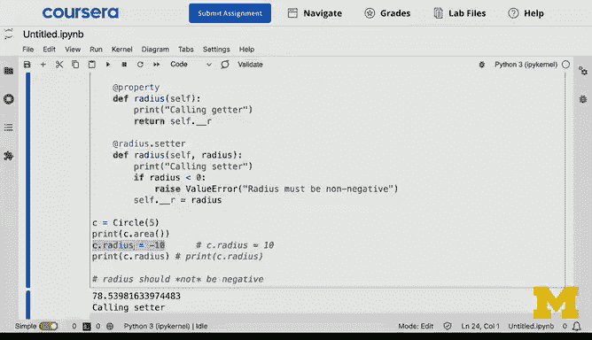

# 课程3：Python 3编程 - P89：32_03_04_属性装饰器 🎯


在本节课中，我们将要学习Python中一个非常实用的内置装饰器——`@property`。这个装饰器允许我们将类的方法当作属性一样访问和设置，从而编写出更直观、更安全的代码。我们将通过一个表示“圆”的类来演示其用法。

---

## 概述

在面向对象编程中，我们经常需要控制对类属性的访问，例如确保某个属性（如圆的半径）不会被设置为无效值（如负数）。本节课将介绍如何使用`@property`装饰器来优雅地实现属性的获取（getter）和设置（setter）方法，从而在保持代码简洁的同时，增强其健壮性。

---

## 问题引入：如何保护属性？

假设我们有一个表示圆的类`Circle`，它有一个实例变量`radius`表示半径，并有一个计算面积的方法`area`。

```python
import math

class Circle:
    def __init__(self, radius):
        self.radius = radius

    def area(self):
        return math.pi * self.radius ** 2
```

现在，我们面临一个问题：我们不希望用户将半径设置为负数。然而，目前用户可以直接通过`c.radius = -10`来修改，这无法阻止。

---

## 初步解决方案：私有变量与显式方法

上一节我们介绍了问题所在，本节中我们来看看一个初步的解决方案。我们可以将半径变量设为私有（通过添加下划线前缀），然后提供专门的`set_radius`和`get_radius`方法来控制访问。

```python
class Circle:
    def __init__(self, radius):
        self._r = radius  # 私有变量

    def set_radius(self, radius):
        if radius < 0:
            raise ValueError("半径必须为非负数。")
        self._r = radius

    def get_radius(self):
        return self._r

    def area(self):
        return math.pi * self._r ** 2
```

以下是使用此方案的操作示例：
*   设置半径：`c.set_radius(10)`
*   获取半径：`c.get_radius()`

这个方案虽然可行，但语法不够直观。我们更希望能像操作普通属性一样使用`c.radius = 10`和`print(c.radius)`。

---

## 优雅解决方案：使用 `@property` 装饰器

上一节的方法虽然实现了功能，但代码不够优雅。本节中我们来看看如何使用`@property`装饰器来实现更自然的语法。

`@property`装饰器可以将一个方法转换为“获取器”（getter）。我们首先定义一个名为`radius`的方法，并为其添加`@property`装饰器。

```python
class Circle:
    def __init__(self, radius):
        self._r = radius

    @property
    def radius(self):
        print("调用获取器")
        return self._r
```

现在，当我们执行`print(c.radius)`时，Python会自动调用这个`radius`方法（即getter），并返回`self._r`的值。这实现了属性的“读”操作。

---

## 定义设置器：`@属性名.setter`

仅仅能读取属性还不够，我们还需要能安全地设置它。为此，我们需要定义一个“设置器”（setter）。我们使用`@属性名.setter`这个装饰器。

```python
class Circle:
    def __init__(self, radius):
        self._r = radius

    @property
    def radius(self):
        print("调用获取器")
        return self._r

    @radius.setter
    def radius(self, radius):
        print("调用设置器")
        if radius < 0:
            raise ValueError("半径必须为非负数。")
        self._r = radius
```

以下是完整的操作流程：
*   **设置属性**：`c.radius = 10` 会触发设置器方法，执行验证并赋值。
*   **获取属性**：`print(c.radius)` 会触发获取器方法，返回当前值。
*   **错误验证**：`c.radius = -5` 会触发设置器中的验证逻辑，抛出`ValueError`异常。

通过这种方式，我们既拥有了`c.radius`这样直观的访问语法，又保证了半径值的安全性。

---

## 总结

本节课中我们一起学习了Python的`@property`装饰器。我们了解到：

1.  **核心目的**：`@property`允许我们将类的方法当作属性来访问，使代码更直观、更易读。
2.  **关键组件**：
    *   **获取器 (Getter)**：使用`@property`装饰的方法，用于读取属性值。
    *   **设置器 (Setter)**：使用`@属性名.setter`装饰的方法，用于在赋值时执行验证或其他逻辑。
3.  **实现步骤**：首先定义一个私有变量（如`_r`），然后使用`@property`创建获取器，最后使用`@属性名.setter`创建设置器来封装对该变量的访问。
4.  **最终效果**：我们得以用`c.radius = value`和`value = c.radius`这样自然的语法，安全地操作类的内部数据。



通过使用属性装饰器，我们能够在保持接口简洁的同时，在背后执行必要的检查和操作，这是编写健壮、可维护的面向对象代码的重要技巧。