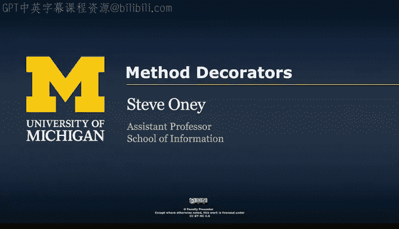
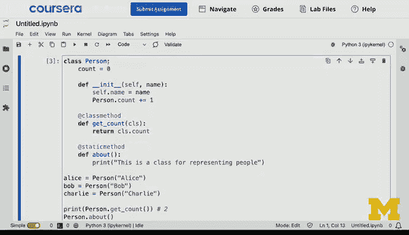

# 密歇根大学《Python3编程》课程3-5｜P90：33_03_05_方法装饰器 🎭




在本节课中，我们将要学习Python中两个内置的、用于在类上定义方法的装饰器：`@classmethod` 和 `@staticmethod`。我们将了解它们的作用、区别以及如何使用它们来编写更清晰、更有组织的代码。

---

## 类方法装饰器 `@classmethod`

上一节我们介绍了装饰器的基本概念，本节中我们来看看第一个专门用于类的方法装饰器。

`@classmethod` 装饰器用于定义一个**操作在类本身**上的方法，而不是类的某个实例上。这意味着该方法接收的第一个参数是类本身，而不是实例（通常的 `self`）。

让我们通过一个例子来理解。假设我们有一个 `Person` 类，它有一个属性 `count`，用于记录我们创建了多少个 `Person` 实例。

```python
class Person:
    count = 0  # 这是一个类属性

    def __init__(self, name):
        self.name = name
        Person.count += 1  # 每次创建实例时，类属性count加1
```

现在，我们想定义一个方法来获取已创建的人数。我们希望这个方法属于类，而不是某个特定的人。这时就可以使用 `@classmethod` 装饰器。

以下是定义和使用类方法的步骤：

```python
class Person:
    count = 0

    def __init__(self, name):
        self.name = name
        Person.count += 1

    @classmethod
    def get_count(cls):
        return cls.count

# 创建两个Person实例
alice = Person("Alice")
bob = Person("Bob")

# 通过类本身调用类方法
print(Person.get_count())  # 输出：2
```

在上面的代码中：
*   `@classmethod` 装饰器告诉Python，`get_count` 是一个类方法。
*   按照约定，类方法的第一个参数命名为 `cls`（代表“class”），Python会自动将类本身（这里是 `Person`）作为这个参数传入。
*   在方法内部，我们通过 `cls.count` 来访问类属性 `count`。
*   我们通过 `Person.get_count()` 直接调用它，而无需先创建一个 `Person` 实例。

---

## 静态方法装饰器 `@staticmethod`

了解了类方法之后，我们再来看看另一个相似的装饰器。

`@staticmethod` 装饰器用于定义一个**属于类**，但既不操作类本身，也不操作类实例的方法。它就像一个普通的函数，只是被放在了类的命名空间里，因为它逻辑上属于这个类。

静态方法**不接收** `self` 或 `cls` 作为第一个参数。它就是一个普通的函数。

假设我们想为 `Person` 类添加一个 `about` 方法，它只是打印一些关于这个类的通用信息，而不需要访问任何类属性或实例属性。

以下是定义和使用静态方法的例子：

```python
class Person:
    count = 0

    def __init__(self, name):
        self.name = name
        Person.count += 1

    @classmethod
    def get_count(cls):
        return cls.count

    @staticmethod
    def about():
        print("这是一个用于表示‘人’的类。")

# 调用静态方法
Person.about()  # 输出：这是一个用于表示‘人’的类。
```

在上面的代码中：
*   `@staticmethod` 装饰器告诉Python，`about` 是一个静态方法。
*   `about` 方法内部没有使用 `self` 或 `cls`，它只是执行自己的逻辑。
*   我们同样通过 `Person.about()` 来调用它。

---

## 总结与对比

本节课中我们一起学习了 `@classmethod` 和 `@staticmethod` 这两个内置装饰器。

以下是它们的关键点总结：

*   **`@classmethod`（类方法）**：
    *   用于定义**操作在类本身**上的方法。
    *   第一个参数是 `cls`，代表类本身。
    *   常用于访问或修改类属性，或者创建类的替代构造函数。

*   **`@staticmethod`（静态方法）**：
    *   用于定义**逻辑上属于类，但不操作类或实例**的方法。
    *   没有 `self` 或 `cls` 参数，就像一个普通函数。
    *   常用于实现一些与类相关的工具函数或辅助函数。



简单来说，当你需要方法访问类本身时，用 `@classmethod`；当你只需要一个与类相关但不依赖类状态的功能时，用 `@staticmethod`。它们都是组织代码、使类接口更清晰的有效工具。