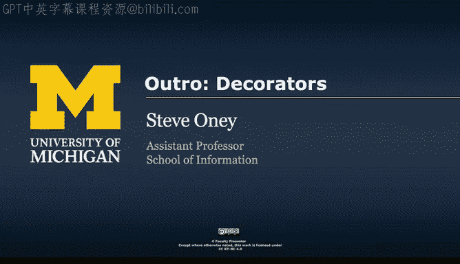
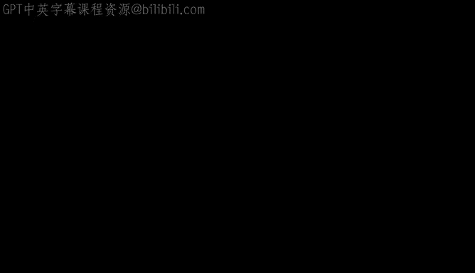

# 课程3、4、5：P91 - 34_03_06_结语：装饰器 🎭

在本节课中，我们将要学习Python中一个强大的工具——装饰器。装饰器允许我们修改函数或类的行为，而无需改变其原始代码。虽然我们主要学习了如何编写自己的装饰器，但许多库和框架也提供了大量现成的、有用的装饰器供我们使用。在后续课程中，我们还将看到更多预置装饰器的例子。

---


上一节我们介绍了装饰器的基本概念和编写方法。本节中，我们来看看装饰器的应用场景和未来学习方向。



装饰器是一种高阶函数，它接受一个函数作为输入，并返回一个新的函数。其核心思想可以用以下代码描述：

```python
def my_decorator(func):
    def wrapper():
        print("在函数执行前做一些事情。")
        func()
        print("在函数执行后做一些事情。")
    return wrapper

@my_decorator
def say_hello():
    print("你好！")
```

以下是装饰器的主要优势：

*   **代码复用**：可以将通用的功能（如日志记录、性能测试、权限检查）封装在装饰器中，应用于多个函数。
*   **分离关注点**：业务逻辑与辅助功能（如验证、缓存）分离，使代码更清晰、更易维护。
*   **动态增强功能**：在不修改原始函数定义的情况下，为其添加新的行为。

---

虽然我们目前专注于理解并创建自己的装饰器，但在实际开发中，直接使用优秀的现成装饰器可以极大提升效率。

许多流行的Python库，如Web框架Flask和Django，以及测试库`pytest`，都广泛使用了装饰器来提供简洁的API。

在接下来的课程中，我们将遇到并学习使用这些由社区和框架提供的装饰器，它们能帮助我们更快速地构建应用程序。

---



本节课中我们一起学习了Python装饰器的核心概念。我们了解到装饰器是用于修改函数或类行为的强大工具，其本质是一个返回函数的高阶函数。我们探讨了编写自定义装饰器的方法，并认识到在实际项目中，灵活运用现成的装饰器同样重要。

下次课再见。