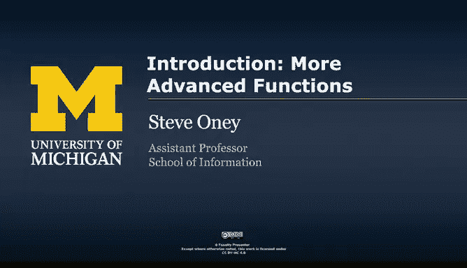

# 课程3：Python 3编程 - P92：高级函数进阶 🚀

在本节课中，我们将学习Python函数相关的三个高级主题：如何为函数和类添加文档字符串，如何使用`*args`和`**kwargs`接受可变数量的参数，以及如何编写更高级的装饰器。

---

## 1. 使用文档字符串添加说明 📝

上一节我们介绍了函数的基础知识，本节中我们来看看如何为代码添加说明文档。

在Python中，我们可以使用**文档字符串**来为函数、类或模块添加说明。文档字符串是写在定义语句之后、用三个引号包裹的一段文本。良好的文档有助于他人理解你的代码，也便于自己日后回顾。

以下是添加文档字符串的基本方法：

```python
def calculate_area(length, width):
    """
    计算矩形的面积。

    参数:
    length (float): 矩形的长度。
    width (float): 矩形的宽度。

    返回:
    float: 矩形的面积。
    """
    return length * width
```

你可以使用`help(calculate_area)`或`calculate_area.__doc__`来访问这个文档字符串。


---

## 2. 接受可变数量的参数 🔄

有时我们无法预先知道函数需要接收多少个参数。Python提供了两种灵活的方式来处理这种情况。



### 使用 `*args` 接收可变数量的位置参数

`*args`允许函数接收任意数量的位置参数，并将它们打包成一个元组。

以下是使用`*args`的示例：

```python
def sum_all(*args):
    """计算所有传入参数的和。"""
    total = 0
    for number in args:
        total += number
    return total

# 调用示例
result = sum_all(1, 2, 3, 4, 5)
```

### 使用 `**kwargs` 接收可变数量的关键字参数

`**kwargs`允许函数接收任意数量的关键字参数，并将它们打包成一个字典。

以下是使用`**kwargs`的示例：

```python
def print_info(**kwargs):
    """打印所有传入的关键字参数。"""
    for key, value in kwargs.items():
        print(f"{key}: {value}")

# 调用示例
print_info(name="Alice", age=30, city="New York")
```

在实际函数定义中，`*args`和`**kwargs`可以结合使用，但顺序必须是`*args`在前，`**kwargs`在后。

---

## 3. 编写高级装饰器 🛠️

装饰器是修改或增强函数行为的强大工具。我们已经了解了基础装饰器，现在我们来探讨如何编写更通用、更强大的装饰器。

一个高级装饰器可以接受参数，或者装饰带有不同签名的函数。

以下是一个能记录函数执行时间、并可选择是否输出日志的高级装饰器示例：

```python
import time
import functools

def timer(verbose=True):
    """一个可以接受参数的装饰器，用于计时函数执行。"""
    def decorator(func):
        @functools.wraps(func)  # 保留原函数的元信息
        def wrapper(*args, **kwargs):
            start_time = time.time()
            result = func(*args, **kwargs)  # 执行原函数
            end_time = time.time()
            if verbose:
                print(f"函数 {func.__name__} 运行耗时: {end_time - start_time:.4f} 秒")
            return result
        return wrapper
    return decorator

# 使用装饰器
@timer(verbose=True)
def slow_function(duration):
    time.sleep(duration)
    return "完成"

# 调用函数
slow_function(1)
```

在这个例子中，`timer`本身是一个返回装饰器的函数，这使得我们可以通过`@timer(verbose=False)`来灵活控制装饰器的行为。`functools.wraps`的使用确保了被装饰函数的名称和文档字符串等元信息不被丢失。

---

## 总结 📚

本节课中我们一起学习了Python函数的三个高级特性。

我们首先学习了如何使用**文档字符串**为代码添加清晰的说明。接着，我们探讨了如何使用`*args`和`**kwargs`来编写能够接受可变数量参数的函数，这大大增加了代码的灵活性。最后，我们深入研究了如何编写**高级装饰器**，包括可以接受参数的装饰器，以及如何妥善处理被装饰函数的元信息。

掌握这些概念将帮助你编写出更专业、更健壮且更易于维护的Python代码。