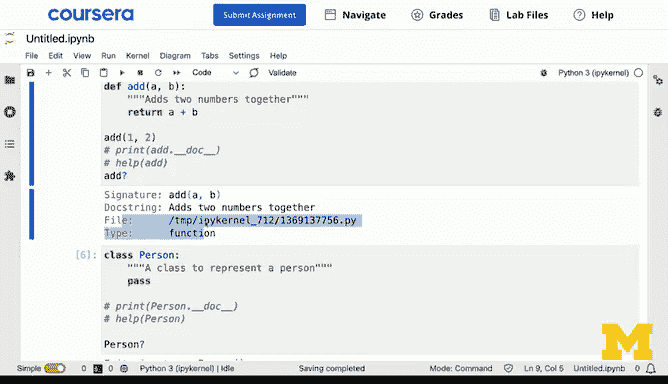

# 课程3：Python 3编程 - P93：使用文档字符串添加函数说明 📝


在本节课中，我们将要学习如何在Python中使用文档字符串为函数、类等添加说明文档。文档字符串是解释代码功能的重要工具，能让你的代码更易于理解和维护。

## 概述

在Python中，我们可以使用一种称为“文档字符串”的功能来为模块、函数、类或方法添加说明，以解释其作用或工作原理。

## 什么是文档字符串？

文档字符串是出现在模块、函数、类或方法定义中的第一个语句位置的字符串。

例如，假设我们有一个将两个数字相加的 `add` 函数。

```python
def add(a, b):
    return a + b
```

## 如何添加文档字符串？

我们可以为 `add` 函数添加一个文档字符串来描述它的功能。方法是在函数定义后立即键入引号。通常，我们使用**三引号**来创建多行字符串。

以下是添加文档字符串的示例：

```python
def add(a, b):
    """
    这个函数将两个数字相加。
    """
    return a + b
```

我使用三引号将这段文档字符串括起来，因为我们通常希望文档字符串更长，并且包含多行内容。

## 为什么使用文档字符串？

尽可能为你编写的所有函数添加文档字符串是一种良好的实践，并且应使其描述尽可能详尽。

如果其他程序员在使用你的代码，这些文档字符串会非常有用。他们可以通过阅读函数文档来理解其功能，而无需阅读整个函数的代码。这对于较长的函数尤其方便。

## 如何访问文档字符串？

你可以通过查看源代码来访问文档字符串，但你也可以通过编程方式访问它。

以下是访问函数文档字符串的方法：

```python
print(add.__doc__)
```

执行这行代码将打印出我为 `add` 函数定义的文档字符串。

## 文档字符串在类中的使用

完全相同的方法也适用于类。

例如，如果我有一个 `Person` 类：

```python
class Person:
    """
    Person类是一个用于表示人的类。
    """
    pass  # 暂时让它成为一个空类
```

现在，如果我打印 `Person.__doc__`，你将看到 `Person` 类的文档。

```python
print(Person.__doc__)
```

## 使用 `help()` 函数

除了使用 `.__doc__` 属性，还有一个内置函数叫 `help()`，可以让我们打印出这些文档字符串。

例如：

```python
help(Person)
```

这将打印出关于 `Person` 类的额外信息，比如它接收什么参数以及文档字符串本身。同样，你也可以对 `add` 函数使用 `help()`。

```python
help(add)
```

## Jupyter环境中的特殊功能

在Jupyter环境中，还有一个特殊功能：我可以输入 `Person?`。

这将会打印出关于一个类的详细信息，我可以看到它的初始化签名、文档字符串、类型，甚至它拥有的任何子类。

同样的问号语法也适用于函数。

例如，在Jupyter中，如果我输入 `add?`，你将看到函数签名、文档字符串以及关于我的 `add` 函数的更多信息。

## 总结

本节课中，我们一起学习了Python文档字符串的核心概念和使用方法。我们了解到：



*   文档字符串是用于解释代码的字符串。
*   使用**三引号**创建多行文档字符串是标准做法。
*   可以通过 `.__doc__` 属性或 `help()` 函数访问文档字符串。
*   为函数和类添加清晰的文档字符串是编写可维护代码的重要习惯。


掌握文档字符串的使用，将使你的代码更专业，也更便于与他人协作。