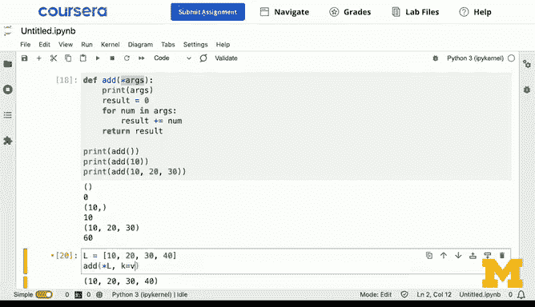

# Python 3 编程课程 94：动态位置参数 *args 🧩


在本节课中，我们将要学习如何编写能够接受任意数量参数的函数。我们将重点介绍 `*args` 语法，它允许函数接收可变数量的位置参数。

## 概述

有时我们希望编写的函数能够接受任意数量的参数。例如，一个加法函数可能不仅限于两个数字相加，而是可以处理任意数量的数字。Python 提供了一种特殊的语法来实现这一功能，即 `*args`（动态位置参数）和 `**kwargs`（动态关键字参数）。本节我们将从 `*args` 开始学习。

## 定义接受任意数量参数的函数

假设我们有一个 `add` 函数，最初设计为接受两个参数 `a` 和 `b`：

```python
def add(a, b):
    return a + b
```

这个函数只能处理两个参数。如果我们尝试传入三个参数，例如 `add(1, 2, 3)`，程序会报错。

为了定义一个能接受任意数量参数的函数，我们需要使用 `*args` 语法。`*args` 允许我们向函数传递可变数量的位置参数。

让我们修改 `add` 函数：

```python
def add(*args):
    print(args)
```

现在，当我们调用 `add(1, 2, 3)` 时，`args` 会变成一个包含所有传入参数的元组 `(1, 2, 3)`。这里的星号 `*` 表示 `args` 不是一个普通参数，而是一个可变长度的参数列表（实际上是一个元组）。

这意味着我们可以用零个、一个或任意多个参数来调用 `add` 函数，它都能正常工作。`args` 将是一个包含所有位置参数的元组。

## 实现真正的加法功能

上一节我们介绍了如何使用 `*args` 接收参数。本节中，我们来看看如何利用它来实现一个真正的、能求和的 `add` 函数。

为了让 `add` 函数真正实现求和，我们可以遍历 `args` 元组中的所有数字并将它们相加：

```python
def add(*args):
    result = 0
    for num in args:
        result += num
    return result
```

现在，如果我们调用 `add()`，会得到 `0`；调用 `add(5)`，会得到 `5`；调用 `add(1, 2, 3, 4)`，会得到 `10`。这个函数可以处理任意数量的参数。

## 使用星号语法解包参数

现在，假设我们有一个列表 `L = [10, 20, 30, 40]`，我们想用 `add` 函数来求这个列表中所有元素的和。

如果我们直接调用 `add(L)`，会发生错误。因为此时 `args` 会变成一个包含单个元素的元组 `([10, 20, 30, 40],)`，而我们期望的是 `args` 为 `(10, 20, 30, 40)`。

为了解决这个问题，我们需要在调用函数时对列表进行“解包”。我们可以在列表 `L` 前加上一个星号 `*`：

```python
L = [10, 20, 30, 40]
print(add(*L))
```

这里的 `*L` 表示将列表 `L` 解包，相当于调用 `add(10, 20, 30, 40)`。这样，`args` 就会正确地成为 `(10, 20, 30, 40)`，函数也能成功计算出总和。

## 总结

本节课中我们一起学习了 Python 中的动态位置参数 `*args`。

*   我们学会了如何使用 `*args` 来定义接受任意数量位置参数的函数。
*   我们了解了 `*args` 在函数内部是一个包含所有传入参数的元组。
*   我们还学习了如何在调用函数时使用星号 `*` 来解包一个序列（如列表或元组），将其元素作为单独的位置参数传入函数。



通过掌握 `*args`，我们可以编写出更加灵活和通用的函数。在下一节视频中，我们将学习与之对应的 `**kwargs`，它用于处理可变数量的关键字参数。