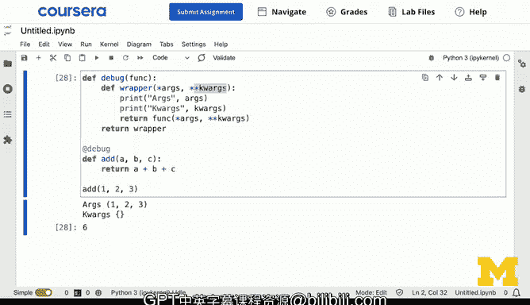

# Python 3 编程课程 38：`**kwargs` 动态关键字参数 🧩


在本节课中，我们将要学习 Python 中一个非常强大的功能：`**kwargs`（动态关键字参数）。它允许我们向函数传递任意数量的关键字参数，极大地增强了函数的灵活性。

上一节我们介绍了 `*args` 用于处理可变数量的位置参数。本节中我们来看看它的“搭档”——`**kwargs`。

## 理解 `**kwargs` 的基本概念

`**kwargs` 允许我们向一个函数传递可变数量的关键字参数。在函数定义中，它不是一个普通的参数，而是一个特殊的参数类型，用于收集所有未明确命名的关键字参数。

其核心概念是：`**kwargs` 会将所有传入的关键字参数打包成一个**字典**。其中，键是参数名，值是参数值。

以下是其基本语法：
```python
def function_name(**kwargs):
    # kwargs 在这里是一个字典
    pass
```

## 使用 `**kwargs` 创建用户档案

让我们通过一个创建用户档案的例子来理解它的用法。假设我们想创建一个函数，它能接受任意描述用户的信息。

```python
def create_user_profile(**kwargs):
    user_profile = {}
    for key, value in kwargs.items():
        user_profile[key] = value
    return user_profile
```

在这个函数中：
1.  `**kwargs` 接收所有传入的关键字参数。
2.  我们初始化一个空字典 `user_profile`。
3.  通过循环 `kwargs.items()`，我们将所有键值对存入新字典。
4.  最后返回这个构建好的用户档案字典。

现在，我们可以用任意关键字参数调用这个函数：

```python
profile = create_user_profile(name='Alice', age=30, city='Wonderland')
print(profile)
# 输出：{'name': 'Alice', 'age': 30, 'city': 'Wonderland'}
```

当函数被调用时，`kwargs` 会变成一个包含 `{'name': 'Alice', 'age': 30, 'city': 'Wonderland'}` 的字典。

## 使用 `**` 解包字典为关键字参数

反过来，如果我们已经有一个字典，并想将其内容作为关键字参数传给函数，该怎么做呢？直接传递字典对象是不行的，因为它会被视为一个位置参数。

以下是错误的尝试：
```python
my_dict = {'name': 'Bob', 'occupation': 'Developer'}
profile = create_user_profile(my_dict) # 这会报错！
```

正确的方法是使用 `**` 操作符来**解包**字典：

```python
my_dict = {'name': 'Bob', 'occupation': 'Developer'}
profile = create_user_profile(**my_dict)
print(profile)
# 输出：{'name': 'Bob', 'occupation': 'Developer'}
```

`**my_dict` 会将字典 `my_dict` 解包成 `name='Bob', occupation='Developer'` 这样的形式传入函数。这样，函数就能正确接收这些关键字参数了。

## 结合使用 `*args` 与 `**kwargs`

我们可以将 `*args` 和 `**kwargs` 组合在同一个函数中，以接受任意数量的位置参数和关键字参数。这在编写高度通用的函数时非常有用。

```python
def print_info(*args, **kwargs):
    print("位置参数 args:", args)
    print("关键字参数 kwargs:", kwargs)
```

现在，我们可以用任何方式调用这个函数：

```python
print_info(10, 20, name='Alice', age=30)
```
输出结果将是：
```
位置参数 args: (10, 20)
关键字参数 kwargs: {'name': 'Alice', 'age': 30}
```
其中，`10` 和 `20` 被收集到元组 `args` 中，而 `name` 和 `age` 被收集到字典 `kwargs` 中。

## 在装饰器中的应用 🛠️

`*args` 和 `**kwargs` 的一个常见且强大的应用场景是编写**装饰器**。装饰器需要能够处理被装饰函数可能拥有的任意参数。

以下是一个简单的调试装饰器示例：

```python
def debug(func):
    def wrapper(*args, **kwargs):
        print(f"调用函数 {func.__name__}，参数：")
        print("  位置参数:", args)
        print("  关键字参数:", kwargs)
        # 将参数原样传递给被装饰的函数
        result = func(*args, **kwargs)
        return result
    return wrapper

@debug
def add(x, y):
    return x + y

add(1, 2)
```
运行上述代码，输出如下：
```
调用函数 add，参数：
  位置参数: (1, 2)
  关键字参数: {}
3
```

这个 `debug` 装饰器通过使用 `*args` 和 `**kwargs`，可以通用地包装任何函数，无论其参数数量和类型如何，都无需修改装饰器本身。

---



本节课中我们一起学习了 `**kwargs` 动态关键字参数。我们了解了它如何将关键字参数打包成字典，如何使用 `**` 操作符解包字典，以及如何将它与 `*args` 结合使用来创建高度灵活的函数。最后，我们还看到了它在编写通用装饰器时的实际应用。掌握这些技巧，将帮助你写出更加强大和适应性更强的 Python 代码。